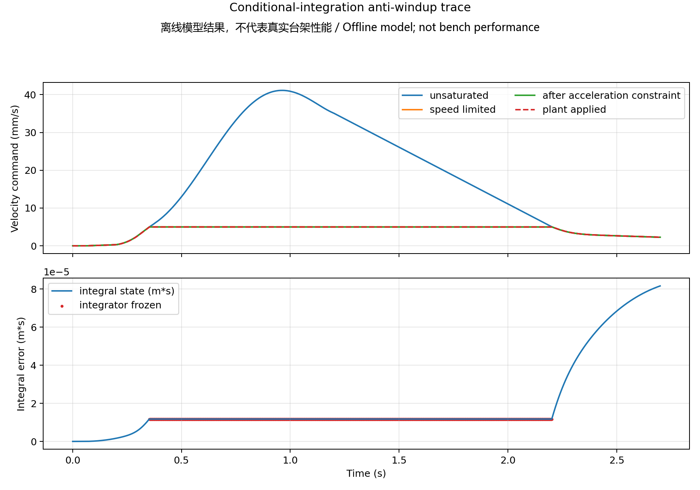

# 控制器、逆模型前馈、anti-windup与微分校正

## 1. 控制器结构

方案B外位置控制器输出速度目标：

$$
u_{raw}=K_pe+K_i\int e\,dt-K_d\hat v_y
+K_{ff,v}v_r+K_{ff,a}a_r
$$

其中$e=r-y$，$\hat v_y$为测量位置的低通微分估计。控制器仍只包含P/PI/PID、速度前馈和加速度前馈。

## 2. 速度与加速度前馈推导

从等效速度模型：

$$
\tau_v\dot v+v=K_vu
$$

令理想状态$v=v_r$、$\dot v=a_r$，则：

$$
u_{ff}=\frac{v_r+\tau_va_r}{K_v}
$$

所以：

$$
K_{ff,v}=\frac{1}{K_v},\qquad
K_{ff,a}=\frac{\tau_v}{K_v}
$$

$K_{ff,v}$无量纲，$K_{ff,a}$单位为s。代码由`inverse_velocity_model_feedforward()`生成，不再手填与模型无关的系数。

这只是基于H/R等效模型的理论初值。真实系统必须先辨识$K_v$和$\tau_v$，再验证饱和、延迟和方向相关误差；不得直接下载到真实控制器。

## 3. 极限情况验证

在无摩擦、无扰动、无测量/命令延迟、无量化/噪声且速度/加速度不受限时，关闭反馈，只保留上述逆模型前馈。0.5 ms离线五次S曲线的归一化最大位置误差小于0.3%，测试通过。残差来自周期内把连续变化前馈按ZOH处理的离散近似，而非台架误差。

## 4. 条件积分anti-windup

### 4.1 处理顺序

每周期先计算：

1. `u_raw`：未饱和控制量；
2. `u_vel`：速度限幅后；
3. `u_con`：加速度约束后的实际外部命令；
4. `u_applied`：再经过命令延迟后实际进入等效对象的命令。

### 4.2 冻结规则

如果$u_{raw}>u_{con}$且$e>0$，或$u_{raw}<u_{con}$且$e<0$，当前误差会把命令进一步推入约束，积分器冻结。若误差方向有助于离开约束，则允许积分器继续更新以卸载积累。

代码接口将该参数命名为`constrained_command_m_s`：它明确表示本地速度/加速度限幅器输出$u_{con}$，不是经过命令延迟后的对象输入$u_{applied}$。本次仅澄清命名，不改变anti-windup算法。

此外保留积分状态硬边界$|\int e\,dt|\le I_{max}$作为第二层数值保护。代码逐周期记录积分状态和冻结布尔值。

### 4.3 限幅案例

5 mm/s H速度上限下，PI+逆模型前馈案例：

| 量 | D1离线值 |
|---|---:|
| 速度饱和比例 | 68.49% |
| 积分冻结比例 | 68.49% |
| 加速度约束比例 | 0% |
| 积分状态峰值 | $8.16\times10^{-5}$ m·s |
| 归一化RMS误差 | 33.05% |

这只证明anti-windup跟随最终约束状态工作；不能把5 mm/s当作现场限值。

## 5. 原PI负偏差复查

校正模型中，默认PI（无前馈）的点到点结果仍出现负的到位误差：轨迹结束时约-326 μm。该案例的速度饱和、加速度约束和积分冻结比例均为0，因此**不是由速度饱和造成的windup**。

延长轨迹结束后的保持时间，最后保持段平均误差为：

| 保持时间 | 平均误差 μm |
|---:|---:|
| 0.8 s | -328.0 |
| 1.5 s | -271.3 |
| 3.0 s | -149.7 |
| 6.0 s | -75.4 |

负偏差随观察时间延长缓慢衰减，说明它主要来自这组H增益下运动期间的积分驱动超调、方向相关力和较慢卸载；“最后15%窗口”会改变报告数值，但不是唯一原因。D1因此改用“轨迹结束时到位误差+轨迹结束后稳定时间+保持段均值”分开报告，不再把短窗平均误差称作稳定台架性能。

## 6. 微分项校正

阶段D使用$K_d(e[k]-e[k-1])/T_s$，会在参考轨迹变化时产生微分冲击，并放大位置量化噪声。D1采用：

$$
v_{raw}[k]=\frac{y[k]-y[k-1]}{T_s}
$$

$$
\hat v_y[k]=\hat v_y[k-1]
+\alpha(v_{raw}[k]-\hat v_y[k-1]),\quad
\alpha=\frac{T_s}{\tau_f+T_s}
$$

$$
u_d[k]=-K_d\hat v_y[k]
$$

$K_d$无量纲，$u_d$单位为m/s。对测量求导避免参考导数冲击；一阶低通降低$q_y/T_s$量级的量化速度尖峰。它仍会受到延迟和滤波相位影响，$\tau_f$必须在辨识后选择。

## 7. 校正基线

- `P`：无积分、无前馈；
- `PI_AW`：条件积分；
- `PI_INV_FF_AW`：条件积分+模型推导速度/加速度前馈；
- `PID_INV_FF_AW`：上项+dirty-derivative测量速度反馈。

所有增益仍为H，不是现场推荐值。D1只在同一B模型内部比较这些基线。
