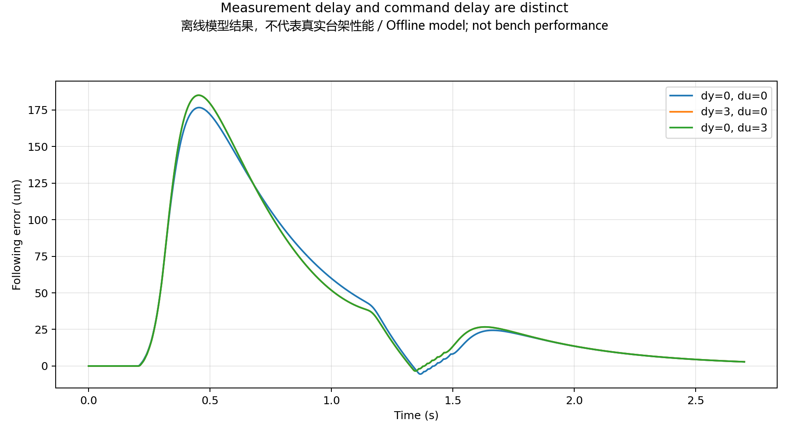
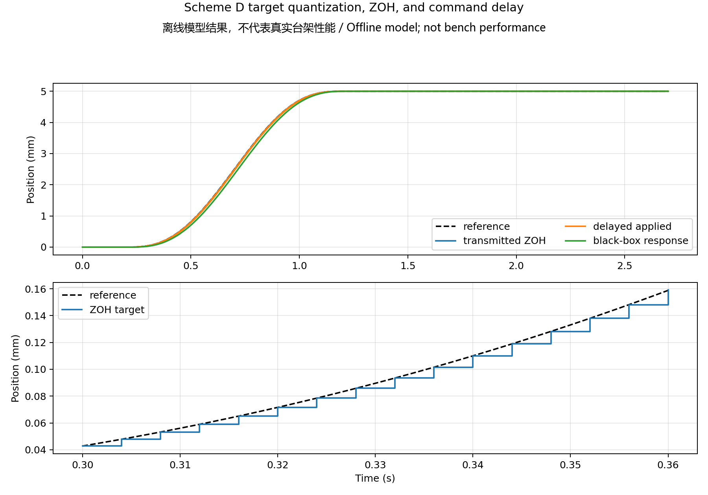

# 测量延迟、命令延迟、零阶保持与采样模型

## 1. 为什么必须分开

方案B存在两条因果不同的延迟链：

```text
真实位置 x
  -> 光栅采样/解码/控制计算 -> y[k]      （测量延迟 d_y）

外部约束速度命令 u_con[k]
  -> PDO/驱动处理/目标生效 -> u_applied[k]（命令延迟 d_u）
```

增加$d_y$改变控制器看到的状态；增加$d_u$不改变当前测量源，而是延后对象收到的命令。D1分别记录`measurement_source_index`和`command_source_index`，极限测试逐项核对索引序列。

## 2. B离散关系

$$
y[k]=
\begin{cases}
Q_{q_y}\{x[k-d_y]+n[k]\},&k-d_y\ge 0\\
Q_{q_y}\{y_{hist}+n[k]\},&k-d_y<0
\end{cases}
$$

$$
u_{applied}[k]=
\begin{cases}
u_{con}[k-d_u],&k-d_u\ge 0\\
u_{hist},&k-d_u<0
\end{cases}
$$

`y_hist`和`u_hist`是显式可配置的预采样历史，默认均为0。凡使用历史值，源索引记为`-1`；不再用`max(0,k-delay)`隐式重复第0个样本。这两个式子不能互换。当前只处理整数拍H延迟；真实系统需把传感器锁存、计算、PDO发送、仲裁、驱动任务和对象更新时间分别测量。

## 3. B定点扫描

默认1 ms基准周期、PI+逆模型前馈，固定另一类延迟为1拍：

| 延迟拍数 | 测量延迟扫描RMS μm | 命令延迟扫描RMS μm |
|---:|---:|---:|
| 0 | 65.09 | 65.47 |
| 1 | 65.65 | 65.65 |
| 2 | 65.92 | 65.74 |
| 4 | 66.56 | 66.25 |

两组都随延迟增加而恶化，但响应曲线和源索引不同。数值差很小是当前H模型、轨迹和增益的结果，不证明真实1 ms或4拍延迟可接受。



## 4. D目标更新与ZOH

D使用基准积分周期$T_s$和目标更新倍数$N_u$。只在`k mod N_u=0`时尝试发送目标；成功更新后，目标在后续拍保持不变，直到下一次成功更新。命令再经过$d_u$拍后进入二阶黑箱。

```text
连续参考 r(t)
  -> 更新调度
  -> 位置目标量化 q_u
  -> 可选漏更新
  -> transmitted target（ZOH）
  -> 命令延迟 d_u
  -> applied target（ZOH）
  -> 局部二阶黑箱
```

D命令延迟同样使用显式目标历史`u_tx,hist`（默认0）：$k-d_u<0$时对象接收历史值且`command_source_index=-1`，$k-d_u\ge0$时才引用`transmitted target[k-d_u]`。

4拍更新的放大图显示目标在拍间保持阶梯，不进行隐含插值。



## 5. D定点扫描

| 项目 | H设置 | 归一化RMS误差 |
|---|---:|---:|
| 更新周期 | 1 / 2 / 4 / 8拍 | 1.150% / 1.187% / 1.259% / 1.405% |
| 命令延迟 | 0 / 1 / 2 / 4拍 | 1.078% / 1.150% / 1.223% / 1.368% |
| 目标量化 | 0 / 0.5 / 2 μm | 1.15038% / 1.15039% / 1.15041% |
| 漏更新概率 | 0 / 1% / 5% | 1.150% / 1.151% / 1.154% |

这些数值只说明代码中的ZOH、延迟、量化和漏更新方向可追踪。在当前动态误差较大时，2 μm目标量化与少量漏更新影响被掩盖；不能据此宣称它们在真实精密系统中不重要。

## 6. 待实测项

- DS-BVM是否对CSP目标插值，若插值，其周期和边界是什么；
- 目标未更新时保持、外推还是故障；
- SYNC、RPDO接收和内部位置环任务的相对相位；
- 非整数延迟、周期抖动、连续漏帧和错误恢复；
- 三轴总线预算与各轴目标到达偏差。

在这些证据关闭前，V0.1只把D称为控制权限更保守、相对较低风险的候选路线，不称已验证路线。
