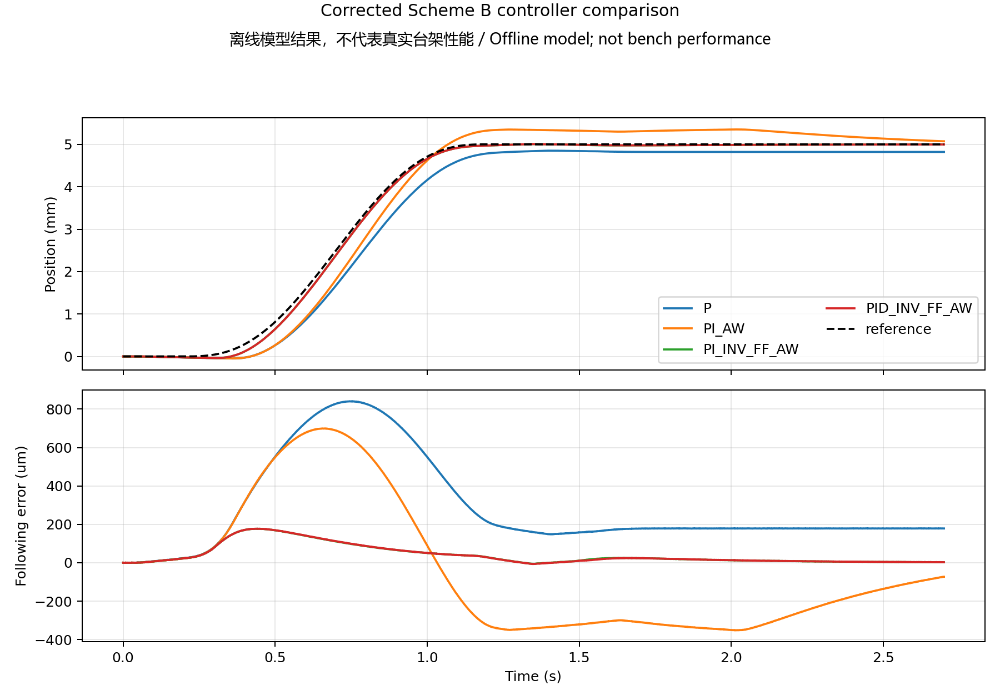

# 校正结果与阶段D旧结论重释

> 以下全部是H/R参数下的离线模型结果，不代表真实台架性能，不证明1 kHz可行，不用于比较B和D谁更优。

## 1. 运行概况

- 15个校正基线：B的4种控制器×3种轨迹，D的局部黑箱×3种轨迹；
- 35个定点案例：B测量/命令延迟、$\tau_v$、速度限幅、方向力、PI保持时间；D更新周期、命令延迟、目标量化、漏更新；
- 15项极限与安全测试全部通过（含最小代码修补新增5项）；
- 5张图、2个指标CSV、1个选定时序CSV、1个运行清单。

## 2. B点到点基线

5 mm H行程、1 ms H基准周期、$d_y=d_u=1$拍：

| 控制器 | 到位误差 μm | 保持段均值 μm | 超调 μm | RMS μm | 归一化RMS | 速度饱和 | 积分冻结 |
|---|---:|---:|---:|---:|---:|---:|---:|
| P | 212.5 | 175.0 | 0.0 | 372.8 | 7.456% | 0% | 0% |
| PI_AW | -326.0 | -271.3 | 351.5 | 339.2 | 6.783% | 0% | 0% |
| PI_INV_FF_AW | 28.0 | 10.9 | 5.5 | 65.7 | 1.313% | 0% | 0% |
| PID_INV_FF_AW | 27.5 | 10.6 | 6.5 | 65.9 | 1.318% | 0% | 0% |

可支持的同模型内部判断：

- 从等效模型推导的速度+加速度前馈大幅降低轨迹滞后；
- 在这组H参数下，加入dirty-derivative速度反馈没有比PI+逆模型前馈进一步改善RMS；
- 不能由此否定PID，只能说明当前H增益和轨迹没有显示可解释收益；
- PI负偏差不是饱和windup，主要是积分驱动超调和慢卸载；统计窗口会改变其报告值。

## 3. 恒速扫描

| 控制器 | 核心段平均滞后 μm | 核心段RMS μm | 速度波动 μm/s | 全轨迹归一化RMS |
|---|---:|---:|---:|---:|
| P | 249.5 | 249.5 | 50.5 | 9.427% |
| PI_AW | 60.6 | 89.3 | 114.3 | 3.636% |
| PI_INV_FF_AW | 39.9 | 59.4 | 79.4 | 2.520% |
| PID_INV_FF_AW | 39.9 | 59.5 | 79.2 | 2.520% |

恒速指标只统计余弦加速结束后的核心段，避免用点到点超调或稳定时间描述扫描。前馈在该H模型中降低平均滞后；绝对μm仍不能外推。

## 4. 换向结果与方向解释

默认方向力0.10/0.13 N、完整PI+逆模型前馈：换向窗口最大误差约66.1 μm，恢复时间为0 s（换向时已在定义误差带内），匹配高速核心段正反向误差幅值差约199.8 μm，滞回面积约$1.20\times10^6$ μm²。

方向力扫描：

| $F_c^+/F_c^-$ N | 换向窗口最大误差 μm | 高速核心方向幅值差 μm | 归一化RMS |
|---|---:|---:|---:|
| 0.10 / 0.10 | 64.1 | 156.1 | 2.571% |
| 0.10 / 0.13 | 66.1 | 199.8 | 2.889% |
| 0.15 / 0.22 | 101.1 | 322.6 | 4.531% |

完整PI往返中，即使方向力相等，控制器积分历史、第一段残余状态和换向过程仍会产生方向表现差异。因此“完整控制回路方向差”不能直接解释为摩擦参数差。专门的极限测试关闭积分记忆、延迟、量化和噪声，只保留对称方向力与P+逆模型前馈，此时匹配高速段幅值差小于5 μm，验证了模型参数对称性。

后续研究名称因此改为“方向相关误差建模与补偿”，因果实验前不称摩擦补偿。

## 5. 测量延迟和命令延迟

两类延迟分别扫描0/1/2/4拍，RMS均随延迟增长，但代码源索引和曲线响应不同。1拍默认下RMS约65.65 μm；4拍测量/命令延迟分别约66.56/66.25 μm。数值变化较小不能证明4拍可接受，只能证明两条延迟路径已分离实现。

## 6. 速度环时间常数

每个$\tau_v$都重新按$K_{ff,a}=\tau_v/K_v$生成前馈：

| $\tau_v$ | RMS μm | 归一化RMS |
|---:|---:|---:|
| 10 ms | 33.0 | 0.659% |
| 20 ms | 65.7 | 1.313% |
| 50 ms | 167.2 | 3.343% |

说明同一外位置反馈增益下，内部速度动态仍是高敏感R量。不能把这些时间常数写成DS-BVM实测值。

## 7. 饱和与anti-windup

| H速度上限 | RMS μm | 速度饱和比例 | 积分冻结比例 | 积分状态峰值 m·s |
|---:|---:|---:|---:|---:|
| 5 mm/s | 1652.3 | 68.49% | 68.49% | $8.16\times10^{-5}$ |
| 10 mm/s | 189.7 | 17.33% | 17.33% | $1.12\times10^{-4}$ |
| 20 mm/s | 65.7 | 0% | 0% | $1.12\times10^{-4}$ |

条件积分在约束与误差同向时冻结；当误差有助于退出约束时允许卸载。误差在5 mm/s案例仍很大，因为轨迹本身不可行，anti-windup不能补偿物理限幅。

## 8. D局部黑箱输入模型

- 更新周期从1拍增至8拍，归一化RMS从1.150%增至1.405%；
- 命令延迟从0拍增至4拍，归一化RMS从1.078%增至1.368%；
- 0–2 μm目标量化和0–5%独立漏更新在当前H动态误差下影响较小；
- 所有目标在更新间隔内严格ZOH；未假设DS-BVM插值。

D的这些数值不得与B表格比较并据此选择路线。D的二阶参数、插值/丢帧行为和真实目标更新时间均待实测。

## 9. 阶段D结论勘误

| 阶段D旧表述/推断 | D1重释 |
|---|---|
| B模型含质量、黏性和速度内环 | 黏性项被代数抵消，旧`B`扫描无物理意义；V0.1删除该参数 |
| 单一通信延迟趋势 | 旧趋势混合测量和命令链；D1只接受分离扫描 |
| 手填速度/加速度前馈带来改善 | 前馈必须先由$K_v,\tau_v$推导；改善只在同一H模型内部成立 |
| PI负偏差可能是windup | 默认案例没有饱和/冻结；是积分超调、慢卸载和观察窗共同作用 |
| PID使用误差差分 | 旧PID数值受参考微分冲击和量化放大风险，不继续沿用 |
| D周期目标等于每积分步目标 | D1显式ZOH、量化、命令延迟和漏更新；驱动器插值未知 |
| 统一指标可跨轨迹比较 | 改为点到点、恒速、换向分型；只保留归一化通用指标 |

## 10. 结果文件

- `results/baseline_metrics.csv`：15个校正基线；
- `results/sensitivity_metrics.csv`：35个扫描/诊断案例；
- `results/selected_timeseries.csv`：控制命令阶段、积分冻结、双延迟源索引和D更新状态；
- `results/run_manifest.json`：安全状态、方程、参数和案例数；
- `figures/01`—`05`：全部带离线免责声明。
