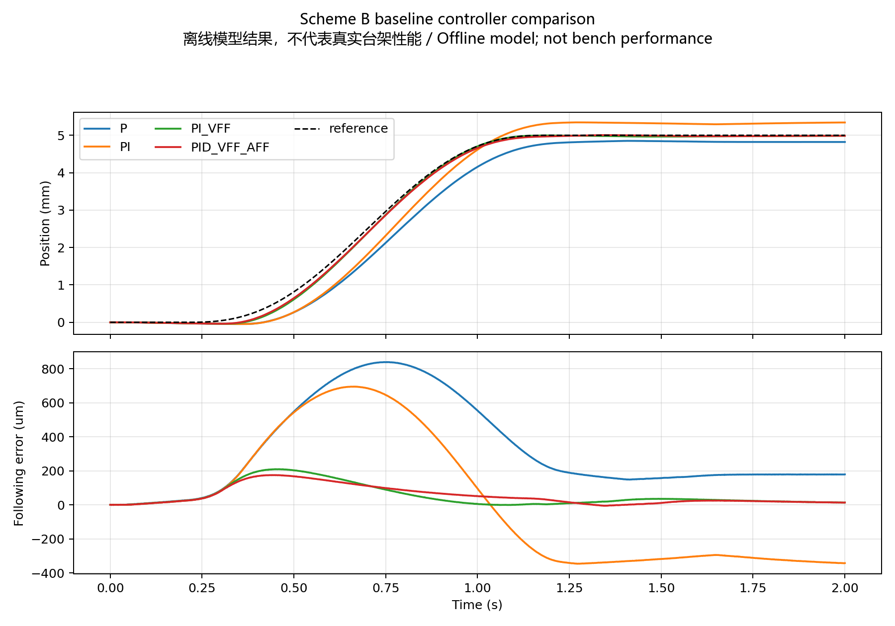
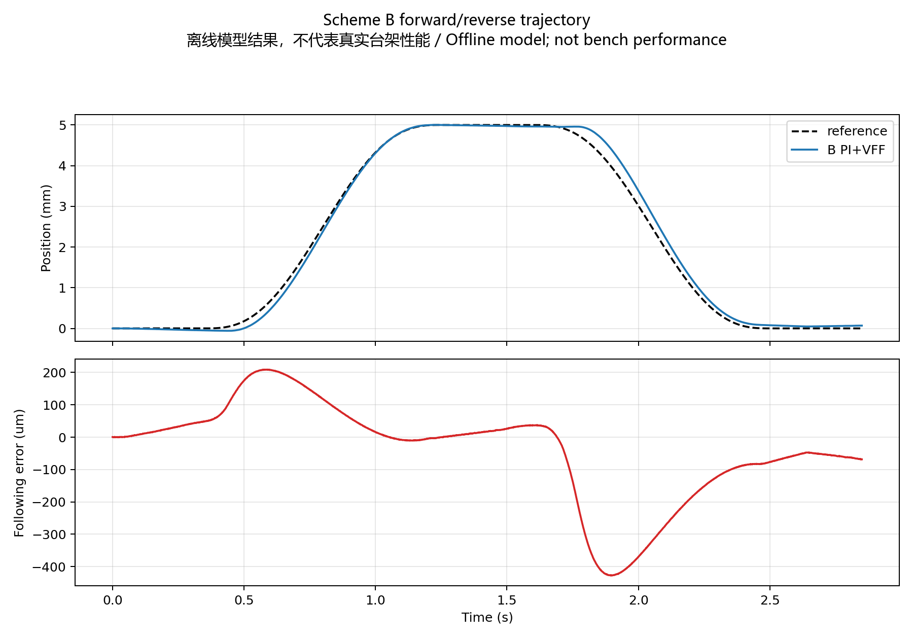
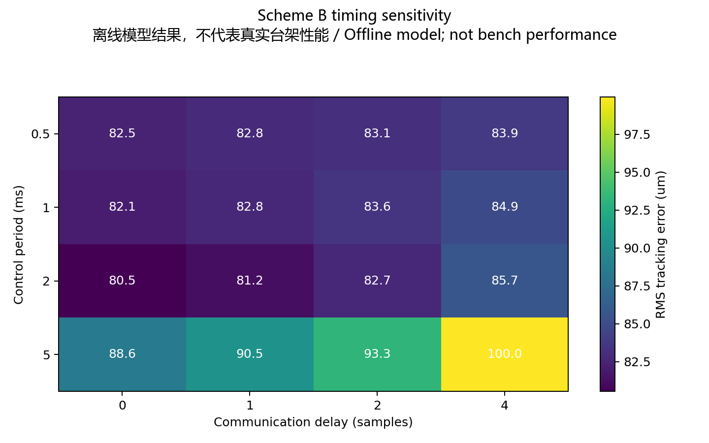
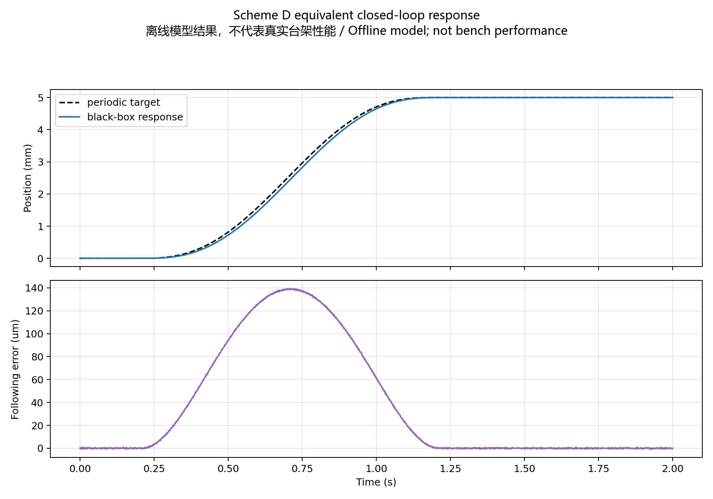

# 离线基线仿真报告

> **统一声明：以下全部为离线模型结果，不代表真实台架性能。** 数值用于比较控制结构和参数敏感性，不能作为DS-BVM、Ri0040、自研光栅尺或三轴平台的性能指标。

## 1. 运行范围与复现

运行环境：Python 3.12.2、NumPy 2.5.1、Matplotlib 3.8.4；不需要CAN、串口、USB、EtherCAT或`motion_acquisition`。

在本目录执行：

```powershell
python -m unittest discover -s tests -p "test_*.py" -v
python scripts/run_baseline_sweeps.py
```

安全守卫：每个仿真入口都要求`simulation_only=True`与`hardware_disabled=True`。脚本还检查输出根目录名称，拒绝向阶段D目录外写入。

本次结果：

- 7项单元测试全部通过；
- 20个基线案例：方案B的4种基线控制器×4种轨迹，方案D黑箱×4种轨迹；
- 55个敏感性案例：B的周期/延迟、量化、噪声、质量、速度环时间常数、方向摩擦、饱和；D的周期/延迟和黑箱带宽；
- 5张PNG图、2个指标CSV、1个选定时序CSV、1个运行清单JSON。

## 2. 基线设置

共同H轨迹为5 mm、1 s五次S曲线，默认$T_s=1$ ms、1拍等效延迟。方案B使用H参数$M=0.8$ kg、$\tau_v=20$ ms、正/反向库仑摩擦0.10/0.13 N、速度限幅20 mm/s。方案D使用H黑箱20 Hz、阻尼比0.9。参数证据见`03_PARAMETER_AND_EVIDENCE_REGISTRY.md`。

## 3. 点到点结果

| 方案/控制器 | 上升时间 s | 稳定时间 s | 超调 μm | 稳态误差 μm | 最大跟随误差 μm | RMS误差 μm | 输入峰值 |
|---|---:|---:|---:|---:|---:|---:|---:|
| B / P | 0.527 | N/A | 0.0 | 178.5 | 839.3 | 419.6 | 0.01175 m/s |
| B / PI | 0.442 | N/A | 346.5 | -325.6 | 695.2 | 368.0 | 0.01288 m/s |
| B / PI+速度前馈 | 0.474 | 1.065 | 0.0 | 19.0 | 209.7 | 82.8 | 0.01241 m/s |
| B / PID+速度/加速度前馈 | 0.487 | 1.089 | 5.5 | 18.2 | 175.1 | 75.9 | 0.01218 m/s |
| D / 黑箱位置闭环 | 0.507 | 1.081 | 1.0 | -0.01 | 139.4 | 62.6 | 0.005 m目标 |

解释：

- 在同一B-H模型中，速度前馈显著降低运动段滞后；加速度前馈进一步降低最大/RMS误差，但改善幅度小于从无前馈到速度前馈的变化。
- PI在当前H增益和短仿真窗中产生明显超调且未进入定义的稳定带，说明“加入积分”不自动改善跟踪。
- D的数值较小只说明假设的20 Hz、0.9阻尼黑箱可跟随这条轨迹；不能据此宣布D优于B，更不能推断真实DS内部带宽。
- B与D的“输入峰值”单位不同，不能横向比较。



## 4. 往返与方向差异

| B控制器 | 最大跟随误差 μm | RMS误差 μm | 正反向平均误差差 μm |
|---|---:|---:|---:|
| P | 963.7 | 513.7 | 1192.7 |
| PI | 1029.3 | 494.7 | 1051.9 |
| PI+速度前馈 | 427.5 | 155.7 | 322.6 |
| PID+速度/加速度前馈 | 388.8 | 152.3 | 338.9 |

方向摩擦扫描：

| $F_c^+/F_c^-$ H设置 N | RMS误差 μm | 正反向误差差 μm |
|---|---:|---:|
| 0.05 / 0.05 | 77.4 | 136.6 |
| 0.10 / 0.13 | 155.7 | 322.6 |
| 0.15 / 0.22 | 238.5 | 510.2 |

这说明方向相关扰动足以在模型中形成可观测的不对称，也说明“正反向误差差”适合作为未来补偿的主要指标。但它不能证明真实台架的不对称就是库仑摩擦；重力、间隙、线缆、驱动器收敛和采样对齐仍需隔离。



## 5. 周期与通信延迟

方案B的点到点RMS误差（μm）：

| 控制周期 | 0拍 | 1拍 | 2拍 | 4拍 |
|---:|---:|---:|---:|---:|
| 0.5 ms | 82.5 | 82.8 | 83.1 | 83.9 |
| 1 ms | 82.1 | 82.8 | 83.6 | 84.9 |
| 2 ms | 80.5 | 81.2 | 82.7 | 85.7 |
| 5 ms | 88.6 | 90.5 | 93.3 | 100.0 |

在每个固定周期内，延迟增加均使误差增大。周期的最小值不严格单调，因为控制器增益未按周期重整、量化/噪声序列和离散积分共同作用；因此不能把2 ms视为真实最优周期。可支持的结论仅是：5 ms与多拍延迟组合在当前模型中明显更差，周期必须与控制器、时延和对象动态联合设计。



## 6. 其他敏感性

### 6.1 速度环时间常数

10、20、50 ms H时间常数对应B的RMS误差约41.6、82.8、208.9 μm。方案B对未知速度内环动态高度敏感，故$\tau_v$是进入外位置环设计前的高优先级R参数。

### 6.2 指令饱和

速度限幅5、10、20 mm/s对应RMS误差约1922.1、275.3、82.8 μm。5 mm/s低于这条5 mm/1 s S曲线所需峰值，造成长时间饱和。轨迹可行性检查必须先于控制器调参。

### 6.3 质量与摩擦耦合

H质量0.4、0.8、1.6 kg对应RMS误差152.7、82.8、49.1 μm。本模型把摩擦力保持不变，较大质量反而减小同一摩擦力造成的加速度扰动；这不是“负载越大性能越好”的物理结论，而是在提醒质量、摩擦和内环参数不能单独解释。

### 6.4 量化与噪声

0–2 μm量化扫描的RMS约82.7–84.2 μm，小于速度环、限幅和方向摩擦影响。0–2 μm噪声结果不单调，变化被固定随机种子、量化和较大的动态误差淹没。不能由此断言量化/噪声不重要；在真实系统动态误差下降后，它们可能成为主导项。

### 6.5 方案D黑箱带宽

10、20、35 Hz H自然频率对应RMS约123.0、62.6、36.7 μm。结果仅证明轨迹可实现性依赖内部闭环动态；正式选择CSP周期和轨迹约束前必须辨识黑箱范围。



## 7. 统一指标中的N/A

CSV保留统一字段。点到点轨迹没有反向运动，因此“正反向误差差”为N/A；往返、周期和恒速扫描没有单一最终阶跃，因此上升时间或超调可能为N/A；P/PI在仿真窗内未进入稳定带时稳定时间为N/A。这些不是运行失败，而是指标不适用或观察窗不足。

## 8. 阶段D可支持的判断

1. 速度前馈是方案B进入真实辨识前最值得保留的基础结构；
2. 加速度前馈可以作为同一基线的增量比较，不需要引入高级算法；
3. 速度环时间常数、饱和和方向扰动是优先级高于微小量化差异的建模项；
4. 采样周期不能脱离总延迟、控制器离散化和对象动态单独指定；
5. 方案D应作为黑箱辨识与轨迹约束问题处理，不应反推内部算法；
6. 绝对μm数值不得写入导师汇报作为台架性能。

## 9. 结果文件

- `results/baseline_metrics.csv`：20个基线案例统一指标；
- `results/sensitivity_metrics.csv`：55个敏感性案例；
- `results/selected_timeseries.csv`：选定案例完整时序；
- `results/run_manifest.json`：安全状态、默认参数、控制器和案例数；
- `figures/01`至`05`：全部带“离线模型结果，不代表真实台架性能”标识。

