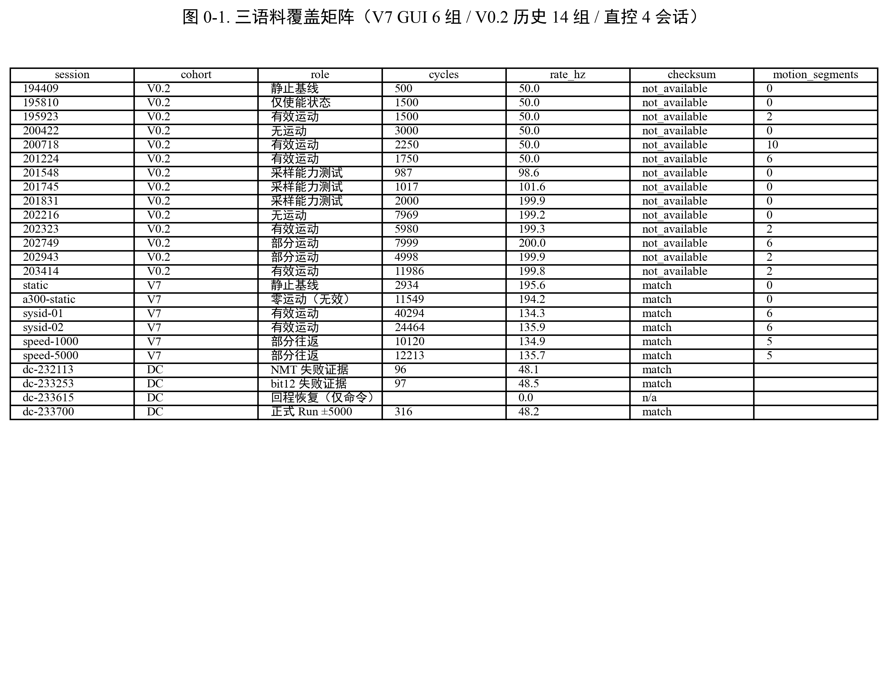

# 00 总览与执行摘要：2026-08-01 直控会话 × V7 GUI × V0.2 历史三语料联合分析

- 生成日期：2026-08-03
- 分析目录：`01_研究主线/07_开题研究/outputs/30_当前阶段/2026-08_数据分析_直控与联合语料/`
- 数据来源：`motion_acquisition/data/20260801/2026/08/`（10 会话）、`motion_acquisition/logs/`（V0.2 历史 14 组）、`motion_acquisition/build/Joint_Experiment_Analysis_20260801/`（Codex joint 分析输出，指标直接引用，不重复计算）

---

## 0.1 数据口径（固定声明，各分报告均适用）

> - **raw counts 为权威量**；`1 count≈0.5 μm` 仅为工程换算，**未完成外部长度基准标定**，本报告不换算成正式精度、不宣称"µm 级"结果。
> - **SDO 顺序读取非硬实时**：直控 20 ms 轮询实际 ≈48 Hz；V7 5 ms 请求实际 135–195 Hz。
> - `error − (demand − actual)` 约 ±9 counts 为**顺序读取伪差**（引用 D1–D3 审计 `01_TIME_AND_SIGNAL_QUALITY_AUDIT.md` 第 65–69 行）。
> - 0x603F 全程为 0；直控仅 PPM 相对位置（无绝对位置基准）。
> - 内部交叉验证非独立泛化；观测关联非因果。

---

## 0.2 三语料覆盖矩阵

**图 0-1.** 三语料覆盖矩阵：V7 GUI 6 组（134–196 Hz）、V0.2 历史 14 组（50/100/200 Hz）、直控 4 会话（48 Hz 采集 + 命令账本）。

**解读一句话**：覆盖最大的缺口不在"量"而在"质"——直控正式 Run 只有 1 次往返，V7-A300 标称批量零运动，且全部时间戳均为主机侧轮询时间，无设备时钟同步。

| 语料 | 会话 | 数据形态 | checksum | 运动段 | 速度/参数覆盖 |
|---|---|---|---|---|---|
| **直控 DC**（8.1 晚） | 232113（NMT 失败）、233253（bit12 失败）、233615（回程恢复，仅命令账本）、**233700（正式 Run）** | samples.csv（7 对象×48 Hz）+ control_commands.jsonl | 3 会话有账本（18 条全匹配） | 233700 2 段（PPM ±5000） | 50 RPM 名义，A300（需求斜率实测 ≈84 k counts/s） |
| **V7 GUI**（8.1 白天） | v7-static、v7-a300-static、v7-sysid-01/02、v7-speed-1000/5000 | samples.csv（3–7 对象×135–196 Hz） | 6 会话账本（30 条全匹配） | 6+6+5+5 段（sysid/speed）；a300-static 0 段 | A150；75/100 RPM；1000/2000/5000 counts |
| **V0.2 历史**（7.12） | 14 组（logs/） | CSV（3–7 对象×50/100/200 Hz） | 无账本（not_available） | 23 段含 13 对配对 | A300/A150；50/100 RPM；1000/5000 counts |

明细见 `data/CORPUS_COVERAGE.csv`；joint 侧一致性见 `SESSION_INVENTORY.csv`（20 会话、48/48 checksum 复验，见 `04_merged_report.py` 断言）。

---

## 0.3 分级结论

### ✅ 已确认（数据可直接支撑）

| # | 结论 | 证据 |
|---|---|---|
| C1 | 直控正式 Run 233700 基线完整：316 cycles / 2212 对象读取 / 0 失败 / 48.22 Hz / deadline_miss=0 / 0x603F 全程 0 | 断言 1–9（`analysis_manifest.json`） |
| C2 | 跟随误差峰值 632 counts 出现在**回程**（seq 215，elapsed 4.548 s），伴随实际位置越界至 −505 counts（目标 29，越界 −534 counts）；正向亦有 +507 counts 超调 | `01_直控闭环分析报告.md` 图 1-1/1-2 |
| C3 | 回零偏差 +1 count：最终实际 30 vs 需求 29 | 断言 7 |
| C4 | NMT 失败链：232113 命令账本无 preflight/NMT start_remote_node，使能状态机卡在 0x33（51），2.3 s 后中止 | 图 1-4 |
| C5 | bit12 失败链：233253 驱动完成位移（状态字出现 bit10 到位 0x437）但 bit12（0x1000）全程未置位，前版握手 2 s 超时中止；轴遗留 5023 counts | 图 1-5、图 1-6 |
| C6 | 直控需求斜率 ≈84 k counts/s，是 GUI 采集（3.9–7.0 k counts/s）的 12–22 倍 → 632 峰值的直接激励来源 | 图 1-7 |
| C7 | deadline_miss 全轮现象：V7 7 对象×5 ms 请求 100% 报 miss（40294/40294 等），直控 20 ms 轮询 0 miss；两者均为非硬实时 | `06_误差分解与时间质量报告.md` 图 6-3/6-4 |

### 🔍 初步观察（描述性，非重复实验）

| # | 观察 | 边界 |
|---|---|---|
| O1 | A/D/J=150 稳态 RMS（3.7–9.0 counts 正向）显著优于 A300（27.8 counts 固定窗 / 18.45 counts 现场人工窗） | A300 仅 1 次往返，不平衡；窗口口径敏感（D1–D3 审计已指出） |
| O2 | 方向不对称符号随工况切换：23 对配对中返回主导 9 对（39%）、正向主导 14 对（61%）；v02-200718（100 RPM）组内 5/5 返回主导，v02-201224（50 RPM）组内 3/3 正向主导 | 观测关联非因果；符号与速度/行程的单调关系不成立 |
| O3 | 5000-count 行程速度 P95 随标称转速分离（97→110 raw），但 FE P95 未随之分离（55→49 counts 正向）；返回方向 FE 系统性大于正向 | 每速度仅 1 完整往返 |
| O4 | 一阶+延迟 FOPDT 在 233700 阶跃段**不可可靠辨识**：τ 顶下界 2 ms、L≈0、残差峰值 579–650 counts（超调振荡）；收敛包络 τ_env≈12–19 ms 拟合残差小（RMSE 3–12 counts） | 48 Hz 采样 + 62 ms 斜坡 → 结构不可辨识本身就是"可辨识边界"证据 |
| O5 | 233615 回程恢复出现 −478 counts 过冲（越目标 ~500 counts），与 233700 回程 −534 counts 越界同源 | 仅命令账本轮询（约 22 ms），无 samples.csv |

### ⏳ 待验证 / 证据缺口

| # | 缺口 | 需要的证据 |
|---|---|---|
| G1 | V7-A300 标称三往返批量**零运动**（11549 cycles 无位移）——不能作为 A300 运动证据 | 重新采集 V7-A300 运动数据（仅当参数效应成为论文中心主张） |
| G2 | A300 仅 1 次完整往返 → 参数对比不平衡 | 平衡重复（条件性，见 joint `MISSING_DATA_DECISIONS.csv`） |
| G3 | "直控 A300 = GUI A300"（驱动对象读回一致 30000/30000/30000）但需求斜率差 12–22 倍，单位换算未解明 | 驱动手册对象单位核对（待模块 A 台架对照表） |
| G4 | 632 counts 峰值与内部环带宽/机械谐振的因果归属未分离（电流峰值 1216 与 FE 强相关但非因果） | 更高采样率或设备侧时间戳 |
| G5 | ~~论文机电模型对照表尚未建立~~ **已完成** | 模块 A 台架对照表（`2026-08_赖建君论文精读/07_台架对照表.md`）已填充至 `02_系统辨识报告.md` 2.5 节；核心结论：论文参数为设计者视角不可直接对拍，τ 下界受采样率限制 |

---

## 0.4 报告入口

| 报告 | 主题 | 核心图 |
|---|---|---|
| [`01_直控闭环分析报告.md`](01_直控闭环分析报告.md) | 233700 全时间线、632 峰值归因、阶跃指标、NMT/bit12 失败证据链、与 V7 对比 | 图 1-1…1-7 |
| [`02_系统辨识报告.md`](02_系统辨识报告.md) | 一阶+延迟 FOPDT 拟合与可辨识边界、收敛包络、论文机电模型对照（占位） | 图 2-1…2-3 |
| [`03_速度与跟随误差关系报告.md`](03_速度与跟随误差关系报告.md) | 5000-count 75/100 RPM 的 FE/速度关系、加速受限标注 | 图 3-1…3-4 |
| [`04_加减速参数对比报告.md`](04_加减速参数对比报告.md) | A/D/J 300 vs 150、现场口径 18.45/3.59 counts、V7-A300 零运动缺口 | 图 4-1…4-3 |
| [`05_方向不对称报告.md`](05_方向不对称报告.md) | 23 对配对方向差、符号稳定性 | 图 5-1…5-3 |
| [`06_误差分解与时间质量报告.md`](06_误差分解与时间质量报告.md) | ramp/稳态/全程 RMS 分解、settling、dt、deadline_miss 全轮现象 | 图 6-1…6-4 |

派生数据：`data/STEP_RESPONSE_SUMMARY.csv`、`data/STEP_RESPONSE_PHASES.csv`、`data/STEP_RESPONSE_STEPS.csv`、`data/SYSID_FITS.csv`、`data/COMPARISON_METRICS.csv`、`data/ACCEL_COMPARISON.csv`、`data/DIRECTION_EFFECTS.csv`、`data/ERROR_DECOMPOSITION.csv`、`data/TIME_QUALITY.csv`、`data/CORPUS_COVERAGE.csv`。

可重复性：`analysis/01_step_response.py`、`analysis/02_system_identification.py`、`analysis/03_comparative_metrics.py`、`analysis/04_merged_report.py`（34 项断言全过才 exit 0）；完整性见 `DERIVED_SHA256SUMS.txt` 与 `analysis_manifest.json`。

---

## 0.5 与论文主线的关系（D1 视角）

本批分析最核心的产出是**可辨识边界**的实证：48 Hz 顺序 SDO 采样下，(a) 需求斜率 84 k counts/s 的阶跃只能采样到约 3 个斜坡点；(b) FOPDT 参数不可可靠辨识（τ 顶界、L≈0）；(c) 可可靠观测的是稳态增益 K≈1、越界/超调幅度（约 ±500 counts，~10% 行程）、收敛包络 τ_env（12–19 ms）与回零偏差（+1 count）。这直接支撑"权限受限商业闭环的低频等效模型"（D1）的建模粒度选择：**模型只承诺 counts 域、低频、包络级**，不承诺内环参数级辨识。
