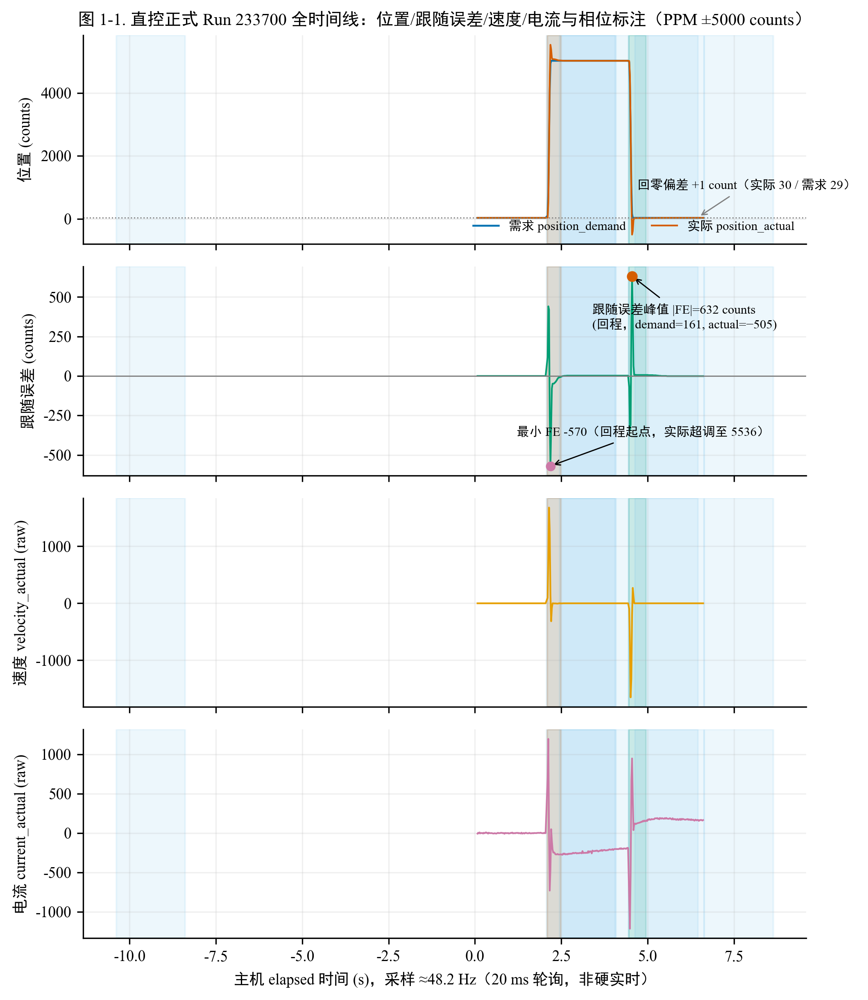
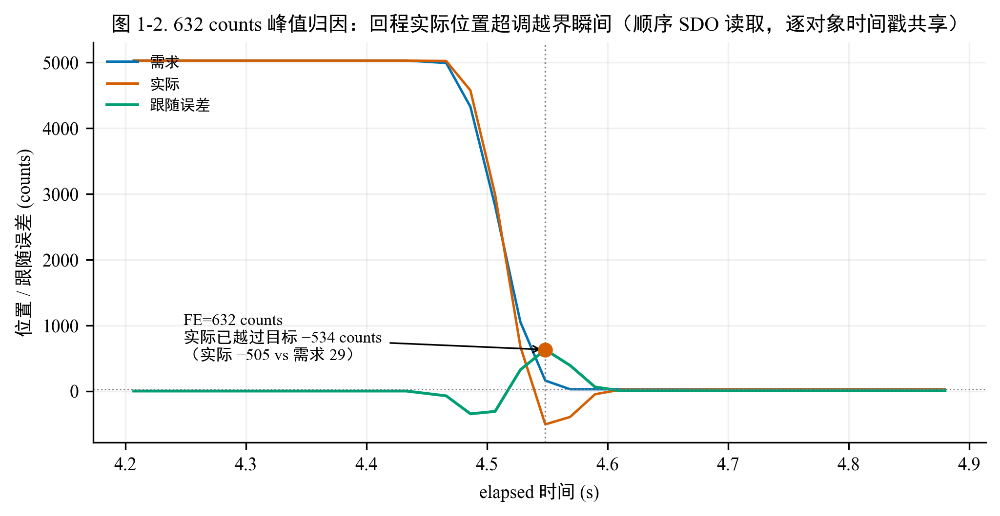
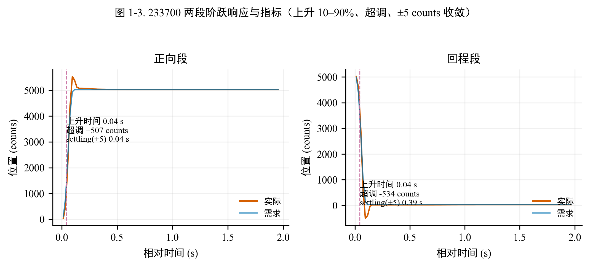
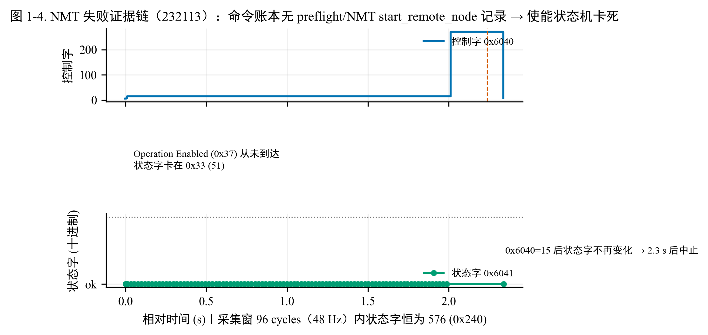
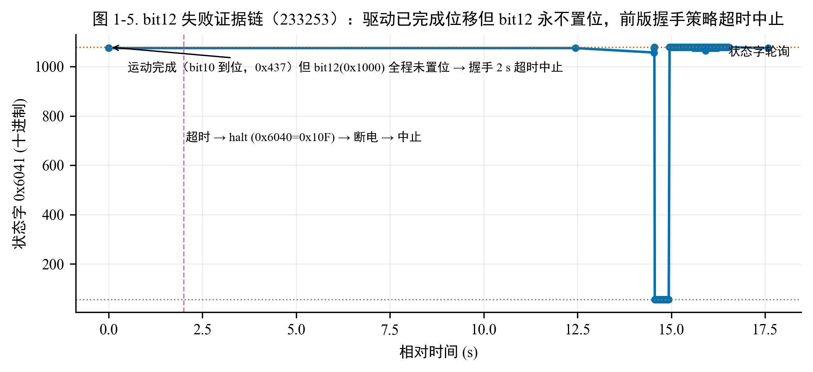
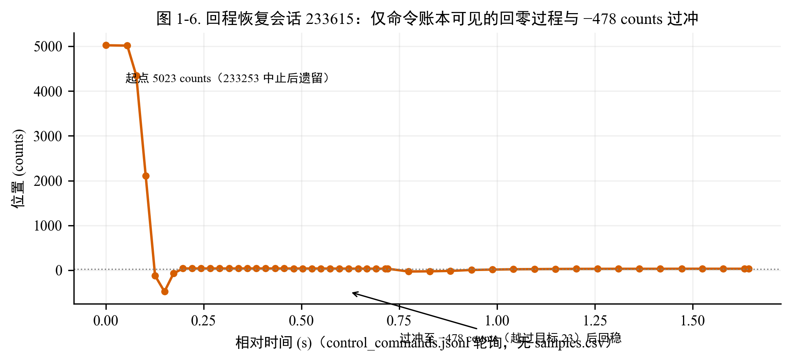
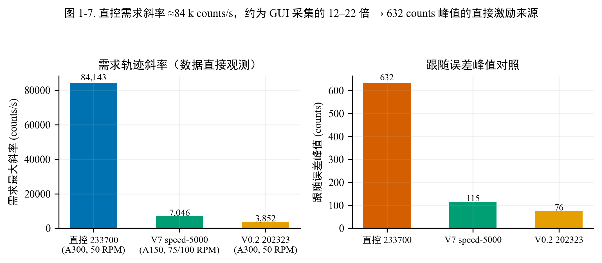

# 01 直控闭环分析报告：233700 正式 Run 全时间线、632 峰值归因与失败证据链

- 数据：`data/20260801/2026/08/20260801_233700_run-3a2bfcc9/`（正式 Run）、`20260801_232113_run-388f39a8/`（NMT 失败）、`20260801_233253_run-5b435911/`（bit12 失败）、`20260801_233615_return_recovery/`（回程恢复）
- 派生数据：`data/STEP_RESPONSE_SUMMARY.csv`、`data/STEP_RESPONSE_PHASES.csv`、`data/STEP_RESPONSE_STEPS.csv`

## 数据口径（固定声明）

> - **raw counts 为权威量**；`1 count≈0.5 μm` 仅为工程换算，未完成外部长度基准标定，本报告不换算成正式精度。
> - **SDO 顺序读取非硬实时**：直控 20 ms 轮询实际 ≈48 Hz；V7 5 ms 请求实际 135–195 Hz。
> - `error − (demand − actual)` 约 ±9 counts 为**顺序读取伪差**（引用 D1–D3 审计）。
> - 0x603F 全程为 0；直控仅 PPM 相对位置。
> - 内部交叉验证非独立泛化；观测关联非因果。

---

## 1.1 会话时间线（wall time 对齐）

命令与采样通过 `wall_time_iso` 对齐（monotonic 跨进程不可比）。233700 完整序列：

| wall time | elapsed (s) | 事件 |
|---|---|---|
| 23:36:49.834 | −10.39 | preflight：NMT start_remote_node（状态字 1075 → 1075，已 OPERATIONAL）、对象读回（0x6064=29，0x603F=0） |
| 23:37:00.207 | ≈0 | preflight 复查；采集窗 23:37:00.23–06.86（316 cycles） |
| 23:37:02.287 | 2.07 | enabling：0x6060=1（PPM）、0x6040 6→1057 / 7→1075 / 15→1079（Operation Enabled） |
| 23:37:02.310 | 2.09 | forward：0x607A=+5000、0x6040=95、0x6040=79，setpoint_handshake ok |
| 23:37:02.673 | 2.45 | forward_dwell（2 s） |
| 23:37:04.675 | 4.45 | returning：0x607A=−5000、0x6040=95、0x6040=79，setpoint_handshake ok |
| 23:37:04.852 | 4.63 | final_capture（2 s） |
| 23:37:06.849 | 6.63 | 0x6064=30（回零偏差 +1）；0x6040=15 保持使能 → completed_enabled |

**图 1-1.** 四通道全时间线（48.2 Hz 采样），相位带标注 forward（橙）/returning（绿）；FE 峰值 632 counts（回程）与 −570 counts（回程起点）均已标出，终点回零偏差 +1 count。

**解读一句话**：整个 Run 仅 6.6 s，动态段（forward/returning）合计约 0.35 s，其余为静止窗——632 counts 峰值发生在极短的回程动态窗内。

**图 1-2.** 峰值邻域放大：seq 215（elapsed 4.548 s）FE=632 counts，此刻 demand=161、actual=−505（越界目标 29 达 −534 counts）。

**解读一句话**：632 counts 并非测量毛刺——是回程实际位置**越过目标 −534 counts**、而需求仍在收尾（161 counts）时刻的驱动器内部跟随误差读数；该 cycle 内 `demand−actual=666`，与 632 之差源于轮内顺序读取（各对象读取时刻相差数 ms，信号以 ~84 k counts/s 变化）。

---

## 1.2 相位统计与阶跃指标

| 相位 | 采样数 | FE min | FE max | FE absmax | FE RMS | demand 范围 | actual 范围 | 速度 P95 (raw) | 电流峰值 (raw) |
|---|---|---|---|---|---|---|---|---|---|
| preflight | 97 | 0 | 0 | 0 | 0.00 | 29–29 | 29–29 | 0 | 10 |
| forward | 18 | −570 | 441 | 570 | 224.4 | 101–5029 | 37–5536 | 1323 | 1195 |
| forward_dwell | 96 | −7 | 2 | 7 | 2.12 | 5029–5029 | 5027–5036 | 0 | 276 |
| returning | 9 | −344 | 632 | 632 | 312.9 | 29–4991 | −505–5021 | 211 | 1216 |
| final_capture | 96 | −1 | 7 | 7 | 3.20 | 29–29 | 22–30 | 0 | 191 |

（`STEP_RESPONSE_PHASES.csv` 全列；"enabling" 相在采样网格上无样本——相位进入与首个运动样本间隔小于一个采样周期。）

| 指标（`STEP_RESPONSE_STEPS.csv`） | 正向段 29→5029 | 回程段 5029→29 |
|---|---|---|
| 上升时间 10–90%（actual） | 0.041 s | 0.042 s |
| 越界/超调（actual 越过目标） | **+507 counts**（实际峰值 5536） | **−534 counts**（实际谷值 −505） |
| 峰值 |FE|（段内） | 570 counts | **632 counts** |
| settling(±5 counts) | 0.042 s | 0.393 s |
| 稳态窗 RMS（到位后 0.5–1.5 s） | 2.0 counts | 1.74 counts |
| 终点实际 / 需求 | 5027 / 5029 | **30 / 29（偏差 +1）** |

**图 1-3.** 两段阶跃响应：需求斜坡约 60–80 ms（20 ms 采样仅 3–4 点），实际超调约 500 counts 后收敛；回程 settling 明显长于正向（0.39 s vs 0.04 s）。

**解读一句话**：上升时间 41 ms 实际反映的是"需求斜坡本身"，超调 ±500 counts（约行程 10%）与回程更长的收敛时间才是闭环动态的真实可观测特征。

---

## 1.3 632 峰值归因链

1. **激励**：PPM 相对定位，驱动对象读回 profile_velocity=6900、accel/decel/jerk=30000（名义 A300）。数据实测需求最大斜率 **84,143 counts/s**（`STEP_RESPONSE_SUMMARY.csv`）。
2. **响应**：正向实际超调至 5536（+507）；回程实际跌至 −505（−534），与需求同向大幅越界。
3. **峰值时刻**：回程需求收尾至 161 counts、实际在谷底 −505 counts → 驱动器内部跟随误差 632 counts。
4. **旁证**：峰值 cycle 电流 947（raw），电流峰值段 1216（回程起点）、1195（正向）——电流与 FE 强共变（joint `METRICS_BY_SEGMENT` 相关列），但**观测关联非因果**。

> 对照 V0.2/V7 GUI 采集：同样名义 A300（202323）需求斜率仅 3.85 k counts/s，FE 峰值仅 76 counts；V7 A150 5000-count 峰值 71–115 counts。直控 Run 的斜率约为其 **12–22 倍**，见 1.5 节图 1-7。

---

## 1.4 失败证据链（不美化，按账本原样）

### 1.4.1 NMT 失败（232113）——证据链

- 命令账本 `control_commands.jsonl` **无 preflight 阶段、无 NMT start_remote_node 记录**（全文件 grep "nmt" = 0 条），会话从 enabling 直接开始。
- 使能序列：0x6040=6 → 状态字 33；0x6040=7 → 51；0x6040=15 → **仍 51（0x33）**，未进入 Operation Enabled（0x37）。
- 状态字卡死约 2.3 s 后中止（halt 0x6040=271，二次 0x6040=7 报 error）→ outcome=error。
- 同期采集窗（96 cycles，48 Hz）状态字恒为 **576（0x240，Switch-on-disabled）**，位置恒 0。
- 对照：233253/233700 均在 preflight 发送 NMT start_remote_node 且使能成功（1079）。**协议层唯一可观测差异即 NMT 命令缺失**；因果表述为"最可能机制"，本数据无法排除并发因素。

**图 1-4.** 232113 使能控制字/状态字轨迹：0x6040=15 后状态字停在 0x33（51），虚线为 Operation Enabled（0x37）参照线。

**解读一句话**：缺失 NMT 置 OPERATIONAL 的会话，驱动器使能状态机拒绝进入 Operation Enabled——这是 233253/233700 成功会话之前最后一个协议层差异。

### 1.4.2 bit12 失败（233253）——证据链

- preflight NMT ok（状态字 1075）→ 使能 6/7/15 → 1079（Operation Enabled + bit10 到位）。
- forward：0x607A=5000、0x6040=95 触发；状态字轮询 55（0x37，运动中）约 0.4 s 后出现 **1079（0x437：bit10 target-reached）**——驱动器已执行完 5000 counts 位移。
- **bit12（0x1000，"跟随指令值"）全程未置位**（本会话全部轮询与全部 samples 中 bit12 均为 0）。
- 前版握手策略等待 bit12（或等效确认）未放行 → **2 s 超时**（23:32:57.151，与 `trigger_relative` timeout_s=2.0 一致）→ halt（0x6040=0x10F）→ 断电（0x6040=7）→ outcome=error。
- 后果：轴遗留 ~5023 counts（后续 233615 preflight 读回 0x6064=5023 证实）。
- 注意：233253 的采集窗（23:32:53.1–55.1）在命令执行前结束，samples.csv 仅含静止基线（位置恒 27、状态字 1075）；**bit12 证据链完全来自命令账本**。
- 修复对照（233700）：0x6040=95 后立即 0x6040=79（0x4F）并在首个轮询（状态字 55，bit10=0）即判定 setpoint 已接受放行。

**图 1-5.** 233253 forward 阶段状态字轮询：55（运动）→ 1079（到位，bit10=1）持续轮询至 2 s 超时 → halt。

**解读一句话**：驱动器在此模式下**根本不产生 bit12**，等待 bit12 的握手必然超时；233700 的兼容判据（bit10 清零即接受）是本次现场排障得到的工程事实，也应作为未来 STM32 主站设计的已知项。

### 1.4.3 回程恢复（233615）——证据链

- 仅 `control_commands.jsonl`（无 samples.csv）。
- preflight 0x6064=5023（确认 233253 遗留）；enabling 阶段直接执行回程：0x607A=−5000、0x6040=95。
- 位置轮询：5023→5015→4344→2111→−123→**−478（越界 ~500 counts）**→−74→38→33…，状态字 1079（到位）。
- stopping：halt 271 → 位置 31/32 稳定 → 断电 → **最终 0x6064=29**（正式 Run 233700 以此为起点）。

**图 1-6.** 233615 回零过程：起点 5023（233253 遗留）、过冲 −478 counts、终值 29 counts。

**解读一句话**：恢复会话同样出现 ~500 counts 越界过冲——与 233700 回程 −534 counts 同源，说明这是该平台 A300 激励下的**系统性动态特征**而非单次异常。

---

## 1.5 与 V7/v0.2 需求斜率与峰值对照

**图 1-7.** 左：需求最大斜率（数据直接观测）直控 84,143 vs V7 7,046 vs V0.2 3,852 counts/s；右：跟随误差峰值 632 vs 115 vs 76 counts。

**解读一句话**：632 counts 峰值与需求斜率放大（12–22 倍）强相关；但注意 233700 与 v02-202323 名义参数同为 A300（驱动对象读回一致），斜率却差 22 倍——**GUI 与直控对同一驱动对象的单位语义可能不同，待模块 A 台架对照表核实**（见 `02_系统辨识报告.md` 第 5 节占位）。

---

## 1.6 结论分级

- **已确认**：C1–C6（见 `00_总览与执行摘要.md` 0.3 节）；632 峰值、回零 +1、NMT/bit12 证据链、斜率对照全部由原始数据与命令账本直接支撑。
- **初步观察**：回程越界过冲（−478/−534 counts）为平台系统性特征；bit12 永不置位为该驱动器此模式下的协议行为。
- **待验证**：直控 A300 与 GUI A300 的驱动对象单位语义差异（G3）；632 与内环带宽/机械谐振的因果归属（G4）。
