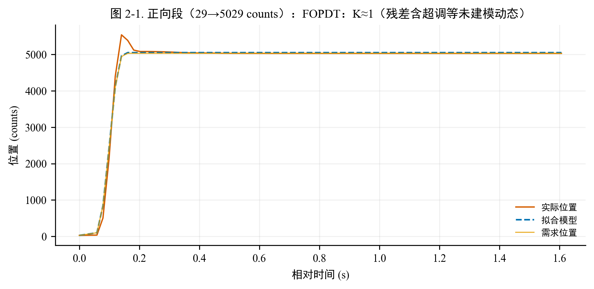
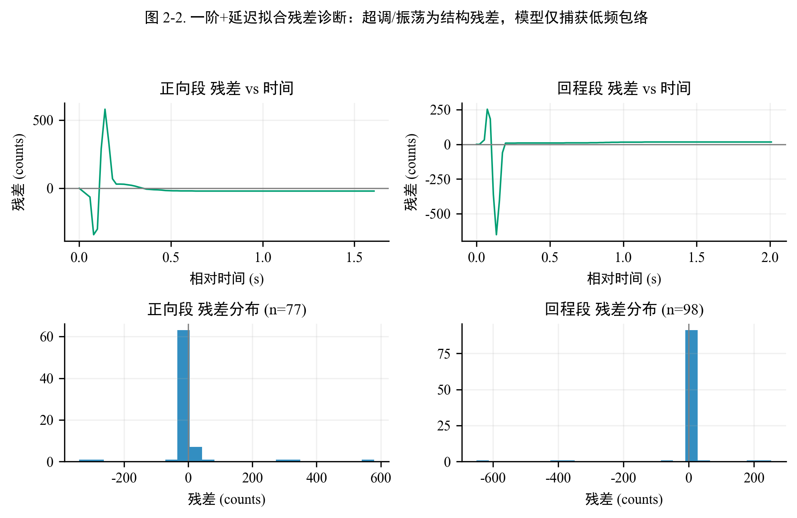
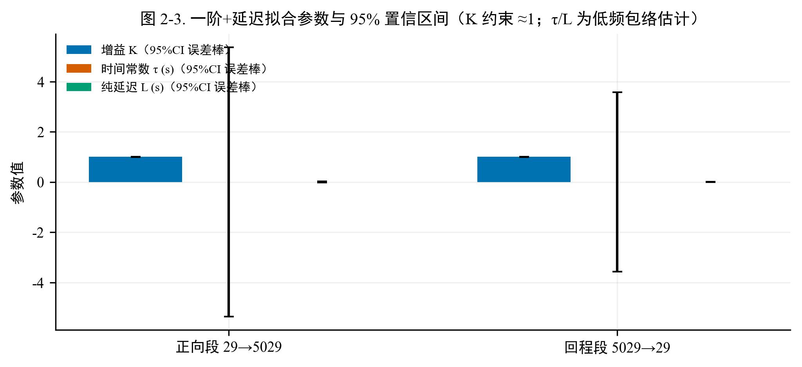
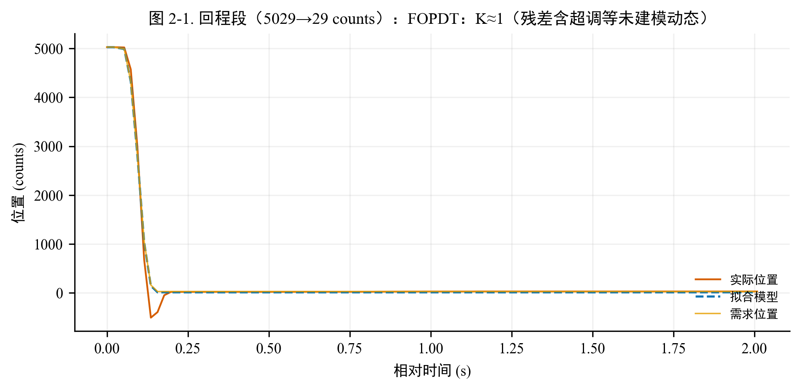

# 02 系统辨识报告：233700 阶跃段一阶+纯延迟拟合与可辨识边界

- 数据：`data/20260801/2026/08/20260801_233700_run-3a2bfcc9/samples.csv`
- 派生数据：`data/SYSID_FITS.csv`；脚本：`analysis/02_system_identification.py`

## 数据口径（固定声明）

> - **raw counts 为权威量**；`1 count≈0.5 μm` 仅为工程换算，未完成外部长度基准标定，本报告不换算成正式精度。
> - **SDO 顺序读取非硬实时**：直控 20 ms 轮询实际 ≈48 Hz；V7 5 ms 请求实际 135–195 Hz。
> - `error − (demand − actual)` 约 ±9 counts 为**顺序读取伪差**（引用 D1–D3 审计）。
> - 0x603F 全程为 0；直控仅 PPM 相对位置。
> - 内部交叉验证非独立泛化；观测关联非因果。

---

## 2.1 方法与输入描述

- 模型结构：`G(s) = K·e^(−Ls)/(τs+1)`（FOPDT），以**驱动器内部需求轨迹**（0x6062，非理想阶跃）为输入、实际位置（0x6064）为输出。
- 数值实现：采样保持离散一阶系统 + 延迟（`scipy.optimize.least_squares` 多起点，非均匀时间网格精确递推），K 约束 [0.95, 1.05]（稳态到达的工程约束），τ∈[2 ms, 2 s]，L∈[0, 0.3 s]；95% CI 为局部线性近似（JᵀJ 协方差）。
- **输入不是理想阶跃**：需求斜坡 10–90% 仅 **62 ms**（实测最大斜率 84,143 counts/s），而采样周期 20.8 ms——斜坡上只有 **3 个采样点**。这是可辨识性的结构性限制，必须先讲清楚再读参数。

| 拟合 | 窗口 | 斜坡 10–90% | 稳态增益 K | 时间常数 τ | 纯延迟 L | RMSE | R² | 残差峰值 |
|---|---|---|---|---|---|---|---|---|
| FOPDT 正向 29→5029 | 2.04–3.65 s | 61.8 ms | 1.004 ± 0.005 | **0.002 s（顶下界）** | ≈0 | 100.2 counts | 0.990 | 579 counts |
| FOPDT 回程 5029→29 | 4.40–6.43 s | 62.1 ms | 1.003 ± 0.004 | **0.002 s（顶下界）** | ≈0 | 92.5 counts | 0.992 | 650 counts |
| 包络 正向（到位后） | 2.21–3.65 s | — | — | **τ_env=0.0185 s** | 0 | 12.1 counts | 0.926 | 43.9 counts |
| 包络 回程（到位后） | 4.57–6.43 s | — | — | **τ_env=0.0119 s** | 0 | 3.4 counts | 0.994 | 6.9 counts |

**图 2-1.** 正向段 FOPDT 拟合：模型跟随需求斜坡但**无法表达 507 counts 超调**（一阶系统不超调），残差即体现为超调/回摆。

**解读一句话**：R²≈0.99 主要来自斜坡本身的可预测性，不能解读为模型捕获了闭环动态。

**图 2-2.** 两段残差 vs 时间与分布：残差峰值 579/650 counts、形状为"超调—回摆"结构（非白噪声）——模型结构缺陷的直接证据。

**解读一句话**：残差不是噪声而是**结构残差**：振荡特征（约 500 counts、周期 ~0.2 s）暗示内环存在一阶以上动态（欠阻尼二阶或更复杂）。

**图 2-3.** FOPDT 参数：τ 顶住 2 ms 下界（不可辨识），L≈0（CI 0.012–0.020 s），K≈1（CI 窄）。

**解读一句话**：可辨识的只有 K≈1；τ 与 L 在"62 ms 斜坡 + 48 Hz 采样 + 欠阻尼振荡"组合下**不可靠**——这正是论文 D1 主张的"可辨识边界"的实证。

---

## 2.2 收敛包络（可解释参数）

到位后的收敛用 `y(t) = target + A·exp(−(t−t0)/τ_env)` 拟合（A=越界幅值，τ_env=收敛时间常数）：

- 正向：A=+348 counts，τ_env=18.5 ms，RMSE 12.1 counts；
- 回程：A=−421 counts，τ_env=11.9 ms，RMSE 3.4 counts。

**解读**：越界后的回摆被包络良好描述（回程尤其干净），说明**主体收敛是快速指数过程**（τ_env≈12–19 ms），叠加小幅振荡（残差 ±7 counts）与最终 ±3 counts 级稳态抖动。注意 τ_env 描述的是"越界后回摆"，与 FOPDT 的 τ 不是同一物理量。

**图 2-1b.** 回程段拟合：−534 counts 越界与回摆清晰可见，模型仅捕获终态。

**解读一句话**：回程包络 RMSE 3.4 counts 显著好于正向（12.1）——回程收敛更"干净"，与 `01` 报告中回程 settling 更长的现象（0.39 s）共同说明回程动态与正向不对称（方向不对称的另一维度）。

---

## 2.3 可辨识边界小结（本批数据）

| 量 | 结论 | 依据 |
|---|---|---|
| 稳态增益 K | ✅ 可辨识，K≈1.00±0.005 | 正向/回程终值偏差 +1/−2 counts；CI 窄 |
| 纯延迟 L | ⚠️ 不可辨识（≈0，CI 12–20 ms） | 斜坡 62 ms 被 20.8 ms 采样模糊；L 与斜坡上升时间混叠 |
| FOPDT τ | ❌ 不可辨识（顶 2 ms 下界） | 结构残差 579–650 counts 占主导 |
| 越界幅值 A | ✅ 可辨识，+507 / −534 counts（~10% 行程） | 直接观测 |
| 收敛包络 τ_env | ✅ 可辨识，12–19 ms（RMSE 3.4–12.1 counts） | 指数包络拟合 |
| 回零偏差 | ✅ 可辨识，+1 count | 直接观测 |

**后续辨识所需**（非当前阻塞项，仅供规划）：斜坡更缓的激励（需求斜率 ≤5 k counts/s，如 V7 A150）、≥500 Hz 采样或设备侧时间戳、多次重复求统计置信。

---

## 2.4 与 V7 GUI 段的对照（定性）

V7 5000-count 段（A150，需求斜率 5.3–7.0 k counts/s）实际位置**无越界**（actual 范围 −3…5000，joint `METRICS_BY_SEGMENT`），FE 峰值 71–115 counts。即：缓斜坡下闭环不越界、无振荡；急斜坡（直控）下越界 ~500 counts 并振荡。这支持"**越界由激励速率驱动、非平台固有静差**"的解读，但 75/100 RPM 仅 1 完整往返，属初步观察。

---

## 2.5 论文机电模型对照

> 论文侧数据来源：`01_研究主线/07_开题研究/outputs/10_证据与现状/2026-08_赖建君论文精读/07_台架对照表.md`（PDF 页引用已核）。

| 对照项 | 本批数据观测 | 论文/文献机电模型值 | 差异说明 |
|---|---|---|---|
| 等效一阶时间常数 τ | 不可辨识（<2 ms 下界）；收敛包络 τ_env 12–19 ms | 论文为设计者视角：LQR 仿真超调 4.5%/1.88 s、PID 6.6%/5 s+（PDF48）；状态空间 A/B/C/D 结构（式2.14）、前馈增益 Kf（式2.15–2.17） | 论文参数是"全环设计目标"不可直接对拍；当前 τ 下界受 48 Hz 采样限制（Nyquist 24 Hz），需缓斜坡+高采样率才能收紧 |
| 机械谐振/振荡频率 | ~5 Hz 级（残差周期 ~0.2 s） | 双质量等效模型（PDF42–44）；电机转动惯量 28 g·cm²、转矩常数 23.38 mN·m·A⁻¹（PDF33 表2.2）；丝杠导程 2 mm C5 级（PDF34 表2.3） | 论文机电参数为"建模输入"；当前为"观测输出"，且无设备侧时间戳，无法分离内环带宽与机械谐振的因果归属（G4） |
| 速度换算（1 raw ≈ 50 counts/s） | 工程观测（见 01 报告 1.5 节） | 论文：电机 6900 r/min + 丝杠导程 2 mm（PDF33–34），光栅 0.1 µm 细分（PDF71） | 单位制不同且当前 counts/mm 未标定（1 count≈0.5 µm 仅工程换算），无法用论文数值换算；需外部长度基准后重做 |
| 驱动器对象单位语义（GUI vs 直控 A300） | 斜率差 22 倍（84 k vs 3.85 k counts/s） | 论文电流环抽象为比例 1（PDF44）——设计者视角；手册级对象语义未覆盖该差异 | 论文未涉及"商业黑箱对象单位"问题；该差异（G3）正是当前课题"可辨识边界"的具体实例，需驱动手册对象单位核对或受控实验解明 |

---

## 2.6 结论分级

- **已确认**：FOPDT 结构残差 579–650 counts（结构不可辨识）；K≈1；τ_env 12–19 ms；越界 ±500 counts 级。
- **初步观察**：缓斜坡（V7 A150）不越界 vs 急斜坡（直控）越界——越界由激励速率驱动。
- **待验证**：τ/L 的真实量级需缓斜坡+高采样率实验；论文模型对照已完成（2.5 节，数据来自模块 A 台架对照表）。
