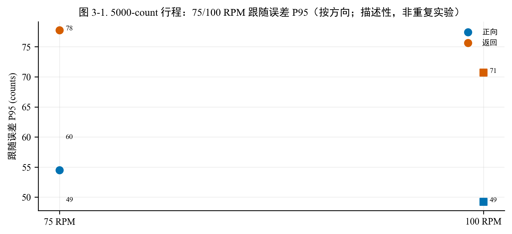
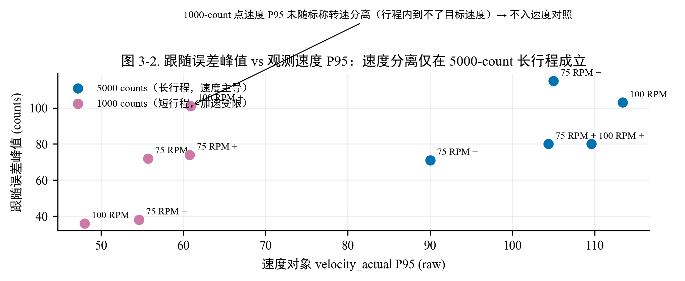
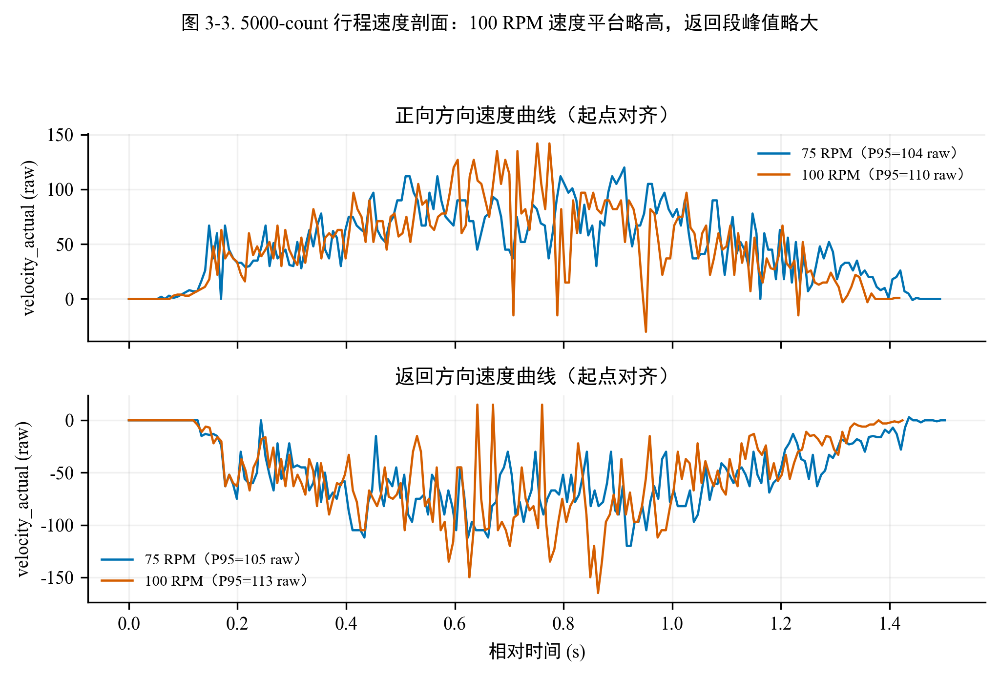
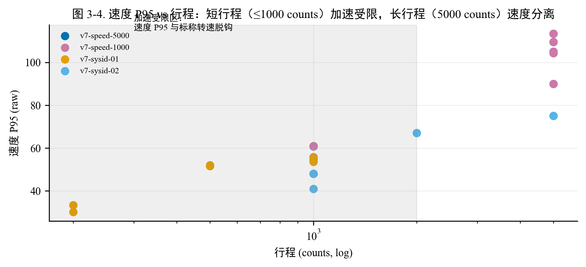

# 03 速度与跟随误差关系报告：5000-count 行程 75/100 RPM

- 数据：`data/20260801/2026/08/20260801_211936_run-c420c16d/`（v7-speed-5000）、`20260801_211315_run-be80b173/`（v7-speed-1000）；joint 输出 `METRICS_BY_SEGMENT.csv`/`MOTION_SEGMENTS.csv`
- 派生数据：`data/COMPARISON_METRICS.csv`；脚本：`analysis/03_comparative_metrics.py`

## 数据口径（固定声明）

> - **raw counts 为权威量**；`1 count≈0.5 μm` 仅为工程换算，未完成外部长度基准标定，本报告不换算成正式精度。
> - **SDO 顺序读取非硬实时**：直控 20 ms 轮询实际 ≈48 Hz；V7 5 ms 请求实际 135–195 Hz。
> - `error − (demand − actual)` 约 ±9 counts 为**顺序读取伪差**（引用 D1–D3 审计）。
> - 0x603F 全程为 0；直控仅 PPM 相对位置。
> - 内部交叉验证非独立泛化；观测关联非因果。

---

## 3.1 实验结构（诚实声明）

v7-speed-5000 会话结构（joint 判定）：75 RPM 与 100 RPM 各 **1 完整往返（2 段）** + 75 RPM 额外 1 段正向（unpaired，seg 5）。每速度每方向的样本量 n=1–2，**描述性结论，非重复实验**。

| 段 | 方向 | 名义转速 | 行程 | FE P50 | **FE P95** | FE 峰值 | 速度 P95 (raw) | 速度峰值 (raw) | 需求斜率 (counts/s) |
|---|---|---|---|---|---|---|---|---|---|
| s1 | 正向 | 75 RPM | 5000 | 10.0 | **49.3** | 80 | 104.4 | 120 | 5308 |
| s2 | 返回 | 75 RPM | −5000 | 11.0 | **77.8** | 115 | 105.0 | 120 | 5309 |
| s3 | 正向 | 100 RPM | 5000 | 8.0 | **49.2** | 80 | 109.6 | 142 | 6969 |
| s4 | 返回 | 100 RPM | −5000 | 13.0 | **70.7** | 103 | 113.4 | 165 | 7046 |
| s5 | 正向 | 75 RPM | 5000 | 10.0 | **59.7** | 71 | 90.0 | 105 | 5306 |

**图 3-1.** FE P95 随标称转速的对照：正向 49–55 counts、返回 71–78 counts，75→100 RPM 未见系统性分离。

**解读一句话**：FE P95 被方向主导（返回 > 正向约 20–30 counts），标称转速 75→100 RPM（+33%）未带来 FE 的对应分离。

**图 3-2.** FE 峰值 vs 观测速度 P95 散点：5000-count 点随速度右移（速度 P95 97→113 raw），1000-count 点挤在低速区。

**解读一句话**：观测速度随标称转速有分离（+13%），但 FE 峰值的速度响应被方向/个体差异淹没。

**图 3-3.** 四段速度原始曲线（起点对齐）：100 RPM 平台略高、返回段峰值 165 vs 正向 142（raw）。

**解读一句话**：速度剖面证实 100 RPM 段确实更快（需求斜率 5.3→7.0 k counts/s，+33%），因此 FE 未分离**不是激励缺失**，而是该平台动态误差对速度不敏感（或受采样掩盖）。

---

## 3.2 加速受限标注（v7-speed-1000 不入速度对照）

- 1000-count 段需求斜率 3.1–3.4 k counts/s，**与 75/100 RPM 无关**（s1–s5 几乎同值）——短行程内加速段占比过高，速度平台尚未建立就需减速。
- joint 判定：1000-count 75/100 RPM 为 **acceleration-limited negative control**，不入速度对照（`CONDITION_COVERAGE_MATRIX.csv` 第 3 行）。
- 本报告与 joint 口径一致：**v7-speed-1000 仅在图 3-2/3-4 中作为加速受限标注点出现**，不参与 75 vs 100 RPM 结论。

**图 3-4.** 速度 P95 vs 行程（log）：≤2000 counts 灰区为加速受限区，速度 P95 与标称转速脱钩；5000-count 段才出现速度分离。

**解读一句话**：这也是未来自研尺/主站实验协议的设计约束——**速度对照必须用 ≥5000 counts 行程**，否则测的是加速度不是速度。

---

## 3.3 结论分级

- **已确认**：5000-count 段速度 P95 随标称转速分离（+13%）；1000-count 段加速受限（需求斜率与转速无关）。
- **初步观察**：FE P95/峰值未随标称转速分离；返回方向 FE 系统性大于正向（与 `05_方向不对称报告.md` 呼应）。
- **待验证**：每速度仅 1 完整往返（n=1）——"速度对 FE 不敏感"若成为论文主张，需平衡重复（joint `MISSING_DATA_DECISIONS.csv` 第 2 行：DO_NOT_COLLECT 1000-count 重复；5000-count 重复仅在必要时补）。
