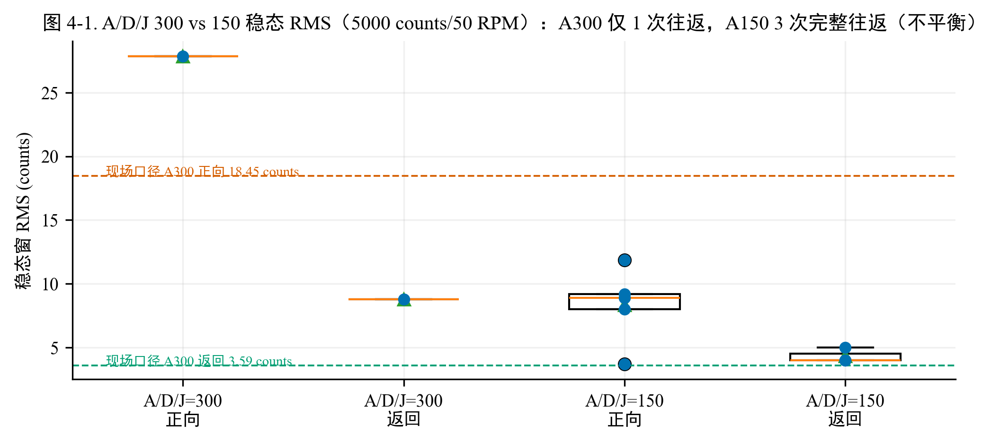
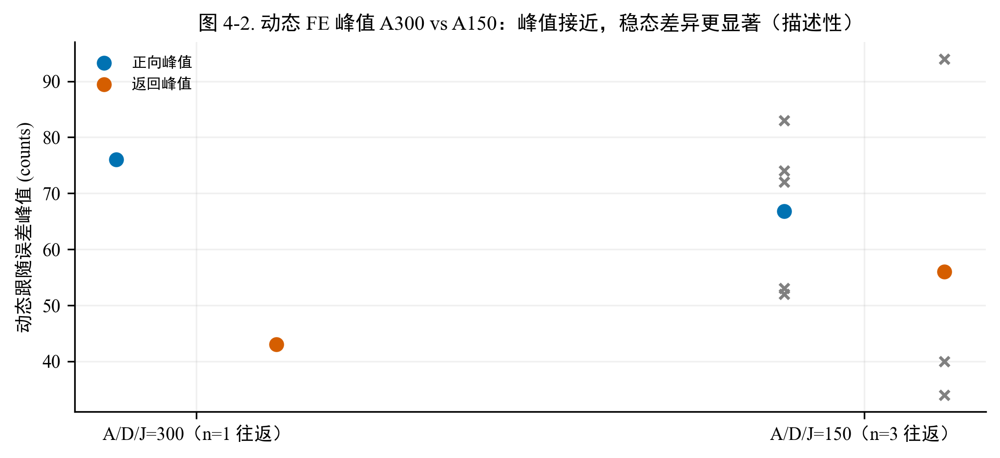
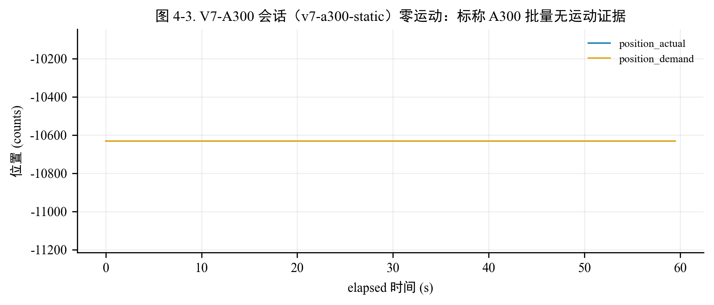

# 04 加减速参数对比报告：A/D/J 300 vs 150（5000 counts / 50 RPM）

- 数据：V0.2 历史 `logs/motion_sdo_20260712_202323.csv`（A300，1 往返）、`202749/203414`（A150，3 完整往返）；V7 `20260801_202307_run-d37b887b/`（v7-a300-static）；现场口径引自 `02_实验与现场/01_当前执行/59_现场检查与测量任务单.md` C13 与 `60_实验室推进记录/2026-07-12_*.md`
- 派生数据：`data/ACCEL_COMPARISON.csv`；脚本：`analysis/03_comparative_metrics.py`（B 节）

## 数据口径（固定声明）

> - **raw counts 为权威量**；`1 count≈0.5 μm` 仅为工程换算，未完成外部长度基准标定，本报告不换算成正式精度。
> - **SDO 顺序读取非硬实时**：直控 20 ms 轮询实际 ≈48 Hz；V7 5 ms 请求实际 135–195 Hz。
> - `error − (demand − actual)` 约 ±9 counts 为**顺序读取伪差**（引用 D1–D3 审计）。
> - 0x603F 全程为 0；直控仅 PPM 相对位置。
> - 内部交叉验证非独立泛化；观测关联非因果。

---

## 4.1 证据结构与不平衡声明

| 条件 | 会话 | 完整往返数 | 备注 |
|---|---|---|---|
| A/D/J=300 | v02-202323 | **1** | 50 RPM、5000 counts、约 200 Hz 三核心对象 |
| A/D/J=150 | v02-202749（2 对）+ v02-203414（1 对） | **3** | 50 RPM、5000 counts；202749 另有 1 段截断（expected_partial，不入配对） |
| V7-A300 批量 | v7-a300-static | **0（零运动）** | 11549 cycles 无位移，**运动证据无效** |

> ⚠️ **A300 仅 1 次往返、A150 3 次完整往返——样本严重不平衡**。本报告只做描述性对照，不做推断统计；joint `MISSING_DATA_DECISIONS.csv` 将"平衡 A300 重复"列为 CONDITIONAL（仅当参数效应成为论文中心主张才补采）。

---

## 4.2 稳态窗 RMS：对齐现场验收口径

**现场口径（2026-07-12 人工观察窗）**：A300 正向稳态 RMS **18.45 counts**、返回 **3.59 counts**（`00_总览.md` 第 98 行、`59_现场检查与测量任务单.md` C13）；A150 正向 3.16–5.58 counts、返回 3.69–4.00 counts（三组重复，第 99 行）。

**joint 固定窗口径**（到位后 0.5–1.5 s，`METRICS_BY_SEGMENT.csv`；D1–D3 审计已声明不逐点复现人工窗）：

| 条件 | 方向 | 稳态 RMS (counts) | 段数 |
|---|---|---|---|
| A300 | 正向 | **27.85** | 1 |
| A300 | 返回 | **8.78** | 1 |
| A150 | 正向 | 3.70 / 8.90 / 8.01 | 3 |
| A150 | 返回 | 4.00 / 4.00 / 5.00 | 3 |

**图 4-1.** 稳态 RMS 箱线+散点：A300 正向 27.85 counts 远高于 A150（3.7–9.0）；虚线为现场口径 18.45/3.59 counts（人工观察窗）。

**解读一句话**：无论人工窗（18.45）还是固定窗（27.85），A300 正向稳态误差显著高于 A150——**加减速激励降低改善了正向到位稳定性**，方向不对称随之收敛（现场记录结论一致）。

> 口径差异说明：18.45 与 27.85 的差异源于观察窗选择（D1–D3 审计 `02_MOTION_PHASE_SEGMENTATION.md` 第 53 行对 202323 三种窗给出 29.66/26.81/0.89 counts）；本报告两者并列引用，不做取舍。

---

## 4.3 动态峰值对照

| 条件 | 方向 | FE 峰值 (counts) |
|---|---|---|
| A300 | 正向 | 76 |
| A300 | 返回 | 43 |
| A150 | 正向 | 52 / 53 / 72 / 74 / 83 |
| A150 | 返回 | 34 / 40 / 94 |

**图 4-2.** 动态峰值两条件相当（A300 正向 76 vs A150 均值 ~66；返回 43 vs ~56），灰叉为单段值。

**解读一句话**：参数的效应主要体现在**稳态/收敛质量**而非动态峰值——峰值由激励斜坡与内环共同决定，稳态差异则与到位后收敛/抖动有关（与 `02` 报告包络分析呼应）。

---

## 4.4 V7-A300 零运动证据缺口

v7-a300-static 会话标称"三次往返"但 samples.csv 中 position_demand/position_actual 全程无位移（11549 cycles、194 Hz、~60 s）：

**图 4-3.** v7-a300-static 位置轨迹：全程平线，零位移。

**解读一句话**：该会话**不能作为 A300 的任何运动证据**（joint `CLAIM_EVIDENCE_MATRIX.csv`：V7 A300 含运动 → FAIL）；A/D/J 对比的全部运动证据来自 V0.2 单次 A300 往返。

---

## 4.5 与直控 A300 的张力（诚实提示）

- 直控 233700 名义参数同为 A300（驱动对象 30000/30000/30000），但需求斜率 84 k counts/s ≈ V0.2 GUI A300（3.85 k counts/s）的 **22 倍**，且出现 ±500 counts 越界。
- 若直控与 GUI 的驱动对象单位语义不同（G3），则"名义 A300"在两条路径上并不可比——**参数对比结论仅限 V0.2 GUI 语料内部**，不得外推到直控路径。
- 详见 `01_直控闭环分析报告.md` 1.5 节与 `02_系统辨识报告.md` 2.5 节占位。

---

## 4.6 结论分级

- **已确认**：A300 正向稳态 RMS（18.45/27.85 counts）显著高于 A150（3.7–9.0 counts）——但仅限 V0.2 GUI 语料、A300 n=1。
- **已确认（负面）**：v7-a300-static 零运动，A300 的 V7 证据缺口真实存在。
- **初步观察**：参数效应集中在稳态/收敛，动态峰值相当。
- **待验证**：平衡 A300 重复（仅当参数效应成为论文中心主张）；直控/GUI 名义参数可比性（G3）。
