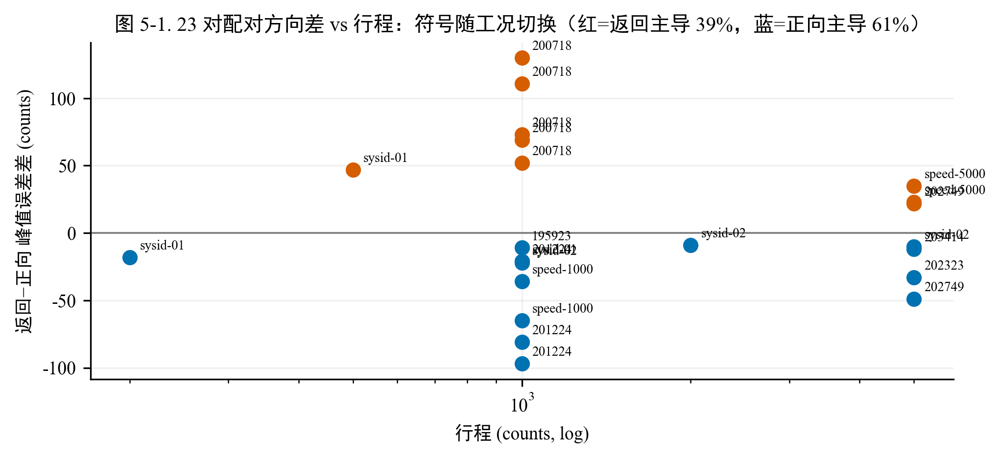
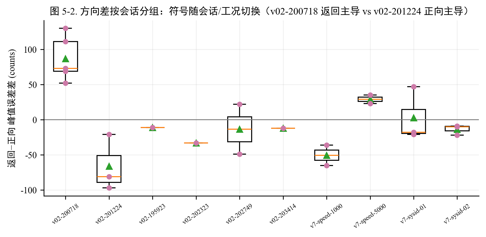
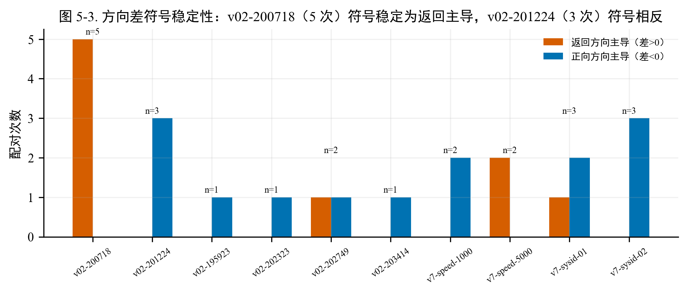

# 05 方向不对称报告：23 对配对的方向差与符号稳定性

- 数据：joint 输出 `PAIRED_DIRECTION_EFFECTS.csv`（23 对，10 个会话）
- 派生数据：`data/DIRECTION_EFFECTS.csv`（追加符号列）；脚本：`analysis/03_comparative_metrics.py`（C 节）

## 数据口径（固定声明）

> - **raw counts 为权威量**；`1 count≈0.5 μm` 仅为工程换算，未完成外部长度基准标定，本报告不换算成正式精度。
> - **SDO 顺序读取非硬实时**：直控 20 ms 轮询实际 ≈48 Hz；V7 5 ms 请求实际 135–195 Hz。
> - `error − (demand − actual)` 约 ±9 counts 为**顺序读取伪差**（引用 D1–D3 审计）。
> - 0x603F 全程为 0；直控仅 PPM 相对位置。
> - 内部交叉验证非独立泛化；观测关联非因果。

---

## 5.1 配对结构与定义

- 配对定义（joint）：同一会话同一 round_trip 内正向/返回两段，`paired==True 且 truncated==False`。
- 方向差：`返回峰值|FE| − 正向峰值|FE|`（>0 即返回方向主导）。
- 23 对分布：V0.2 13 对（195923×1、200718×5、201224×3、202323×1、202749×2、203414×1）+ V7 10 对（speed-1000×2、speed-5000×2、sysid-01×3、sysid-02×3）。

**图 5-1.** 方向差 vs 行程散点（log 轴）：返回主导 9 对（红）、正向主导 14 对（蓝），幅值 ±100 counts 量级。

**解读一句话**：方向不对称**真实存在但符号随工况切换**——不是平台固有的单向偏差。

**图 5-2.** 按会话分组的箱线（点=各对）：v02-200718（100 RPM/1000 counts/A300）5 对全部返回主导（+52…+130）；v02-201224（50 RPM/1000 counts/A300）3 对全部正向主导（−21…−97）。

**解读一句话**：方向差符号在**会话内高度稳定、会话间可反转**——与 joint 报告"100 RPM 返回主导、50 RPM 正向主导"的速度相关方向不对称结论一致（该记录设置下）。

**图 5-3.** 符号计数：红=返回主导、蓝=正向主导，n 为各会话配对总数。

**解读一句话**：符号稳定性最好的是 V0.2 重复批次（200718/201224），V7 单次往返会话无法检验稳定性。

---

## 5.2 主要数值

| 会话 | 工况 | 配对 | 方向差（返回−正向峰值） | 稳态 RMS 差（返回−正向） |
|---|---|---|---|---|
| v02-200718 | 1000c/100RPM/A300 | 5 | +130/+52/+73/+111/+69（全>0） | +2.1/+1.3/+8.3/+28.2/+7.2 |
| v02-201224 | 1000c/50RPM/A300 | 3 | −21/−97/−81（全<0） | −5.3/−10.4/−7.8 |
| v02-202323 | 5000c/50RPM/A300 | 1 | −33 | −19.1 |
| v02-202749 | 5000c/50RPM/A150 | 2 | +22/−49 | +0.3/−4.9 |
| v02-203414 | 5000c/50RPM/A150 | 1 | −12 | −3.0 |
| v7-speed-1000 | 1000c/75/100RPM/A150 | 2 | −36/−65 | +4.0/−9.7 |
| v7-speed-5000 | 5000c/75/100RPM/A150 | 2 | +35/+23 | 0.0/−0.0 |
| v7-sysid-01 | 200–1000c/A150 | 3 | −18/+47/−21 | +0.1/+1.0/−13.6 |
| v7-sysid-02 | 1000–5000c/A150 | 3 | −9/−10/−22 | +1.0/−4.0/+9.9 |

（全表见 `data/DIRECTION_EFFECTS.csv`；稳态差为 `negative_steady_rms − positive_steady_rms`。）

---

## 5.3 与历史记录的呼应

- 现场记录（2026-07-12）："正向到位后稳态窗 RMS 18.45 counts，明显差于返回的 3.59 counts，**方向不对称与正向收敛成为下一排查重点**"——即当时观察为**正向稳态差**。
- 本批 23 对中稳态方向差：v02-200718 返回差（+），v02-201224 正向差（−），符号同样随工况切换；**"方向不对称"是稳定的现象，"哪边差"不稳定**。
- 与 `04` 报告呼应：A150 参数下正/返回稳态 RMS 收敛至 3.7–9.0 counts，方向差幅值显著缩小——参数与方向效应相互纠缠，单变量归因不可行（观测关联非因果）。

---

## 5.4 结论分级

- **已确认**：23 对配对中 9 对返回主导（39%）、14 对正向主导（61%）；方向差幅值 ±100 counts 级。
- **初步观察**：符号在重复批次内稳定（200718 5/5 返回、201224 3/3 正向），批次间反转；速度相关方向不对称（100 RPM 返回、50 RPM 正向）在 V0.2 记录设置下成立。
- **待验证**：方向差与速度/行程的单调关系不成立（散点无单调结构）——若作为论文主张需控制参数与速度的交叉设计（joint `MISSING_DATA_DECISIONS.csv` 未列为优先补采项，本报告维持该判定）。
