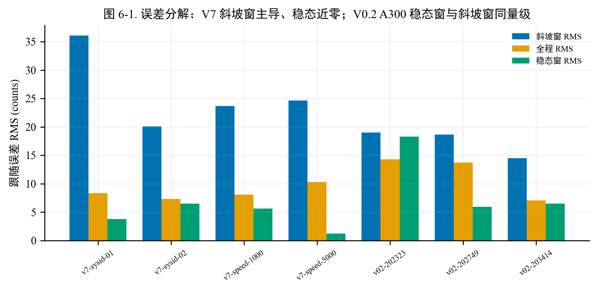
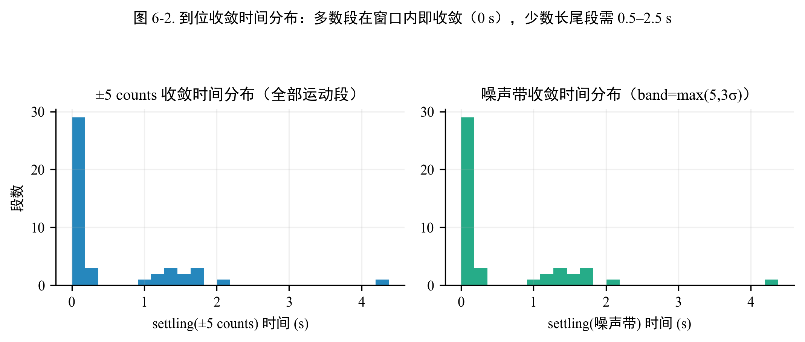
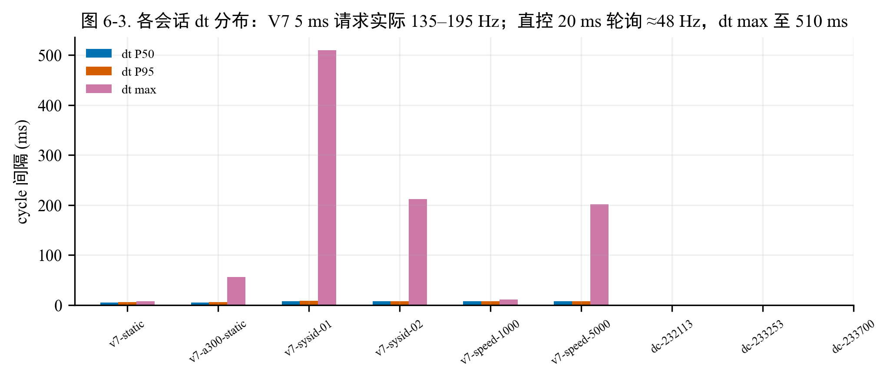
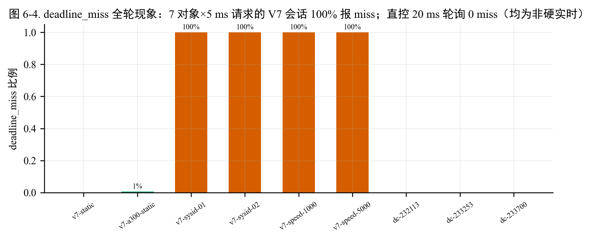

# 06 误差分解与时间质量报告：RMS 分解、收敛分布与非硬实时证据

- 数据：joint 输出（`METRICS_BY_SEGMENT.csv`/`SESSION_INVENTORY.csv`）+ 原始 samples（V7 4 会话、V0.2 3 会话）+ 各会话 manifest
- 派生数据：`data/ERROR_DECOMPOSITION.csv`、`data/TIME_QUALITY.csv`；脚本：`analysis/03_comparative_metrics.py`（D/E 节）

## 数据口径（固定声明）

> - **raw counts 为权威量**；`1 count≈0.5 μm` 仅为工程换算，未完成外部长度基准标定，本报告不换算成正式精度。
> - **SDO 顺序读取非硬实时**：直控 20 ms 轮询实际 ≈48 Hz；V7 5 ms 请求实际 135–195 Hz。
> - `error − (demand − actual)` 约 ±9 counts 为**顺序读取伪差**（引用 D1–D3 审计）。
> - 0x603F 全程为 0；直控仅 PPM 相对位置。
> - 内部交叉验证非独立泛化；观测关联非因果。

---

## 6.1 误差分解：斜坡窗 / 全程 / 稳态窗 RMS

窗口定义（与 joint 口径一致）：斜坡窗=[运动起点, 需求到达目标]，稳态窗=[到位+0.5 s, 到位+1.5 s]，全程=[运动起点, 下一段起点]。

| 会话 | 段数* | 斜坡窗 RMS 均值 | 全程 RMS 均值 | 稳态窗 RMS 均值 |
|---|---|---|---|---|
| v7-sysid-01（A150 多级行程） | 6 | 36.1 | 8.3 | 3.8 |
| v7-sysid-02 | 6 | 20.1 | 7.3 | 6.5 |
| v7-speed-1000 | 5 | 23.7 | 8.1 | 5.7 |
| v7-speed-5000 | 5 | 24.7 | 10.3 | 1.2 |
| v02-202323（5000c/50RPM/A300） | 2 | 19.0 | 14.3 | 18.3 |
| v02-202749（A150） | 6 | 18.6 | 13.7 | 6.0 |
| v02-203414（A150） | 2 | 14.5 | 7.1 | 6.5 |

* 段数来自本报告脚本的 `movement_segments` 重检测（v02-202749 含截断段），与 joint 口径略有出入；数值均出自 `data/ERROR_DECOMPOSITION.csv`。

（逐段值见 `data/ERROR_DECOMPOSITION.csv`。）

**图 6-1.** 三窗 RMS 分组柱：V7 稳态窗 1.2–6.5 counts（到位即稳），V0.2 A300 会话稳态窗 18.3 counts（到位后持续高误差）。

**解读一句话**：V7 A150 语料中动态误差集中在斜坡窗（20–36 counts）、到位后迅速归零（稳态 1.2–6.5 counts）；**v02-202323（A300）稳态窗（18.3 counts）与斜坡窗（19.0 counts）同量级**——两种误差形态对应不同的建模对象（斜坡跟随 vs 到位收敛），与 `04` 报告参数效应一致。

---

## 6.2 收敛时间分布

**图 6-2.** 左：±5 counts 收敛时间（joint `settling_time_5_counts_s`）；右：噪声带（max(5, 3σ)=5 counts）收敛时间。

**解读一句话**：约半数段在到位瞬间已满足 ±5 counts（0 s），长尾（0.5–2.5 s）来自 v02-201224/202323 等 A300 高稳态误差段——**收敛分布的两峰形态再次把 A300 与 A150 分开**。

---

## 6.3 dt 分布与 deadline_miss 全轮现象（非硬实时证据）

| 会话 | 请求周期 | 实际频率 | dt P50 | dt P95 | dt max | deadline_miss | 占比 |
|---|---|---|---|---|---|---|---|
| v7-static | 5 ms | 195.6 Hz | 5.24 ms | 6.01 ms | 7.34 ms | 4 / 2934 | 0.1% |
| v7-a300-static | 5 ms | 194.2 Hz | 5.29 ms | 6.11 ms | 56.4 ms | 80 / 11549 | 0.7% |
| v7-sysid-01（7 对象） | 5 ms | 134.3 Hz | 7.32 ms | 8.32 ms | **509.9 ms** | **40294 / 40294** | **100%** |
| v7-sysid-02 | 5 ms | 135.9 Hz | 7.26 ms | 8.08 ms | 211.9 ms | 24464 / 24464 | 100% |
| v7-speed-1000 | 5 ms | 134.9 Hz | 7.34 ms | 8.00 ms | 11.3 ms | 10120 / 10120 | 100% |
| v7-speed-5000 | 5 ms | 135.7 Hz | 7.29 ms | 7.92 ms | 201.2 ms | 12213 / 12213 | 100% |
| dc-233700（直控） | 20 ms | 48.2 Hz | 20.48 ms | 21.30 ms | 58.6 ms | 0 / 316 | 0% |
| V0.2 7 对象×100 Hz（201548） | 10 ms | 98.6 Hz | 10.13 ms | 10.52 ms | 10.8 ms | 262 / 987 | 26.5% |
| V0.2 7 对象×100 Hz（201745） | 10 ms | 101.6 Hz | 9.85 ms | 10.13 ms | 10.9 ms | 1017 / 1017 | 100% |

**图 6-3.** dt P50/P95/max 分组柱（对数观感：V7 请求 5 ms 实际 7.3 ms；直控 20 ms 请求达标；dt max 离群 11–510 ms）。

**解读一句话**：deadline_miss 是**相对请求周期的账本量**——7 对象×5 ms 请求的会话 100% 报 miss（物理上不可达），2 对象×5 ms 与 20 ms 请求的会话几乎 0 miss；无论哪一端，dt max 都存在 56–510 ms 的离群抖动。

**图 6-4.** deadline_miss 占比：红色柱为 100% 会话（v7-sysid-01/02、speed-1000/5000 与 V0.2 201745）。

**解读一句话**：该现象的含义是——**任何"周期达标"结论都必须带请求周期前缀**，且 dt max（58–510 ms）说明主机调度存在 Windows/USB 级暂停，动态观测的时间戳不确定度远超标称周期。

---

## 6.4 对建模与实验协议的含义

1. **非硬实时确认**：时间戳为主机 cycle-start（`time_semantics.hard_realtime=false`），dt max 至 510 ms；速度/电流等动态量仅在斜坡窗内可用（静止窗对象值无信息量）。
2. **采样率分级**：V0.2 200 Hz（三核心对象）、V7 135–196 Hz（3–7 对象）、直控 48 Hz（7 对象）——**对象数决定可达频率**，未来主站设计（PDO 多对象）应将此作为约束。
3. **误差分解的建模选择**：动态误差（斜坡窗）与稳态误差（稳态窗）应分别建模；V7 A150 语料稳态误差 ~1–5 counts 已近静止噪声水平（v7-static robust σ=0，band=5 counts），无需额外稳态模型；V0.2 A300 语料稳态误差 18.3 counts（均值；正向 27.85）则需要到位收敛模型（`02` 报告包络）。
4. 4.4 节以外的直控 20 ms 轮询中，632 counts 峰值仅 1–2 个采样点覆盖——**动态峰值只能作存在性证据，不能作时间分辨率证据**。

---

## 6.5 结论分级

- **已确认**：deadline_miss 全轮现象（7 对象×5 ms → 100% miss）；dt max 58–510 ms 的调度抖动；斜坡/稳态窗 RMS 分解的结构性差异。
- **初步观察**：V7 A150 稳态误差已近静止噪声水平；V0.2 A300 稳态误差为独立建模对象。
- **待验证**：dt 离群（509.9 ms）与 Windows 调度/USB 暂停的归因（非阻塞项）；若论文需要时间戳可信的动态测量，需设备侧时间戳或 PDO 同步（STM32 分支，非当前执行线）。
