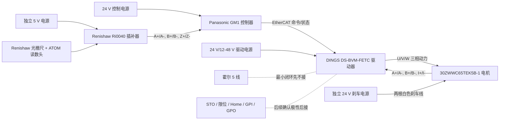

# Z 轴闭环控制系统接线项目手册

> 更新时间：2026-06-01  
> 资料定位：这是 GM1 + EtherCAT + DS-BVM 候选路线的长手册，不是当前现场已放行接线方案。  
> 目标读者：完全零基础，但愿意按工程步骤一项一项核对、贴线号、量电压、做记录的人。  
> 项目边界：候选路线只服务 Z 轴单轴低速、小行程闭环验证研判，不复现整机所有机械结构；任何未闭环接法都不靠猜。

## 项目启动：先选定一个真实场景

我选择的具体项目场景是：**利用现有 Z 轴运动平台，完成一套单轴低速、小行程闭环控制验证系统**。  
这不是讲一个通用伺服课件，也不是重新设计整台设备。我们手里已经有真实器件：Panasonic GM1 控制器、DINGS DS-BVM-FETC 驱动器、带刹车空心杯电机、Renishaw 光栅尺/Ri 插补链路、绿色 DB15 转接板、24 V/5 V 电源和若干线束。我们的任务是把这些器件安全地接起来，让它们能形成一条真正可验证的闭环链路。

你现在不是在“学习接线理论”，而是在接一套真实的 Z 轴闭环运动系统：一台 Panasonic GM1 控制器作为主站，一台 DINGS DS-BVM-FETC 驱动器负责驱动带刹车空心杯电机，运动平台上已有 Renishaw 光栅尺负责测量真实位置。最终目标是：控制器发运动命令，驱动器带动电机转，平台移动，光栅尺把平台真实位置反馈回来，系统能低速、小行程、安全地闭环运行。

先把这个场景拆成四句话：

| 角色 | 本项目里的器件 | 它负责什么 | 新人最容易搞错的点 |
|---|---|---|---|
| 主站/控制器 | Panasonic GM1 EtherCAT 控制器 | 发运动命令、读光栅尺高速计数、做外层到位判断 | 以为 GM1 直接驱动电机 U/V/W |
| 从站/驱动器 | DINGS DS-BVM-FETC | 接收 EtherCAT 命令、读电机编码器、输出 U/V/W | 把光栅尺接到驱动器当电机反馈 |
| 电机执行器 | 30ZWWC65TEK5B-1 带刹车电机 | 通过 U/V/W 输出转矩，带动 Z 轴机构 | 忘记刹车和 Z 轴重力风险 |
| 平台实际反馈 | Renishaw 光栅尺 + Ri0040 | 测平台真实位移，反馈给 GM1 | 把光栅尺 A/B/Z 和编码器 A/B/I 混成一组线 |

这四句话决定了后面每一根线的去向：**GM1 管命令和平台位置，DS-BVM 管电机出力和电机反馈，刹车独立保命，光栅尺不参与电机换相。**

师傅会先拦你一下：“别急着拿螺丝刀。先问自己一个问题：这根线在闭环链路里承担什么角色？”  
因为接线不是把颜色接到颜色，接线是把“能量、命令、反馈、安全”这几类东西各走各的通道。混在一起，轻则读不到数，重则烧驱动器、掉 Z 轴、损坏编码器。

> ⚠️ 安全底线  
> 在没有完成通断、电压、绝缘、刹车释放逻辑确认前，不允许 Servo On，不允许释放 Z 轴刹车，不允许让电机带负载运动。所有“暂不接”的线头都要贴线号并绝缘固定，不能悬空裸露。

## 第一步：解读控制系统方框图

项目方框图先这样看：



你可能会问：“为什么光栅尺反馈进 GM1，电机编码器却进驱动器？它们不都是位置反馈吗？”  
这正是闭环系统最容易混乱的地方。电机编码器告诉驱动器“电机轴现在转到哪里了”，驱动器靠它完成电流、速度、换相和局部位置控制；光栅尺告诉控制器“平台真实移动到哪里了”，它反映的是丝杆、联轴器、机械间隙之后的实际位置。一个看电机，一个看平台，不能混接。

先把每一类线分清：

| 信号类别 | 本项目里的线 | 为什么要接 | 接错会怎样 | 当前策略 |
|---|---|---|---|---|
| 控制器电源 | 24 V、0 V、FG 到 GM1 | 让 GM1 上电运行，给逻辑和通信供电 | 极性反会损坏控制器；FG 乱接会引入干扰 | 按 Panasonic GM1 手册接，先量 24 V 极性 |
| 光栅尺电源 | 独立 5 V 到 Ri0040 `7/8`，0 V 到 `2/9` | 给 Renishaw Ri 插补器供电 | 把 GM1 输入端当 5 V 电源会导致 Ri 不工作，甚至损坏输入 | 现场先量绿板和 Ri 5 V，确认后接 |
| 光栅尺 A/B/Z | Ri DB15 经绿板到 GM1 高速计数 CH0 | 把平台真实位置送给控制器 | A/B 反会方向错；差分对拆开会干扰大；接错端子读不到数 | 先测绿板 1-15 直通，再接 A/B/Z |
| EtherCAT | GM1 EtherCAT 到 DS-BVM M11 Input | 控制器向驱动器发命令，读取驱动状态 | TX/RX 错、线对拆错会扫不到从站 | 优先用成品屏蔽线，不自制 |
| 驱动器主电源 | 24 V 或手册允许范围内 DC 电源到 DS-BVM | 给功率级和控制级供电 | 极性或电压错会烧驱动器 | 首次限流上电，只看状态 |
| 电机三相动力 | DS-BVM J101 `U/V/W` 到电机棕/黄/绿 | 驱动器把电能送进电机绕组形成转矩 | 相序错会抖动、反转、报警；短路会烧功率级 | 图纸已支持 U=棕、V=黄、W=绿，但接前量三相电阻和对壳绝缘 |
| 电机编码器 | J201 pin 1-8 到电机编码器 8 线 | 驱动器知道电机轴位置，完成反馈 | 5 V/GND 反接会烧编码器；A/B/I 接错会反馈异常 | 最小闭环必接，先手转看计数 |
| 电机霍尔 | 红/黑/灰/白/蓝五线 | 可用于初始电角度或换相辅助 | 当前电机是单端霍尔，DS-BVM 数字霍尔口是差分命名，猜接 `HALL-` 有风险 | 2024-03-13 聊天记录支持有编码器可先不用霍尔；全部贴标绝缘 |
| 刹车 | 电机两根白线，24 V 刹车 | 防止 Z 轴掉落，通电释放或按厂家定义动作 | 未支撑 Z 轴就释放会掉轴；电流过大会烧线圈 | 独立 24 V 限流短时测试，不接 GPO 直驱 |
| J13 安全/数字 I/O | STO、限位、Home、GPI、GPO | 安全使能、限位保护、后续自动刹车控制 | STO 乱短接会绕过安全；GPI_COMMON 极性错会输入无效；GPO 直驱刹车会过流 | 最小闭环先不接，等 Servo Studio 状态和限流测试 |
| 屏蔽/接地 | FG、机壳地、屏蔽层 | 给干扰提供回路，保护信号完整性 | 屏蔽当地线用会引入地环路；两端随便接会噪声大 | 屏蔽层优先单端接 FG/机壳，不当信号 0 V |

这里先建立一个工程判断：**本项目的最小闭环不是“所有线都接上”，而是“只接必要且已证明的线，剩余线贴标绝缘”。**  
新人最常犯的错，是觉得“端子上有孔就要接满”。实际上，第一次低风险调试时，越是没闭环的线，越不能接。霍尔、J13、GPO 刹车控制这些线都先后置。

> 📎 DS-BVM-FETC/FCAO 驱动器官方手册下载页：[DINGS 手册下载页](https://www.dingsmotion.cn/manual/109-3.html)  
> 请重点看 `DS-BVM-FETC/FCAO Hardware Manual` 的 J201、J13、J101 端子页；J201 只证明端子名，不证明单端霍尔能直接接入差分霍尔口。

> 📎 DS-BVS/BVM 参数与对象字典官方资料：[DINGS 手册下载页](https://www.dingsmotion.cn/manual/109-3.html)  
> 请重点看 `DS-BVS/BVM Series Reference Manual` 里的 `0x4610 Brake Parameters`、`0x60FD Digital Inputs`、`0x60FE Digital Outputs`；它解释软件对象，但不替代外部刹车驱动电路。

> 📎 Servo Studio 官方软件手册：[DINGS 手册下载页](https://www.dingsmotion.cn/manual/109-3.html)  
> 请重点看 `Feedback Setting`、`Brake Setting`、`I/O` 页面。它支持选择纯增量编码器反馈路线，但没有给 `HALL U-/V-/W-` 的逐针接线图。

> 📎 Panasonic GM1 控制器官方资料入口：[Panasonic GM1 Motion Controller](https://industry.panasonic.com/ap/en/products/fasys/plc/mc/gm1)  
> 请重点看 `Manual` 下载区里的 `GM1 Series Reference Manual (Hardware)` 和 EtherCAT 控制器资料；我们要核对的是电源、FG、高速计数输入和 EtherCAT 主站接口，不要和普通相机 GM1 资料混淆。

> 📎 Renishaw ATOM/Ri 官方资料入口：[Renishaw ATOM downloads](https://www.renishaw.com/en/atom-downloads--37855)  
> 请重点找 ATOM/Ri digital interface 的 DB15 pin 定义，看 `A+/A-`、`B+/B-`、`Z+/Z-`、`+5V/0V` 和 `Do not connect`。注意 `Do not connect` 不能因为端子空着就拿去当地线。

### 本项目第一轮接线依据快照

接线前，先把证据来源摆出来。新人会觉得“师傅怎么一会儿看官网，一会儿看 PDF，一会儿又拿万用表量？”原因很简单：**官网和手册证明设备端口能力，现场实测证明你手里这根线真的接到那个端子。两者缺一不可。**

| 证据来源 | 当前能证明什么 | 仍不能证明什么 |
|---|---|---|
| DINGS DS-BVM-FETC/FCAO Hardware Manual，官网手册页在线核对 | DS-BVM 有 J201 Digital Encoder、J13 Digital I/O、EtherCAT Input/Output，GPO 最大电流量级为 50 mA | 电机本体线色、单端 Hall 怎么接差分 Hall、J13 STO 的现场安全回路该怎么做 |
| DINGS DS-BVS/BVM Series Reference Manual，官网手册页在线核对 | EtherCAT/CoE 对象、`0x6040`、`0x6064`、`0x4610`、`0x60FD/0x60FE` 等对象用途 | 外部刹车线圈能不能直接由驱动器供电，不能替代硬件接线图 |
| DINGS Servo Studio Manual，官网软件/手册页在线核对 | USB 连接、Feedback Setting、Brake Setting、Digital I/O 页面操作路径 | 不证明未确认的 Hall 逐线接法，也不证明 GPO 可以直带刹车 |
| Panasonic GM1 Hardware Manual，本地归档并与官网入口核对 | GM1 电源线棕/蓝/绿，高速计数 A/B/Z 支持 5 V line driver 输入，A/B/Z 应用屏蔽双绞线，EtherCAT 要 Cat5e 以上屏蔽双绞线 | 不提供 Renishaw 绿色 DB15 转接板的现场端子直通关系 |
| Renishaw ATOM/Ri 官方下载页，本地归档 ATOM data sheet | 光栅尺/Ri 是独立测量链路，A/B/Z、5 V、0 V、屏蔽要按 Renishaw 资料核对 | 不能代替现场绿色转接板 `1-15` 通断测试 |
| 电机 CAD/参数表和聊天记录照片 | 当前可用电机参数、U/V/W 线色、编码器线色、刹车 24 V 信息 | 极对数、Hall 差分接法、刹车实测电流仍需补证据 |

所以本手册后面每次说“接到哪个端子”，都要同时满足三类证据：

1. 官方手册证明设备端口定义；
2. 项目资料证明电机或线束的线色/功能；
3. 万用表或低压限流测试证明现场这根线没接错、没短路、没误通。

现在我们把第一步变成现场动作。你站在实验台前，先不要上电，只做识别和贴标：

1. 找出 GM1 控制器，贴大标签：`控制器/主站/读光栅尺/发 EtherCAT 命令`。
2. 找出 DS-BVM-FETC，贴大标签：`驱动器/从站/驱动电机/读电机编码器`。
3. 找出 Renishaw 读数头、Ri0040 和绿色 DB15 板，贴大标签：`平台位置反馈/进 GM1 高速计数`。
4. 找出电机三相粗线，贴 `MOT-U/MOT-V/MOT-W`，但暂不接。
5. 找出电机编码器 8 根细线，贴 `ENC-5V/ENC-GND/ENC-A+/ENC-A-/ENC-B+/ENC-B-/ENC-I+/ENC-I-`。
6. 找出霍尔 5 根线，贴 `HALL-5V/HALL-GND/HALL-U+/HALL-V+/HALL-W+`，然后线头绝缘固定。
7. 找出两根白色刹车线，贴 `BRK-1/BRK-2`，写上“未测电阻前不接 24 V”。
8. 找出 J13 线束，贴 `STO/GPI/GPO/Limit/Home`，写上“未确认公共端极性前不接”。

师傅这时会让你复述一遍：“这套系统里，谁给命令？谁出力？谁看电机？谁看平台？”  
正确答案是：GM1 给命令，DS-BVM 出力，电机编码器看电机，光栅尺看平台。你能说清这句话，后面逐根接线就不会乱。

下一步我们进入“看懂端子和列物料清单”：把每类线需要的线材、端子、线号、万用表验证项目列出来，然后从最安全的断电通断测试开始。

现在进入第二步。我们不急着接线，先把桌面摆成一个能工作的工程现场。新人常犯的第二个错，是拿到一把线就开始剥皮。这样做最大的问题不是“不专业”，而是后面每根线都没有身份，一旦出错就查不回来。

师傅会让你先准备三样东西：线材、端头、记录表。线材决定信号能不能稳定传；端头决定接触会不会松；记录表决定出了问题能不能查到是哪一根线。

## 看懂端子和列物料清单

先列物料，不是为了买齐所有高级工具，而是为了让每一根线都有合适的载体。

| 类别 | 本项目要准备什么 | 用在哪里 | 为什么需要 | 用错会怎样 |
|---|---|---|---|---|
| 24 V DC 电源 | 一路稳定 24 V 控制电源，电流按 GM1、DS-BVM、传感器余量选 | GM1、DS-BVM 首次低压调试、J13 输入测试 | 控制器和驱动器都需要稳定直流供电 | 电压不稳会通讯掉线、驱动报警；极性反接可能烧设备 |
| 独立 5 V 电源 | 一路稳定 5 V，建议可限流或串小保险 | Renishaw Ri0040；必要时独立测霍尔 | Ri 和编码器/霍尔这类反馈器件通常怕过压 | 把 24 V 接到 5 V 器件会直接损坏；把 GM1 输入端当电源会读不到光栅 |
| 屏蔽双绞细线 | 至少 3 对双绞屏蔽线，AWG24/AWG26 左右 | Ri A/B/Z 到 GM1；编码器 A/B/I | 差分信号要一对一对走，抗干扰靠成对绞合和屏蔽 | A+ 和 A- 分开走会引入噪声，计数跳变、丢脉冲 |
| 屏蔽网线 | Cat5e/Cat6 屏蔽成品线 | GM1 到 DS-BVM EtherCAT | EtherCAT 是高速通信，成品线最稳 | 自制线序错会扫不到从站；线对拆错会偶发掉站 |
| 三相动力线 | 三芯或四芯柔性屏蔽线，线径按电流选，初步可按 AWG20-AWG22 级别准备 | DS-BVM J101 到电机 U/V/W/FG | 电机电流比信号线大，动力线要承受电流和运动弯折 | 线太细会发热压降；屏蔽和 FG 不处理会干扰编码器 |
| 多芯反馈线 | 多芯屏蔽细线，最好内部有成对线对 | DS-BVM J201 到电机编码器 | 编码器 5 V、GND、A/B/I 都集中在反馈线束里 | 线束松散会造成反馈噪声，驱动器可能报编码器错误 |
| 两芯刹车线 | 两芯线，线径按刹车实测电流选 | 独立 24 V 到两根白色刹车线 | 刹车线圈是负载，不是信号线 | 线太细会发热；没串保险时短路风险高 |
| 管型冷压端头 | 小号用于信号线，大号用于电源/动力线 | 所有螺丝端子 | 让细铜丝形成可靠接触面 | 裸铜丝直接压容易散股、短路、松脱 |
| 线号管/标签纸 | 打印 `RI-A+`、`ENC-A+`、`MOT-U` 等线号 | 每根线两端 | 后续排错靠线号，不靠记忆 | 只按颜色接，后面看到同色线会完全分不清 |
| 热缩管/绝缘帽 | 给暂不接、待确认、禁止接线头绝缘 | 霍尔、J13、Ri NC、报警线 | 未接线也可能碰到金属壳或别的端子 | 悬空裸线碰到 24 V 或 5 V 会烧器件 |
| 万用表 | 通断、直流电压、电阻档都要正常 | 所有断电和低压检查 | 每一根线接前都要被证据放行 | 不量就接，等于靠猜 |
| 限流电源或串联电阻 | 5 V/24 V 小电流测试 | Ri 供电、霍尔测试、J13 GPI0 极性测试 | 第一次测试要把故障电流限制住 | 直接硬上电，一旦接错就是烧件 |
| 保险/急停/开关 | 24 V 主电和刹车回路 | 断电、保护、刹车释放 | 出异常时能快速切断能量 | 没有断电手段时，Z 轴或电机异常会很危险 |
| 电脑 + Servo Studio | DINGS 驱动器调试软件 | 看驱动状态、反馈计数、I/O、刹车参数 | 驱动器内部状态靠软件确认 | 只看 LED 很难判断 STO、反馈、输入输出问题 |

你可能想问：“线径到底要多粗才算对？”  
先记一个工程规则：**信号线按抗干扰选结构，动力线按电流选线径，刹车线按线圈电流选线径，屏蔽层按干扰路径接，不按颜色接。**  
本项目里，光栅尺和编码器优先考虑双绞屏蔽；U/V/W 和刹车优先考虑电流能力；J13 输入输出是 24 V 小信号，初次只贴标。

接下来识别每个器件的端子。识别端子时只认三件事：设备丝印、官方手册 pin 表、万用表通断。颜色只能辅助，不能决定接法。

### GM1 控制器：主站和光栅尺入口

GM1 在这套系统里有两个角色：第一，它是 EtherCAT 主站，给 DS-BVM 发命令；第二，它读取 Renishaw Ri0040 输出的 A/B/Z 脉冲，知道 Z 轴平台实际移动了多少。

要先识别 GM1 的三类端子：

| GM1 上要找的东西 | 现场怎么识别 | 后续接什么 | 为什么重要 |
|---|---|---|---|
| 电源线 | GM1 电源线棕、蓝、绿 | `GM1-P24`、`GM1-0V`、`GM1-FG` | 没有稳定 24 V，控制器不工作；FG 是干扰和安全边界 |
| 高速计数 CH0 | `A2/B2`、`A4/B4`、`A6/B6` | Ri 的 A/B/Z 差分输出 | 光栅尺反馈进这里，不进普通慢速输入 |
| EtherCAT 口 | GM1 的 RJ45 EtherCAT 接口 | `ECAT-CABLE` 到 DS-BVM M11 Input | 控制器靠这条线发运动命令 |

为什么要先把 GM1 看清？因为 Ri 绿色板上有很多 DB15 pin，新人很容易把 `A2/A4/A6` 当成 5 V 电源。这里要反复强调：**GM1 的 `A2/A4/A6` 是高速计数输入，不是 5 V 电源输出。** Ri0040 的 5 V 要从独立 5 V 电源来。

线号先这样打：

| 线号 | 起点 | 终点 | 当前动作 |
|---|---|---|---|
| `GM1-P24` | 24 V 控制电源 + | GM1 棕线 | 可准备接，接前量 24 V |
| `GM1-0V` | 24 V 控制电源 0 V | GM1 蓝线 | 可准备接，接前量极性 |
| `GM1-FG` | PE/功能地 | GM1 绿线 | 可准备接，确认接地端 |
| `RI-A+` / `RI-A-` | 绿色板 `14/6` | GM1 `A2/B2` | 等绿板通断确认后接 |
| `RI-B+` / `RI-B-` | 绿色板 `13/5` | GM1 `A4/B4` | 等绿板通断确认后接 |
| `RI-Z+` / `RI-Z-` | 绿色板 `12/4` | GM1 `A6/B6` | 建议接，方便后续回零/index |

### Renishaw Ri0040 和绿色 DB15 板：平台真实位置反馈

Ri0040 是光栅尺读数链路的插补器。你可以把它理解成“把光栅读数头的微小信号整理成控制器能读的数字 A/B/Z 脉冲”。绿色 DB15 板只是转接板，不是智能模块。它最危险的地方在于：**你不能假设板上数字 1 就一定直通 DB15 pin 1，必须量。**

这一步只做断电识别：

1. 拿万用表通断档。
2. 找 DB15 插头或插座的 pin 1。
3. 测 `DB15 pin 1 -> 绿板 1`，记录是否蜂鸣。
4. 一直测到 `DB15 pin 15 -> 绿板 15`。
5. 再测 `绿板 GND -> DB15 金属外壳`。
6. 测相邻端子之间有没有误短路，比如 `7` 对 `8` 是否被你外部短接前就已经短、`2` 对 `9` 是否已短。

> ⚠️ 断电要求  
> 绿板通断测试时，Ri、GM1、5 V 电源都必须断开。通断档不是带电测量档，带电测通断可能损坏万用表，也可能误判。

如果绿板确认直通，后续才允许按下面准备：

| 线号 | 绿色板端 | 另一端 | 为什么这样接 | 当前状态 |
|---|---:|---|---|---|
| `RI-5V+` | `7/8` | 独立 5 V + | Ri0040 需要 5 V 供电，`7/8` 都是 +5 V | 条件接，先确认 5 V |
| `RI-0V` | `2/9` | 独立 5 V 0 V | 给 Ri0040 供电回路 | 条件接，先确认 0 V |
| `RI-A+` | `14` | GM1 `A2` | A 相正脉冲进 CH0 A | 条件接 |
| `RI-A-` | `6` | GM1 `B2` | A 相负端/COM | 条件接 |
| `RI-B+` | `13` | GM1 `A4` | B 相正脉冲进 CH0 B | 条件接 |
| `RI-B-` | `5` | GM1 `B4` | B 相负端/COM | 条件接 |
| `RI-Z+` | `12` | GM1 `A6` | Index/参考点正端 | 建议接 |
| `RI-Z-` | `4` | GM1 `B6` | Index/参考点负端 | 建议接 |
| `RI-NC10` | `10` | 不接 | 官方手册 Do not connect | 禁止接 |
| `RI-NC15` | `15` | 不接 | 官方手册 Do not connect | 禁止接 |

这里再讲一个“为什么”：A+/A-、B+/B-、Z+/Z- 要成对走线，是因为控制器看的是一对线之间的差值，而不是单根线对地电压。这样做能抵消外界干扰。如果你把 A+ 和 A- 分别丢进一把散线里，短距离也许能跳，长一点就会抖、丢数、方向乱。

### DS-BVM-FETC：从站、功率输出和电机反馈入口

DS-BVM 是这套系统最容易接错的器件，因为它同时有主电源、三相动力、编码器、霍尔、J13 安全 I/O、EtherCAT。新人一定要按接口分组，不要看到插头就接。

先只识别这些接口：

| DS-BVM 接口 | 作用 | 当前接线策略 | 接错后果 |
|---|---|---|---|
| J1/M5 主电源 | 给驱动器供电 | `BVM-VCC/BVM-GND/BVM-FG` 可准备接，首次 24 V 限流 | 极性错会烧驱动 |
| M11/J11 EtherCAT Input | 接 GM1 主站 | 优先成品屏蔽线 | 接到 Output 或线序错会扫不到从站 |
| J101/M4 U/V/W/FG | 输出三相动力到电机 | U/V/W 条件接，先量三相电阻 | 相序错会抖动，短路会烧功率级 |
| J201/M6 编码器 | 读电机编码器 A/B/I | 最小闭环必接 pin 1-8，FG 建议接 | 5 V/GND 错会烧编码器，A/B 错会反馈异常 |
| J201/M6 霍尔 | 可读 Hall U/V/W | 最小闭环不接，全部贴标绝缘 | `HALL-` 猜接可能损坏或误触发 |
| J13 数字 I/O | STO、限位、Home、GPI、GPO | 最小闭环先不接 | STO 乱接影响安全，GPO 直驱刹车会过流 |

> 📎 DINGS DS-BVM-FETC/FCAO 硬件手册： [DINGS 手册下载页](https://www.dingsmotion.cn/manual/109-3.html)  
> 请重点看 `J101 UVW`、`J201 Digital Encoder`、`J13 Digital I/O` 三处 pin 表。看手册时只把它当“驱动器端 pin 定义”，不要用它推导电机本体线色；电机本体线色必须看电机图纸或现场线标。

这里的线号先按接口准备：

| 接口 | 先贴哪些线号 | 暂不接哪些线号 |
|---|---|---|
| J1/M5 | `BVM-VCC`、`BVM-GND`、`BVM-FG` | 无 |
| EtherCAT | `ECAT-CABLE` | 自制线的 `ECAT-TX/RX` 只有必须自制时才贴 |
| J101/M4 | `MOT-U`、`MOT-V`、`MOT-W`、`MOT-FG` | U/V/W 未测三相电阻前不进端子 |
| J201/M6 编码器 | `ENC-5V`、`ENC-GND`、`ENC-A+/-`、`ENC-B+/-`、`ENC-I+/-`、`ENC-FG` | 无，最小闭环需要编码器 |
| J201/M6 霍尔 | `HALL-5V`、`HALL-GND`、`HALL-U+`、`HALL-V+`、`HALL-W+`、`HALL-U-`、`HALL-V-`、`HALL-W-` | 全部暂不接，线头绝缘 |
| J13 | `J13-STO`、`J13-GPIC`、`J13-GPI0`、`J13-LIM+/-`、`J13-HOME`、`J13-GPO0/1/GPOC` | 全部暂不接，除非软件报 STO 或做限流极性测试 |

### 电机线束：动力、编码器、霍尔、刹车必须分开

这台电机不是“几根线一起接驱动器”这么简单。它至少有四组线：

| 电机线组 | 线色/形态 | 去哪里 | 当前判断 |
|---|---|---|---|
| 三相动力 | 棕、黄、绿 | DS-BVM J101 `U/V/W` | CAD/实物标签支持 `U=棕、V=黄、W=绿`，接前仍要量电阻 |
| 编码器 | 黑、白、白黑、红、黄、黄黑、绿、绿黑 | DS-BVM J201 pin 1-8 | 最小闭环必接 |
| 霍尔 | 红、灰、白、蓝、黑 | 最小闭环不接 | 线色已知，但 `HALL-` 接法未闭环 |
| 刹车 | 两根白线 | 独立 24 V 刹车回路 | 先量电阻，支撑 Z 轴后短时测试 |

你可能会问：“编码器和霍尔都有红黑，会不会共用 5 V 和 GND？”  
在某些成套线束里可能会共用驱动器的 5 V 和 GND，但本项目最小闭环明确不接霍尔，所以不要顺手把霍尔红黑并到编码器红黑上。先让编码器单独跑通，霍尔线贴标绝缘。等未来要启用霍尔时，再按 DINGS 正式方案处理。

### 本阶段的现场产出

这一阶段完成后，桌面上应该有三份东西：

1. 一张物料清单：哪些线、端头、标签、工具已经准备好。
2. 一套已贴好的线号：每根线两端都有同一个线号。
3. 一张端子识别草图：GM1、绿板、DS-BVM、电机线束分别标出“可接、条件接、只贴标、禁止接”。

合格标准很简单：让一个没参与接线的人站到现场，拿着线号表，也能说出 `RI-A+` 从哪里来、到哪里去、为什么不能接到别处。

### 把方框图翻译成逐根施工网表

现在咱们把前面的方框图变成真正能施工的“网表”。网表不是为了好看，它的作用是让你拿着一根线时，能立刻回答五个问题：

```text
这根线叫什么？
它从哪个端子来？
它到哪个端子去？
为什么必须接？
接错以后先坏什么、先表现出什么故障？
```

> ⚠️ 网表不是放行单  
> 下面的表告诉你“应该怎么接”，但不代表现在马上能接。每一组线还要先通过后面的断电通断、短路、电阻、限流测试。没有通过测试的线，只能贴标，不能进端子。

#### GM1 控制器与电源

| 线号 | 起点 | 终点 | 线材/端头 | 为什么接 | 接错会怎样 | 放行条件 |
|---|---|---|---|---|---|---|
| `GM1-P24` | 24 V 控制电源 `+` | GM1 棕色电源线 | 0.5-0.75 mm2 控制线，管型端头 | 给 GM1 控制器供电 | 反接或过压可能损坏控制器 | 电源空载和端子处都量到正常 24 V |
| `GM1-0V` | 24 V 控制电源 `0V` | GM1 蓝色电源线 | 与 `GM1-P24` 同规格 | 形成 GM1 供电回路 | 悬空会不上电；接到 PE 会造成回路混乱 | 与 `GM1-P24` 极性确认 |
| `GM1-FG` | 控制柜 PE/FG 排 | GM1 绿色功能地线 | 黄绿线或原电源线，压接可靠 | 给控制器外壳/功能地参考，泄放干扰 | 不接会增加高速计数和通信干扰 | 与柜内接地排连续 |

你可能想问：“0V 和 FG 都像地，能不能接一起？”  
先不要在现场随手短。`0V` 是电源回流，`FG` 是功能地/屏蔽泄放路径。它们在系统电源或设备内部可能有设计好的连接点，现场乱并会引入噪声或地环流。第一次调试按手册和柜内接地方案处理，不把信号 0 V 当屏蔽排使用。

#### Renishaw Ri / 绿色 DB15 板到 GM1 高速计数

| 线号 | 起点 | 终点 | 线材/端头 | 为什么接 | 接错会怎样 | 放行条件 |
|---|---|---|---|---|---|---|
| `RI-5V+` | 独立 5 V 电源 `+` | 绿色板 `7/8` | 细控制线，可与 Ri 信号同束；端头压接 | 给 Ri0040/读数链路供电 | 接 24 V 会烧 Ri；极性错可能损坏读头 | `G2` 证明 `7/8` 对 `2/9` 无短路，限流 5 V 正常 |
| `RI-0V` | 独立 5 V 电源 `0V` | 绿色板 `2/9` | 与 `RI-5V+` 同束 | 形成 Ri 5 V 供电回路 | 悬空读不到信号；错接屏蔽会噪声大 | 与 `RI-5V+` 极性确认 |
| `RI-A+` | 绿色板 `14` | GM1 CH0 `A2` | 屏蔽双绞线一对中的一根 | A 相正端，平台位移主计数 | 接错通道会无计数或方向乱 | `G1` 证明绿板直通，无相邻短路 |
| `RI-A-` | 绿色板 `6` | GM1 CH0 `B2` | 与 `RI-A+` 同一双绞对 | A 相负端/差分返回 | 不成对会抗干扰差，静止跳数 | 与 `RI-A+` 成对压接 |
| `RI-B+` | 绿色板 `13` | GM1 CH0 `A4` | 第二对屏蔽双绞线 | B 相正端，用于方向判断 | A/B 互换会方向或计数模式异常 | `G1` 通过后接 |
| `RI-B-` | 绿色板 `5` | GM1 CH0 `B4` | 与 `RI-B+` 同一双绞对 | B 相负端/差分返回 | 悬空会偶发计数 | 与 `RI-B+` 成对压接 |
| `RI-Z+` | 绿色板 `12` | GM1 CH0 `A6` | 第三对屏蔽双绞线 | Index/参考点正端 | 接错会回零/index 失败 | 可先接，后续过零验证 |
| `RI-Z-` | 绿色板 `4` | GM1 CH0 `B6` | 与 `RI-Z+` 同一双绞对 | Index/参考点负端 | Z 相误触发或无触发 | 与 `RI-Z+` 成对压接 |
| `RI-SHIELD` | Ri 线缆屏蔽/DB15 外壳 | 控制柜 FG 或 GM1 侧约定 FG 点 | 屏蔽层压接，另一端按接地方案处理 | 泄放光栅尺信号干扰 | 当成 0 V 会形成地环流 | `G1` 记录外壳/GND 通断后决定 |

这里的关键不是背端子号，而是理解：`A+` 和 `A-` 是一对，`B+` 和 `B-` 是一对，`Z+` 和 `Z-` 是一对。差分信号拆对走线，就像两个人对讲却被分到两个嘈杂房间，控制器听到的就不再是干净的差值。

#### GM1 到 DS-BVM 的 EtherCAT

| 线号 | 起点 | 终点 | 线材/端头 | 为什么接 | 接错会怎样 | 放行条件 |
|---|---|---|---|---|---|---|
| `ECAT-GM1-BVM` | GM1 EtherCAT 口 | DS-BVM `M11/J11 Input` | 成品屏蔽 Cat5e/Cat6 或确认线序的专用线 | GM1 通过它给驱动器发命令、读状态 | 接到 Output 或线序错会扫不到从站 | GM1 和 DS-BVM 单独上电正常后接 |

第一次只接一台从站：GM1 到 DS-BVM Input。不要把 Output、交换机、其它从站一起接进来。通信链路越短，越容易判断问题在电源、线缆、接口方向还是 ESI 配置。

#### DS-BVM 电源、编码器和电机动力

| 线号 | 起点 | 终点 | 线材/端头 | 为什么接 | 接错会怎样 | 放行条件 |
|---|---|---|---|---|---|---|
| `BVM-VCC` | 驱动电源 `+` | DS-BVM J1 pin 1 `VCC` | 按驱动电流选线，管型端头 | 给 DS-BVM 控制/功率级供电 | 反接、过压会损坏驱动器 | 断电确认 J1 极性，首次限流上电 |
| `BVM-GND` | 驱动电源 `0V` | DS-BVM J1 pin 2 `GND` | 与 `BVM-VCC` 同规格 | 形成驱动器电源回路 | 悬空不上电，接错会异常 | 与 `BVM-VCC` 极性确认 |
| `BVM-FG` | 控制柜 PE/FG 排 | DS-BVM J1 pin 3 `FG` | 黄绿线或电源束内 FG | 给驱动器和屏蔽提供泄放路径 | 不接会增加编码器/EtherCAT 干扰 | 与 PE/FG 连续 |
| `ENC-5V` | DS-BVM J201 pin 1 `5V` | 电机编码器红线 | 多芯屏蔽反馈线 | 给电机编码器供电 | 接错最容易烧编码器 | 红黑无短路，插前量 J201 5 V |
| `ENC-GND` | DS-BVM J201 pin 2 `GND` | 电机编码器黑线 | 与 `ENC-5V` 同束 | 编码器供电 0 V | 悬空无反馈；接屏蔽会噪声大 | 与 `ENC-5V` 极性确认 |
| `ENC-A+` | DS-BVM J201 pin 3 `A+` | 电机编码器白线 | 屏蔽双绞对 | 电机编码器 A 相正端 | 反馈不连续、方向异常 | 手转计数验证 |
| `ENC-A-` | DS-BVM J201 pin 4 `A-` | 电机编码器白/黑 | 与 `ENC-A+` 同一对 | A 相负端 | A 相丢失或抗干扰差 | 与 A+ 成对 |
| `ENC-B+` | DS-BVM J201 pin 5 `B+` | 电机编码器黄线 | 第二对双绞线 | 电机编码器 B 相正端 | 方向判断错、报警 | 手转计数验证 |
| `ENC-B-` | DS-BVM J201 pin 6 `B-` | 电机编码器黄/黑 | 与 `ENC-B+` 同一对 | B 相负端 | B 相丢失或噪声大 | 与 B+ 成对 |
| `ENC-I+` | DS-BVM J201 pin 7 `I+` | 电机编码器绿线 | 第三对双绞线 | Index 正端 | 回零/index 失败，不影响 A/B 基本计数 | 若选 with Index 则必须验证 |
| `ENC-I-` | DS-BVM J201 pin 8 `I-` | 电机编码器绿/黑 | 与 `ENC-I+` 同一对 | Index 负端 | Index 误触发或无触发 | 与 I+ 成对 |
| `ENC-FG` | 编码器屏蔽层 | DS-BVM J201 pin 15 `FG` | 屏蔽层压接 | 保护 A/B/I 差分反馈 | 接到 GND 会把干扰带进 5 V 回路 | 信号线对屏蔽无短路 |
| `MOT-U` | DS-BVM J101 pin 1 `U` | 电机棕线 | 三芯/四芯屏蔽动力线，按电流选线径 | 输出 U 相电流 | 相序错会抖动、报警、反向冲动 | `G3` 三相电阻和绝缘通过 |
| `MOT-V` | DS-BVM J101 pin 2 `V` | 电机黄线 | 与 U 同规格 | 输出 V 相电流 | 接错会换相异常 | `G3` 通过 |
| `MOT-W` | DS-BVM J101 pin 3 `W` | 电机绿线 | 与 U 同规格 | 输出 W 相电流 | 短路会烧功率级 | `G3` 通过 |
| `MOT-FG` | 电机外壳/动力线屏蔽 | DS-BVM J101 pin 4 `FG` 或柜内 PE | 动力线屏蔽/黄绿线 | 泄放动力线共模干扰 | 不接会干扰编码器；乱接 0 V 会制造噪声 | 对壳绝缘和接地路径确认 |

你可能想问：“编码器和 U/V/W 都接驱动器，能不能捆在一起走线？”  
不要长距离平行捆扎。U/V/W 是开关功率线，编码器是 5 V 小信号。它们必须分开布线，必须交叉时尽量 90 度交叉。否则你会遇到一种很难查的故障：电机不动时编码器正常，一使能或一加速，反馈开始跳。

#### 刹车、霍尔、J13：第一轮先把边界写清楚

| 线号 | 起点 | 终点 | 线材/端头 | 为什么接或为什么不接 | 接错会怎样 | 当前处理 |
|---|---|---|---|---|---|---|
| `BRK+` | 独立 24 V 刹车电源 `+` | 电机白线 1，建议串保险/开关 | 两芯线，按 `24/R_brake` 电流选线径 | 给刹车线圈释放电源 | 没支撑释放会掉轴；接 U/V/W 会烧 | `G7a` 测电阻后，支撑 Z 轴再短时测试 |
| `BRK-` | 独立 24 V 刹车电源 `0V` | 电机白线 2 | 与 `BRK+` 同规格 | 形成刹车线圈回路 | 悬空不释放；接错公共端会异常 | 与 `BRK+` 成对，暂不接 GPO |
| `HALL-5V/GND/U/V/W` | 电机霍尔 5 线 | 暂不接 DS-BVM | 贴线号、热缩绝缘 | 最小闭环先不用 Hall，避免未闭合接法引入风险 | 单端 Hall 猜接差分输入可能误触发或损坏 | 只贴标绝缘；必要时独立 5 V 体检 |
| `J13-STO` | DS-BVM J13 pin 1 | 暂不接，除非明确报 STO | J13 原厂线或细控制线 | STO 是安全链路，不能为了消报警乱短接 | 永久短接会绕过安全；极性错无效 | 等官方图/软件状态/限流测试确认 |
| `J13-GPIC` | DS-BVM J13 pin 7 `GPI_COMMON` | 暂不接 | 与 J13 输入同束 | 输入公共端，决定 PNP/NPN 接法 | 公共端极性错，输入状态全错 | 与 STO/GPI 一起确认 |
| `J13-GPO0/1/GPOC` | DS-BVM J13 GPO | 暂不接刹车线圈 | 细控制线，只接外部驱动控制端 | 后续可控制继电器/光耦/MOSFET | 直接带刹车会超过 GPO 能力 | 先画外部刹车驱动电路 |

这张网表的结论很重要：**第一轮真正接进去的，是 GM1 电源、Ri 5 V 和 A/B/Z、EtherCAT、DS-BVM 电源、编码器、U/V/W、独立刹车测试回路；Hall 和 J13 是“贴标绝缘，条件成熟后再接”。**  
一个新人能照着这张表说出每根线的理由，再进入断电测试，就已经避开了大多数“看颜色接线”的坑。

### 现场开工前：先把安全布置做好

现在你已经知道每根线大概要去哪里了，但还不能动手接。真正的工程现场，第一件事不是剥线，而是把“出事时怎么停住”安排好。尤其这是 Z 轴系统，Z 轴有重力，刹车一释放，平台可能往下滑。桌面小电机可以让人觉得“动一下没事”，Z 轴不行。

师傅会先问徒弟：“如果你点错了 Servo On，谁能在 1 秒内让它停下来？”  
如果答不上来，今天就不准上电。

> ⚠️ Z 轴项目的安全底线  
> 没有机械支撑、没有可触及的断电/急停手段、没有人员分工、没有行程边界，就不允许释放刹车，不允许 Servo On，不允许执行自动运动。软件里的 Stop 按钮不能替代现场断电手段。

先把现场分成四个区域：

| 区域 | 放什么 | 为什么这样分 | 新人容易犯的错 |
|---|---|---|---|
| 电源区 | 24 V 控制电源、5 V Ri 电源、刹车 24 V、电源开关/保险 | 能量来源集中，方便一眼看出哪一路上电 | 几路 24 V 混在一起，刹车和控制器共用不清 |
| 控制区 | GM1、电脑、EtherCAT 线、Servo Studio | 操作员看状态和发命令 | 操作电脑的人同时伸手到机构里 |
| 驱动区 | DS-BVM、J101、J201、J13、动力线端子 | 功率输出和反馈集中，便于排查 | 编码器线和 U/V/W 绑在一起 |
| 机械区 | Z 轴平台、电机、刹车、限位、支撑块 | 有运动和夹伤风险 | 觉得低速就可以把手放在滑台附近 |

然后安排两个人的角色。如果现场只有一个人，也要把这两件事拆成两个步骤，不要一边点鼠标一边盯线头。

| 角色 | 站在哪里 | 只负责什么 | 不能做什么 |
|---|---|---|---|
| 软件操作员 | 电脑和控制器旁 | 看 Servo Studio/GM1 状态，执行上电、连接、点动命令 | 不把手伸进机械区，不临时改线 |
| 现场监护员 | 机械区侧面，手能碰到断电/急停 | 看 Z 轴、刹车、线缆、异响、冒烟，必要时立即断电 | 不同时操作电脑，不绕开支撑 |

如果只有你一个人，就按这个顺序做：先把要点的按钮和要看的机械现象写在纸上；站到电脑前点一下；手离开鼠标；走到侧面观察；发现异常先断电，不要再回电脑里找菜单。

#### Z 轴机械支撑先落地

刹车测试和 Servo On 前，Z 轴必须有支撑。支撑不是“手扶一下”，而是断电以后也能挡住平台下落的东西。

可接受的支撑方式：

| 支撑方式 | 怎么做 | 适用场景 | 注意点 |
|---|---|---|---|
| 机械挡块 | 在滑台下方放刚性挡块，限制下落 | 第一次刹车释放、第一次 Servo On | 挡块不能压坏光栅尺或线缆 |
| 行程限位块 | 用平台原有机械限位限制最低位置 | 小行程验证 | 机械限位只能兜底，不能当运动目标反复撞 |
| 夹具/抱箍 | 固定滑台或负载，使其不能自由下滑 | 刹车线圈独立测试 | 夹具不能夹到运动导轨和读数头 |
| 卸载负载 | 暂时拆掉重物或让平台处于低风险位置 | 首次空载调试 | 拆装后要重新确认光栅尺和线缆余量 |

不可接受的做法：

| 做法 | 为什么不行 |
|---|---|
| 人手托住平台 | 人会躲、会累、会被夹，不能作为安全措施 |
| 只相信软件限位 | 软件还没调通时，限位参数可能没生效 |
| 只相信刹车 | 今天正是在测试刹车，不能让被测试对象当唯一保护 |
| 用细扎带当支撑 | 扎带能整理线缆，不能承受 Z 轴负载 |

#### 急停、断电、Disable 分清楚

新人经常把“停”说成一个动作。现场要分清三种停法：

| 停法 | 切掉什么 | 什么时候用 | 局限 |
|---|---|---|---|
| 软件 Disable / Servo Off | 取消驱动使能 | 点动结束、参数调整、轻微异常 | 软件卡住或通信掉线时不可靠 |
| 驱动器电源断电 | 切 DS-BVM 功率和控制电源 | 抖动、异响、线缆异常、方向不受控 | Z 轴断电后要确认刹车抱住或机械支撑有效 |
| 总电源/急停 | 切现场主要能量来源 | 冒烟、夹伤风险、平台下滑、人员危险 | 断电后不能立刻伸手，先等运动停止和电容放电 |

这里有个极容易犯错的地方：**急停不等于刹车一定已经抱住。** 如果刹车回路是独立 24 V，急停切了哪一路电源、刹车是通电释放还是断电抱闸，都要在接线图里写清楚。第一轮调试先用独立刹车电源手动验证，不把 GPO 自动刹车作为唯一安全手段。

#### 行程边界：机械限位、软件限位、观察窗口各管一层

第一次闭环运动前，行程边界要有三层：

| 层级 | 谁负责 | 怎么设 | 作用 |
|---|---|---|---|
| 机械边界 | 机械限位/挡块/支撑 | 让平台即使失控也不会撞到危险位置 | 最后兜底 |
| 软件边界 | DS-BVM `0x607D`、GM1 程序限幅、点动距离 | 只允许小速度、小距离、小修正 | 防止命令太大 |
| 人员观察边界 | 现场监护员目视判断 | 平台接近危险区立即断电 | 发现软件没想到的情况 |

不要把三层边界合并成一句“我们小心一点”。工程上没有“小心一点”这个保护装置。

#### 故障后不能立刻做的事

只要出现抖动、冲击、报警、掉线、刹车异常、光栅尺乱跳，第一动作是停住。停住以后也不能马上拆线，要按这个顺序：

1. Disable 或断电，让电机不再出力。
2. 确认 Z 轴被支撑，平台不会下滑。
3. 等驱动器电容放电，确认端子无电压。
4. 拍照记录：报警码、软件页面、线缆状态、平台位置。
5. 再开始量电压、量电阻、查端子。

如果你一报警就伸手拧线，后面根本分不清是原始故障，还是你拧线时又制造了新故障。师傅带新人最看重这一点：**先保现场，再排故。**

### 真正动手前：剥线、压接、线号、屏蔽和走线

现在还没有上电，也还没有把线真正锁进端子。先讲这一小段，是因为很多新手不是输在原理上，而是输在工艺上：线号管漏打、铜丝散股、屏蔽碰芯线、双绞线拆得太长、端子压住绝缘皮、动力线和编码器线扎在一起。现场一旦出现这些问题，软件里看到的故障会很像“参数错”，其实根子在接线手法。

> ⚠️ 任何剥线和压接都在断电状态下做  
> 电源插头拔掉，电容放电等待，万用表确认端子无电压。不要一边通电一边修线，不要拿金属工具在带电端子附近试探。

#### 第一步：先打线号，再剥线

线号管要在压端头前套上去。不要等线接完了再想起来补标签，那时很多线已经进槽、进端子、进拖链，补标签很容易漏。

本项目的线号规则这样做：

| 线类型 | 线号例子 | 两端怎么打 | 备注 |
|---|---|---|---|
| 电源 | `GM1-P24`、`BVM-GND`、`RI-0V` | 两端同名 | 电源线最怕正负接反，线号必须清楚 |
| 差分对 | `RI-A+` / `RI-A-`、`ENC-B+` / `ENC-B-` | 每根芯线各打自己的线号 | 不要只给一整对线打一个总标签 |
| 动力线 | `MOT-U`、`MOT-V`、`MOT-W` | 驱动器端和电机端都打 | 后续查相序靠它 |
| 屏蔽/FG | `RI-SHIELD`、`ENC-FG`、`MOT-FG` | 屏蔽引出线也打 | 避免被误接成信号 GND |
| 暂不接线 | `HALL-U`、`J13-STO` | 线头附近打，绝缘帽外再贴一层 | 以后启用时能找回来 |

师傅会强调一句：“线号不是给今天的你看的，是给三个月后的你和下一个接手的人看的。”  
所以线号要靠近端子，但不能压进端子；要能看见，但不能影响插拔和弯曲。

#### 第二步：剥线长度按端子和端头来，不按感觉来

没有官方端子剥线长度时，按管型端头金属套长度处理：铜芯应完全进入金属套，压好后端头前端不露长铜丝，后端也不要把绝缘皮压进金属套太多。原则是：

| 情况 | 正确状态 | 错误状态 |
|---|---|---|
| 管型端头 | 铜丝填满金属套，端头压痕牢固 | 铜丝只进去一半，轻拉就掉 |
| 螺丝端子 | 金属端头被端子压住 | 端子压在绝缘皮上，看似紧其实不导电 |
| 差分细线 | 剥线短、端头小、芯线不外露 | 裸铜太长，相邻端子容易短 |
| 屏蔽引出线 | 热缩包住屏蔽毛刺，只留压接端 | 屏蔽丝散开，碰到 A/B/I 或 5 V |

不要给细多股线“上锡再压螺丝端子”。锡会随时间和压力变形，端子可能慢慢松。更稳妥的是用合适规格的管型冷压端头。

#### 第三步：压接后做拉力和目视检查

每压好一根线，不要马上塞进端子。先做三件事：

1. 目视：有没有散股、毛刺、压偏、绝缘皮被压进导电区。
2. 轻拉：用手轻轻拉线，端头不能滑出。
3. 复核：线号、线色、端子号和网表一致。

检查表可以贴在工位上：

| 检查项 | 通过标准 |
|---|---|
| 线号 | 两端同名，和网表一致 |
| 铜丝 | 无散股、无外露长铜 |
| 端头 | 压痕牢固，轻拉不脱 |
| 绝缘 | 未被端子夹住，未破皮 |
| 相邻端子 | 没有铜丝或屏蔽毛刺跨接 |
| 暂不接线 | 已热缩/绝缘帽处理，固定不晃 |

#### 第四步：差分对尽量保持绞合到端子前

`RI-A+/A-`、`RI-B+/B-`、`RI-Z+/Z-`，以及 `ENC-A+/A-`、`ENC-B+/B-`、`ENC-I+/I-` 都是差分对。差分对的抗干扰能力来自“两根线贴着一起走”。如果你在端子前拆开很长一段，它就不再像一对线，而像两根天线。

现场做法：

| 线组 | 工艺要求 |
|---|---|
| Ri A/B/Z | 每一对保持绞合到靠近 GM1 端子和绿板端子，拆开只够进端子 |
| 编码器 A/B/I | 每一对保持绞合到 J201 附近，避免和 U/V/W 平行 |
| EtherCAT | 优先成品线，不剥开重接；必须自制时保持线对结构 |
| 5 V/GND | 和信号同束但不要绕 U/V/W，避免电源回流带噪声 |

你可能想问：“拆开多长算太长？”  
不要在这里记一个死数字。看原则：拆开部分只为进端子服务，能短就短，不能为了好看把一对线拉成两条长弧线。

#### 第五步：屏蔽层只做屏蔽，不做备用地线

屏蔽层处理要慢一点。它最容易出现两种错误：第一，屏蔽丝没包好，碰到信号芯线；第二，把屏蔽层当成 0 V 或 GND 随手接。

本项目第一轮这样处理：

| 屏蔽 | 处理 |
|---|---|
| `RI-SHIELD` | 按 `G1` 外壳/GND 通断结果决定，优先在控制柜侧或 GM1 侧接 FG，另一端按现场接地方案处理 |
| `ENC-FG` | 接 DS-BVM J201 pin 15 `FG`，不并入 `ENC-GND` |
| `MOT-FG` | 接 DS-BVM J101 pin 4 `FG` 或柜内 PE/电机外壳路径，和 U/V/W 同束但不接信号地 |
| EtherCAT 屏蔽 | 使用成品屏蔽线，让屏蔽通过连接器和设备外壳处理，不剥开乱接 |

屏蔽引出线要用热缩管包住，只露出需要压接的末端。屏蔽丝不允许在端子排附近散开，尤其不能靠近 `RI-5V+`、`ENC-5V`、J201 A/B/I 这些细信号。

#### 第六步：动力线、刹车线、信号线分开走

线槽里看起来整齐，不等于电气上合理。运动控制系统要按“干扰强弱”分线：

| 线束 | 干扰/敏感程度 | 走线建议 |
|---|---|---|
| U/V/W 动力线 | 强干扰源 | 单独走线或靠线槽一侧，远离光栅尺和编码器 |
| 刹车 24 V | 线圈负载，断电有尖峰 | 不和 Ri/编码器长距离并行，后续自动刹车要加续流/TVS |
| Ri A/B/Z | 高速敏感信号 | 屏蔽双绞，远离 U/V/W，必要交叉时 90 度 |
| 编码器 A/B/I | 驱动器内环关键反馈 | 屏蔽双绞，远离 U/V/W 和刹车线 |
| EtherCAT | 高速通信 | 成品屏蔽 Cat5e/Cat6，避免和动力线捆扎 |
| 24 V/5 V 电源 | 供电回路 | 5 V 尽量靠近反馈链路，不和动力线长距离并行 |

如果柜内空间很小，至少做到两点：U/V/W 不和编码器/Ri 同扎一束；必须交叉时尽量垂直交叉，不长距离平行。

#### 第七步：每接完一批，拍照和记录

零基础项目最需要“留证据”。接线完成后拍三类照片：

1. 端子近照：能看清线号和端子号。
2. 全局走线照：能看出动力线、信号线、屏蔽线怎么走。
3. 暂不接线照：Hall、J13、备用线头是否绝缘固定。

记录表里写的不只是“已接”，而是：

| 记录项 | 示例 |
|---|---|
| 接线人/日期 | `2026-06-01 张三` |
| 线号 | `RI-A+` |
| 起点/终点 | `绿板 14 -> GM1 A2` |
| 端头状态 | `已压端头，轻拉不脱` |
| 通断结果 | `通` |
| 短路检查 | `对相邻端子不通` |
| 照片编号 | `IMG_20260601_RI_A_01` |

这样做看起来慢，但它能避免后面最耗时的一类故障：谁也不知道这根线到底是怎么接的。

下一步才开始真正的第一批断电测试：绿色 DB15 板逐针通断、Ri 5 V 极性、三相电阻、刹车电阻、编码器线束短路检查。

## 第一批断电测试：先证明“不会烧”，再谈“能不能动”

师傅这时候会把手按在电源开关上，不让你上电。不是故意慢，而是运动控制接线里最贵的错误，往往发生在第一次上电前的最后五分钟：5 V 和 0 V 接反、U/V/W 有短路、刹车没支撑就释放、屏蔽线被当成信号地、DB15 转接板方向看反。

所以第一批测试的目标不是让轴动起来，而是先回答四个问题：

1. 这根线是不是接到它以为接到的那个 pin？
2. 不该短接的地方有没有短接？
3. 低压供电极性对不对？
4. 一旦上电，哪一个器件最可能被错误电压打坏？

你可能想问：“既然有手册，为什么还要量？”  
因为手册只定义设备端口，不保证现场转接板、线缆焊接、压线端子、临时接线都没有错。特别是绿色 DB15 板和电机线束，照片和颜色都只能给方向，最后放行必须靠万用表。

> ⚠️ 断电总要求  
> 做这一节时，GM1、DS-BVM、Ri0040、5 V 电源、24 V 控制电源、刹车电源全部断开。万用表通断档和电阻档不能拿来测带电回路。每测完一组线，把结果写进 `../../../../02_实验与现场/01_当前执行/40_逐线验收记录表.md`，不要靠记忆继续接下一组。

### 工具先摆好：万用表不是“响了就行”

这一轮只需要四样东西：

| 工具 | 用在哪里 | 新手容易错的点 |
|---|---|---|
| 万用表通断档 | 找 pin、查短路、确认屏蔽 | 通断档不能带电测 |
| 万用表电阻档 | 量 U/V/W、刹车线圈 | 手指捏表笔会影响高阻判断 |
| 限流 5 V 电源 | Ri0040 和可选霍尔本体测试 | 不限流直接上电，接错会烧 |
| 纸质记录表/标签纸 | 把 G1-G7 的结果写下来 | 不记录就等于没验收 |

先做一个小动作：把万用表两支表笔短接，确认蜂鸣；再分开，确认不蜂鸣。这样是为了排除“表本身没设对档位”的低级错误。然后把表笔碰到一根已知导线两端，确认你能稳定测出通断。现场新人很容易在 DB15 小针脚上戳歪，结果把“没戳到”误判成“没接通”。

### G1：绿色 DB15 板逐针通断，先别急着相信板上的数字

现在拿绿色 DB15 板。咱们要证明一件事：板上 `1-15` 这些端子，是否真的一一对应 DB15 的 pin `1-15`。

操作顺序这样做：

1. Ri0040 不接，GM1 不接，5 V 电源不接，绿色板单独拿出来。
2. 找 DB15 的 pin 1 方向。不要靠“看起来左上角”，要按 DB15 编号规则或板上丝印确认。 
3. 万用表通断档，一支表笔碰 `DB15 pin 1`，另一支碰绿色板端子 `1`。
4. 蜂鸣，记录 `pin1 -> 板1：通`；不蜂鸣，先换角度重测，仍不通就记录异常。
5. 依次测到 `DB15 pin 15 -> 板15`。
6. 再测绿色板相邻端子之间有没有误短路，例如 `1-2`、`2-3`、一直到 `14-15`。
7. 最后测绿色板 `GND` 和 DB15 金属外壳是否相通。

记录格式建议直接写成这样：

| 测试项 | 期望结果 | 现场记录 |
|---|---|---|
| `DB15 pin 1 -> 绿板 1` | 通 | |
| `DB15 pin 2 -> 绿板 2` | 通 | |
| `...` | `...` | |
| `DB15 pin 15 -> 绿板 15` | 通 | |
| 任意相邻端子 | 不通，除非手册明确同点 | |
| `绿板 GND -> DB15 外壳` | 记录通/不通，不强行假设 | |

怎么判断结果？

| 现象 | 判断 | 处理 |
|---|---|---|
| `pin n -> 板 n` 全部通，且没有相邻短路 | 绿色板可按现有 pin 表使用 | `G1` 可以准备关闭 |
| 某个 pin 不通 | 可能是没戳准、板子非直通、焊点问题 | 重测；仍不通则不能接 Ri 信号 |
| `pin n` 通到 `板 m`，不是同号 | 板号可能镜像或定义不同 | 重新画转接表，不能沿用当前接线表 |
| 相邻端子蜂鸣 | 可能短路，也可能外部线没拆干净 | 拆空后重测；短路未排除前禁止上电 |
| `GND` 通 DB15 外壳 | 这个 `GND` 更可能是屏蔽/外壳参考 | 后续按 `RI-SHIELD` 处理，不当 0 V 信号地 |
| `GND` 不通 DB15 外壳 | 板上 GND 另有定义或悬空 | 继续记录，不擅自接到 0 V |

注意这里有个极容易犯错的地方：**DB15 外壳和信号 0 V 不是同一个概念。** 外壳通常服务于屏蔽和机壳泄放，信号 0 V 是电子电路回流。把屏蔽壳当成 0 V，有时短距离能用，但一遇到电机驱动器开关噪声，就可能把干扰引进计数输入。

### G2：Ri0040 的 5 V，先查短路，再限流上电

Ri0040 这条链路最怕 5 V 接错。它不是 24 V 传感器，不能因为控制柜里常用 24 V 就顺手接上去。本项目当前按资料整理，绿色板 `7/8` 是 `RI-5V+`，`2/9` 是 `RI-0V`，但真正上电前还要做两件事。

第一件事，断电查短路：

1. 绿色板仍不接 GM1。
2. 万用表电阻档或通断档，测 `7/8` 到 `2/9`。
3. 正常不应蜂鸣，也不应接近 0 欧。
4. 再测 `7` 到相邻端、`8` 到相邻端、`2` 到相邻端、`9` 到相邻端，确认没有压线毛刺。

第二件事，限流 5 V 上电：

1. 把独立 5 V 电源先设成 5.0 V。
2. 电流限流先设小一点，例如 100-200 mA；如果 Ri 手册给出更明确的工作电流，以手册为准。
3. 电源正接 `RI-5V+`，也就是绿板 `7/8`；电源 0 V 接 `RI-0V`，也就是绿板 `2/9`。
4. 上电后先看电源是否立刻限流。
5. 用万用表直流电压档，在绿板端子上实测 `7/8` 对 `2/9`，目标是约 5 V，工程上先按 `4.5-5.5 V` 作为初筛。

> 📎 Renishaw ATOM 下载页： [ATOM downloads](https://www.renishaw.com/en/atom-downloads--37855)  
> 重点找 Ri/ATOM 接口和电气连接说明。看的时候只确认供电电压、输出类型、DB15 pin 定义，不要用通用示意图替代你现场绿色板的通断测试。

怎么判断？

| 现象 | 说明 | 下一步 |
|---|---|---|
| 5 V 电源一上就限流 | 可能 5 V/0 V 短路、极性错、Ri 端损坏 | 立即断电，回到通断检查 |
| 电压只有 1-2 V | 电源被拉低或限流过小 | 先查短路，再按手册电流提高限流 |
| 电压稳定在 4.5-5.5 V | 供电初步正常 | 记录 `G2`，后续再接 GM1 计数输入 |
| Ri 或线缆发热 | 异常 | 立即断电，不继续 |

这里顺便讲“为什么电源和信号要分开走线”。Ri 的 A/B/Z 是高速脉冲，电源线承载的是供电回流。如果 5 V 电源线和电机 U/V/W 或刹车线扎在一起，驱动器开关沿和线圈断电尖峰会耦合进 5 V，表现出来就是 GM1 计数抖、偶发多计数、回零点漂。正确做法是：Ri 5 V 和 A/B/Z 用屏蔽线或至少成束远离动力线，和 U/V/W 交叉时尽量 90 度交叉，不长距离平行。

### G3：电机 U/V/W，电阻能证明“线圈没短”，不能证明“相序一定对”

现在看电机三相动力线。已有资料支持 `U=棕`、`V=黄`、`W=绿`，但接进 DS-BVM J101 前仍要量。

断电测量顺序：

1. 电机三相线与驱动器完全断开。
2. 万用表电阻档，测 `棕-黄`。
3. 测 `黄-绿`。
4. 测 `绿-棕`。
5. 三个数记录到 `../../../../02_实验与现场/01_当前执行/40_逐线验收记录表.md` 的 `G3`。
6. 再测 `棕-电机外壳/FG`、`黄-电机外壳/FG`、`绿-电机外壳/FG`。

期望结果不是某一个固定欧姆值，而是“三个线间电阻相近，且对壳不短路”。小功率低压伺服/无刷电机的相间电阻可能很低，普通万用表读数会受表笔电阻影响，所以要先短接表笔看表笔自身电阻，再用测得值减去或至少心里有数。

怎么判断？

| 现象 | 判断 | 处理 |
|---|---|---|
| 三个相间电阻都低且接近 | 三相绕组连续性初步正常 | 可进入后续低速验证 |
| 某一组明显开路 | 一相断线或端子没接上 | 不能接驱动，查线束 |
| 某一组接近 0 且明显低于另外两组 | 可能相间短路 | 不能上电 |
| 任一相对外壳蜂鸣或低阻 | 绝缘异常或接线碰壳 | 禁止接驱动 |

你可能想问：“三相电阻都对，是不是 U/V/W 就一定没接反？”  
不是。电阻只能证明这三根线确实是三相绕组，并且没有明显断路短路；它不能告诉你棕线是不是电气意义上的 U。相序最后要靠图纸证据、驱动器低电流低速测试、编码器反馈方向共同验证。第一次使能时如果电机抖、报警、反向冲一下，不要急着加参数，先停机复核 U/V/W 和编码器 A/B 方向。

### G7a：刹车两根白线，先算电流，再考虑释放

Z 轴带刹车是安全件，不是普通负载。断电抱闸、上电释放，这个逻辑一旦弄反，平台可能在你没准备的时候下滑。所以这一节只做断电电阻和绝缘确认，不直接释放。

> ⚠️ Z 轴安全要求  
> 任何刹车释放测试前，Z 轴必须有机械支撑、限位保护或人工可靠托举方案。不要用“手扶着”代替支撑，不要在丝杆、平台、夹具可能下落的方向伸手。

断电测量：

1. 两根白色刹车线与所有电源、驱动器、GPO 都断开。
2. 万用表电阻档，测白线 1 到白线 2，记为 `R_brake`。
3. 测白线 1 到电机外壳/FG。
4. 测白线 2 到电机外壳/FG。
5. 计算理论电流：`I = 24 / R_brake`。

比如你量到 `R_brake = 120 ohm`，那理论电流就是 `24 / 120 = 0.2 A`。这说明刹车线圈工作时大约吃 200 mA。真正自动控制时，DS-BVM 的 GPO 不能直接带这个线圈，必须用继电器、光耦加 MOSFET、或专用输出模块去带，GPO 只做控制信号。

怎么判断？

| 现象 | 判断 | 处理 |
|---|---|---|
| 两白线之间有稳定电阻 | 像一个刹车线圈 | 记录阻值和计算电流 |
| 两白线开路 | 线圈断线、线没找对、接插件没通 | 不做释放测试 |
| 两白线接近 0 欧 | 可能短路 | 不上 24 V |
| 任一白线对外壳低阻 | 绝缘异常 | 禁止上电 |
| 计算电流明显大于小信号输出能力 | 不能由 GPO 直驱 | 设计外部驱动回路 |

刹车后续短时释放测试这样做：先机械支撑 Z 轴，再用限流 24 V 电源短时给两白线供电，观察电流是否接近 `24/R_brake`，听是否有释放声音，断电是否重新抱闸。这个测试不是本轮断电测试的一部分，必须等支撑和人员站位确认后再做。

### 编码器线束：5 V/GND 先保命，A/B/I 再看信号

电机编码器是 DS-BVM 闭环的眼睛。已有资料把 J201 pin 1-8 的接法整理为：

| J201 pin | 信号 | 电机编码器线色 |
|---:|---|---|
| 1 | `5V` | 红 |
| 2 | `GND` | 黑 |
| 3 | `A+` | 白 |
| 4 | `A-` | 白/黑 |
| 5 | `B+` | 黄 |
| 6 | `B-` | 黄/黑 |
| 7 | `I+` | 绿 |
| 8 | `I-` | 绿/黑 |

断电检查先不看波形，先看有没有把编码器电源短了：

1. J201 线束不插驱动，编码器端也保持可测。
2. 测红线 `ENC-5V` 到黑线 `ENC-GND`，不应接近 0 欧。
3. 测 `A+` 到 `A-`、`B+` 到 `B-`、`I+` 到 `I-`，确认没有压接短路。
4. 测每根信号线到屏蔽层/外壳，确认信号线没有碰屏蔽。
5. 确认屏蔽层只作为 `ENC-FG`，不要并到 `ENC-GND`。

这里再讲“为什么屏蔽层通常单端接地”。屏蔽层的工作是把外界电磁干扰引到机壳/地，而不是让它参与信号回流。如果屏蔽层两端都硬接到不同设备的 0 V 或机壳，当两个设备之间有微小地电位差时，屏蔽层里就会流工频或高频地环流。这个电流反过来会把噪声耦合到编码器 A/B/I 上。实际做法一般是：优先在控制柜或驱动器侧接 FG，电机端按设备结构和手册决定是否接壳，但不要把屏蔽层随手接到 5 V GND。

怎么判断？

| 现象 | 判断 | 处理 |
|---|---|---|
| 红黑短路 | 编码器电源风险最高 | 禁止插 J201，查线束 |
| 某对 A/B/I 短路 | 可能压线毛刺或线序错 | 修线后重测 |
| 信号线对屏蔽短路 | 屏蔽碰芯线 | 禁止上电 |
| 屏蔽和 GND 已经内部相通 | 记录事实 | 后续避免再制造额外地环路 |

> 📎 DINGS DS-BVM-FETC/FCAO 硬件手册： [DINGS 手册下载页](https://www.dingsmotion.cn/manual/109-3.html)  
> 看 J201 Digital Encoder pin 表时，重点核对 pin 1/2 的电源和 pin 3-8 的 A/B/I。手册能证明驱动器端 pin 定义，但不能证明你手上的电机线色，所以线色仍以 CAD、线标和通断结果共同确认。

### 霍尔线：最小闭环先不接，最多做独立体检

霍尔这组线目前不阻塞最小闭环。聊天记录里已有“正常有编码器就可以了 / 霍尔可以不需要”的证据，Servo Studio 手册也支持选择增量编码器类反馈模式。因此现在的工程策略是：**霍尔线全部贴标、绝缘、固定，不接入 DS-BVM J201。**

如果你只是想确认霍尔本体有没有坏，可以做独立体检，但不要把这个体检结果等同于“可以接驱动”：

1. 霍尔红/黑接独立 5 V 电源，限流 50-100 mA。
2. 灰、白、蓝分别对黑线测电压。
3. 手动慢转电机，观察是否有 0/5 V 跳变。
4. 记录为 `G4` 霍尔本体结果。

但 `HALL-U-`、`HALL-V-`、`HALL-W-` 到底接 GND、悬空，还是需要单端转差分，这个问题还不能凭经验闭合。除非 DINGS 官方明确回复，或者手册里有针对单端霍尔接入 J201 差分 Hall 的接线图，否则 `G5` 只能写“后置不用”或“未关闭”，不能写“已接好”。

### 这一轮测试怎么收口

这一轮结束时，不要求系统能动，只要求每个缺口有状态：

| 缺口 | 关闭条件 | 本轮该写到哪里 |
|---|---|---|
| `G1` 绿板直通 | `DB15 pin 1-15` 与绿板 `1-15` 一一对应，无异常短路 | `../../../../02_实验与现场/01_当前执行/40_逐线验收记录表.md` 第 3 节和第 12 节 |
| `G2` Ri 5 V | `7/8` 对 `2/9` 无短路，限流 5 V 上电正常 | 第 3 节和第 12 节 |
| `G3` U/V/W | 三相电阻相近，对壳不短 | 第 6 节和第 12 节 |
| 编码器 | 红黑无短路，A/B/I 对和屏蔽无异常短路 | 第 7 节 |
| `G7a` 刹车 | 两白线电阻、电流估算、对壳绝缘已记录 | 第 9 节和第 12 节 |
| `G4/G5` 霍尔 | 最小闭环记录“不接，贴标绝缘”；若体检则记录跳变 | 第 8 节和第 12 节 |

最后师傅会问徒弟一句：“现在能上电了吗？”  
正确回答不是“应该可以”，而是先看记录表。如果记录表已经填出合格证据，才能这样说：

- `G1` 绿板已经证明没有镜像和短路，所以 Ri 信号可以按表接。
- `G2` 5 V 已经限流验证，所以不会把 Ri 当 24 V 烧掉。
- `G3` 三相线圈没有明显断短路，所以可以进入低速、小电流验证。
- 编码器 5 V/GND 没短，所以可以插 J201 做反馈检查。
- 刹车只是测过线圈，还没在无支撑状态释放。
- 霍尔本轮不接，不影响最小闭环。

只有能这样逐条回答，才进入下一阶段：分批接线和低压上电检查。

## 分批实际接线：一次只让一个子系统变复杂

现在假设第一批断电测试都已经按记录表做完，咱们才开始把线真正接进端子。这里的原则很朴素：**不要把 GM1、Ri、DS-BVM、电机、刹车、J13 一次性全部接上再上电。** 如果一次接完，第一次出问题时你不知道是供电、反馈、通讯、动力、刹车还是安全输入造成的。正确做法是分批接，每接一批就做一次小检查。

本项目的接线批次这样排：

1. 接保护地、屏蔽和两套低压电源，但先不上电。
2. 接 Ri0040 到 GM1，让控制器先读到平台真实位置。
3. 接 GM1 到 DS-BVM 的 EtherCAT，让主站先能找到从站。
4. 接 DS-BVM 主电源和编码器，让驱动器先能看见电机反馈。
5. 接电机 U/V/W，做低电流、低速、短行程验证。
6. 刹车单独用 24 V 验证释放/抱闸，暂不自动联动。
7. J13、限位、Home、自动刹车、霍尔都放到后续功能完善阶段。

> 📎 DINGS DS-BVM-FETC/FCAO 硬件手册： [DINGS 手册下载页](https://www.dingsmotion.cn/manual/109-3.html)  
> 请重点看 J1 主电源、J101 U/V/W、J201 Digital Encoder、J13 Digital I/O、J10/J11 EtherCAT 的 pin 表。硬件手册能证明驱动器端 pin 号，但不能证明现场线色，所以每根线仍要按线号和通断记录接。

> 📎 Panasonic GM1 控制器官网： [Panasonic GM1 EtherCAT-compatible Controller](https://industry.panasonic.com/ap/en/products/fasys/plc/mc/gm1)  
> 重点确认 GM1 是 EtherCAT 主站控制器，并查 GM1 硬件手册里的电源线、高速计数输入、EtherCAT 网络要求。不要把 GM1 的高速计数输入误当成传感器电源输出。

> 📎 Renishaw ATOM/Ri 官方资料： [Renishaw ATOM downloads](https://www.renishaw.com/en/atom-downloads--37855)  
> 重点看 Ri 数字接口的 DB15 pin 定义、5 V 供电、A/B/Z 差分输出和屏蔽要求。现场绿色板是否一一对应 DB15，仍以 G1 通断测试为准。

### 第 0 批：先接地和屏蔽，不接任何信号到电源

师傅通常会先让你处理“看起来不让系统动”的线：PE、FG、屏蔽层。为什么？因为这些线决定干扰往哪里走，也决定外壳异常带电时有没有泄放路径。它们接错不一定马上烧东西，但会让后面所有信号变得难判断。

本项目先按下面做：

| 线号 | 起点 | 终点 | 用什么线 | 为什么要接 | 接错会怎样 |
|---|---|---|---|---|---|
| `GM1-FG` | 控制柜 PE/功能地排 | GM1 绿色电源线 | 原 GM1 电源线 | 给 GM1 外壳/功能地参考 | 干扰更容易进高速计数，外壳泄放不清 |
| `BVM-FG` | 控制柜 PE/功能地排 | DS-BVM J1 pin 3 `FG` | 与电源线同束，或原厂 P8 FG | 给驱动器功率地/屏蔽参考 | 编码器、EtherCAT 更容易被驱动开关噪声影响 |
| `MOT-FG` | 电机外壳/屏蔽 | DS-BVM J101 pin 4 `FG` 或柜内 PE | 动力线屏蔽/黄绿地线 | 泄放 U/V/W 的共模干扰 | 不接会干扰编码器；乱接信号地会制造地环流 |
| `ENC-FG` | 编码器屏蔽层 | DS-BVM J201 pin 15 `FG` | 编码器屏蔽层 | 保护 A/B/I 差分信号 | 当成 GND 会把干扰带进 5 V 回路 |
| `RI-SHIELD` | Ri DB15 外壳/绿板 GND，前提是 G1 证明通外壳 | 控制柜 FG 或 GM1 侧 FG | Ri 屏蔽层 | 保护光栅尺高速脉冲 | 两端随意接 0 V 可能造成地环流 |

注意这里的判断口径：屏蔽层不是“万能地线”。它优先接到 FG/机壳地，不随手并到 `0V`。如果设备手册要求某一端接壳，按手册；如果现场出现两端都已通过金属结构接壳，也要记录事实，后面排干扰时才知道电流可能走哪里。

> ⚠️ 安全提醒  
> PE/FG 接线也要在断电状态下做。接地排、金属外壳、驱动器散热片附近可能连着其他设备，不确认断电就伸手，会把一个“低压调试项目”变成触电风险。

### 第 1 批：接 GM1 电源，让控制器先单独活起来

GM1 是这套系统的大脑，但第一批只让它上电，不让它控制电机。这样做的好处是：如果控制器不亮、报电源、电脑连不上，我们不需要怀疑电机和驱动器。

| 线号 | 接法 | 线号管怎么打 | 上电前怎么判断 |
|---|---|---|---|
| `GM1-P24` | 24 V 控制电源 `+` -> GM1 棕色电源线 | 两端都打 `GM1-P24` | 电源空载量到 20.4-28.8 V |
| `GM1-0V` | 24 V 控制电源 `0V` -> GM1 蓝色电源线 | 两端都打 `GM1-0V` | 与 `GM1-P24` 极性正确 |
| `GM1-FG` | PE/FG -> GM1 绿色电源线 | 两端都打 `GM1-FG` | 与柜内接地排连续 |

为什么要先接 GM1？因为 Ri 光栅尺最终进 GM1 高速计数，EtherCAT 主站也在 GM1。控制器如果自己都没正常上电，后面接再多反馈和驱动都没有意义。

接错后果要记住：

| 错法 | 后果 |
|---|---|
| 棕蓝反接 | 控制器可能不工作，严重时损坏 |
| 把 220 V 当 24 V 接入 | 设备损坏和触电风险 |
| FG 悬空 | 短期也许能运行，但高速计数和 EtherCAT 抗干扰变差 |

上电只做一件事：确认 GM1 指示灯正常、无明显电源异常。此时 Ri、DS-BVM、电机都可以不接。

### 第 2 批：接 Ri0040 到 GM1，让平台位置先被读出来

这一步的目标是让 GM1 能看到光栅尺计数变化。注意，光栅尺反馈代表平台真实位置，它不是给 DS-BVM 的电机编码器，也不是给驱动器换相用的反馈。

先接 Ri 5 V：

| 线号 | 起点 | 终点 | 用什么线 | 为什么要接 | 接错会怎样 |
|---|---|---|---|---|---|
| `RI-5V+` | 独立 5 V 电源 `+` | 绿色板 `7/8` | 细线即可，建议同 Ri 信号成束屏蔽 | 给 Ri0040 供电 | 接 24 V 会烧 Ri；反接也可能烧 |
| `RI-0V` | 独立 5 V 电源 `0V` | 绿色板 `2/9` | 与 5 V 同束 | 形成供电回路 | 悬空会无输出，错接会异常发热 |

再接 A/B/Z 差分信号：

| 线号 | 绿色板端 | GM1 CH0 端 | 建议线材 | 线号管 | 为什么要接 |
|---|---:|---|---|---|---|
| `RI-A+` | `14` | GM1 `A2` | 第 1 对双绞屏蔽 | 两端 `RI-A+` | A 相正端，计数脉冲 |
| `RI-A-` | `6` | GM1 `B2` | 与 A+ 同一对 | 两端 `RI-A-` | A 相负端，抗干扰 |
| `RI-B+` | `13` | GM1 `A4` | 第 2 对双绞屏蔽 | 两端 `RI-B+` | B 相正端，判断方向 |
| `RI-B-` | `5` | GM1 `B4` | 与 B+ 同一对 | 两端 `RI-B-` | B 相负端，抗干扰 |
| `RI-Z+` | `12` | GM1 `A6` | 第 3 对双绞屏蔽 | 两端 `RI-Z+` | Index/参考点 |
| `RI-Z-` | `4` | GM1 `B6` | 与 Z+ 同一对 | 两端 `RI-Z-` | Index 负端 |

`RI-NC10` 和 `RI-NC15` 不接，线头如果引出来就单独绝缘。`RI-E+/-` 报警线第一次也不接，先把 A/B/Z 读数跑通。

你可能会问：“A- 为什么接 GM1 的 B2，看名字不像负端？”  
这里要按 GM1 高速计数端子定义理解。我们当前表里 GM1 的 `A2/B2` 是一组差分输入端，不是“B 相”。B 相在下一组 `A4/B4`。所以线号比端子字母更重要：你接线时看 `RI-A+ -> A2`、`RI-A- -> B2`，不要被 GM1 的端子字母绕进去。

接完这一批，先不上驱动器。手动轻推平台或移动读数头，观察 GM1 高速计数值是否变化：

| 现象 | 说明 | 处理 |
|---|---|---|
| A/B 计数稳定变化 | 光栅尺链路初步正常 | 记录，进入 EtherCAT |
| 计数不变 | Ri 没供电、A/B 没进正确端子、GM1 高速计数参数没开 | 先量 5 V，再查 A/B 端子 |
| 计数乱跳 | 屏蔽、双绞、0 V、输入类型或干扰问题 | 先缩短线、远离 U/V/W、电源限流复查 |
| 方向与实际相反 | A/B 相位方向相反 | 软件改方向或按规范调换 A/B，不能乱换 A+/A- |

### 第 3 批：接 EtherCAT，只验证“主站找到从站”

现在接 GM1 到 DS-BVM 的通讯线。此时仍然可以不接电机 U/V/W，这样 EtherCAT 出问题时不会伴随机械动作。

优先使用成品屏蔽 Cat5e/Cat6 或厂家 RJ45-M11 线：

| 线号 | 起点 | 终点 | 为什么这样接 |
|---|---|---|---|
| `ECAT-CABLE` | GM1 EtherCAT RJ45 口 | DS-BVM `M11/J11 EtherCAT Input` | 单轴系统主站进从站 Input，Output 留给下一个从站 |

如果必须自制 RJ45 到 DS-BVM 5 pin 线，才使用下面的线号：

| 线号 | GM1 RJ45 端 | DS-BVM M11/J11 端 | 放行条件 |
|---|---|---|---|
| `ECAT-TX+` | RJ45 pin 1 | M11 pin 3 `Rx+` | 通断确认，屏蔽处理确认 |
| `ECAT-TX-` | RJ45 pin 2 | M11 pin 4 `Rx-` | 同一双绞对 |
| `ECAT-RX+` | RJ45 pin 3 | M11 pin 1 `Tx+` | 通断确认 |
| `ECAT-RX-` | RJ45 pin 6 | M11 pin 2 `Tx-` | 同一双绞对 |

DINGS 硬件手册给了 DS-BVM J10/J11 侧 `Tx/Rx` pin 表；GM1 RJ45 侧以 GM1 手册为准。自制线的原则是主站 `TX` 到从站 `RX`，主站 `RX` 到从站 `TX`。不要把 EtherCAT 口接到普通交换机，也不要接到 DS-BVM 的 CAN 口。

接错会怎样？

| 错法 | 现象 |
|---|---|
| 接到 DS-BVM Output 而不是 Input | 主站可能扫描不到从站 |
| TX/RX 没交叉或线序错 | Link 灯异常，EtherCAT 扫描失败 |
| 用普通网线但中间插普通 hub | EtherCAT 通讯异常 |
| 屏蔽悬空且环境噪声大 | 偶发掉站、同步错误 |

### 第 4 批：接 DS-BVM 主电源和编码器，先不让电机出力

DS-BVM 主电源是驱动器内部逻辑和功率输出的来源。第一次建议用 24 V 低风险调试，不直接上高电压；电源要限流，速度和行程也要限制。

| 线号 | 接法 | 官方 pin | 为什么要接 | 接错会怎样 |
|---|---|---|---|---|
| `BVM-VCC` | 24 V 驱动电源 `+` -> DS-BVM J1 pin 1 | J1 pin 1 `VCC` | 给驱动器供电 | 反接/过压可能损坏驱动 |
| `BVM-GND` | 24 V 驱动电源 `0V` -> DS-BVM J1 pin 2 | J1 pin 2 `GND` | 电源回路 | 悬空不工作，错接危险 |
| `BVM-FG` | PE/FG -> DS-BVM J1 pin 3 | J1 pin 3 `FG` | 功能地和屏蔽泄放 | 干扰、通讯不稳 |

接编码器时按 J201 pin 1-8：

| 线号 | DS-BVM J201 | 电机编码器线 | 线材 | 为什么要接 | 接错会怎样 |
|---|---:|---|---|---|---|
| `ENC-5V` | pin 1 `5V` | 红 | 编码器电源线 | 给编码器供电 | 接错最容易烧编码器 |
| `ENC-GND` | pin 2 `GND` | 黑 | 与 5 V 同束 | 编码器电源回路 | 悬空反馈无效 |
| `ENC-A+` | pin 3 | 白 | A 对双绞 | 电机反馈 A 相 | 反馈计数异常 |
| `ENC-A-` | pin 4 | 白/黑 | 与 A+ 同对 | A 相负端 | 抗干扰失败 |
| `ENC-B+` | pin 5 | 黄 | B 对双绞 | 电机反馈 B 相 | 方向/速度异常 |
| `ENC-B-` | pin 6 | 黄/黑 | 与 B+ 同对 | B 相负端 | 抗干扰失败 |
| `ENC-I+` | pin 7 | 绿 | I 对双绞 | Index 参考 | 回零/索引异常 |
| `ENC-I-` | pin 8 | 绿/黑 | 与 I+ 同对 | Index 负端 | Index 不稳定 |
| `ENC-FG` | pin 15 | 屏蔽/壳 | 屏蔽层 | 抑制干扰 | 当 GND 用会引入噪声 |

这一批接完后，先让 DS-BVM 上电、连 Servo Studio，看驱动器是否能读到编码器反馈。不要急着使能。手转电机轴时，如果软件能看到编码器计数变化，说明电机反馈链路初步通了。

如果软件看不到反馈，按这个顺序查：

1. 先量 J201 pin 1 到 pin 2 是否有 5 V。
2. 再查红黑线是否接反。
3. 再查 A/B/I 是否按差分对进了 pin 3-8。
4. 再查反馈类型参数是否选了增量编码器路线。
5. 最后才怀疑编码器本体。

### 第 5 批：接 U/V/W，第一次只做“低速、短行程、不带负载冲击”

只有 `G3` 三相电阻、对壳绝缘、线色证据都过了，才接 U/V/W。

| 线号 | DS-BVM J101 | 电机线 | 线材 | 为什么要接 | 接错会怎样 |
|---|---:|---|---|---|---|
| `MOT-U` | pin 1 `U` | 棕色 U | 动力线，按电流选线径，建议屏蔽 | 三相动力输出 | 相序错会抖、报警、反向冲动 |
| `MOT-V` | pin 2 `V` | 黄色 V | 同上 | 三相动力输出 | 同上 |
| `MOT-W` | pin 3 `W` | 绿色 W | 同上 | 三相动力输出 | 同上 |
| `MOT-FG` | pin 4 `FG` | 电机壳/屏蔽 | 屏蔽或保护地线 | 泄放动力线干扰 | 不接会干扰编码器 |

这里有两个规矩：

第一，U/V/W 线和编码器线不要同管长距离平行走。动力线里是驱动器 PWM 电流，编码器线里是 5 V 高速信号。绑在一起会把噪声直接耦进反馈。

第二，第一次不要靠“换两根电机线试试”来排错。伺服/无刷电机的 U/V/W、编码器方向、反馈类型共同决定闭环方向。乱换线可能让问题从“方向错”变成“过流、飞车、撞限位”。正确动作是：低电流、低速、短行程，观察报警和方向；异常立即停机，再按驱动器软件的相序/整定流程或厂家建议处理。

### 第 6 批：刹车独立验证，不让 GPO 直接带线圈

刹车两根白线目前按独立 24 V 回路处理。第一次不要把它接到 J13 GPO，也不要让驱动器自动控制。咱们先证明它“上电释放、断电抱闸”。

| 线号 | 接法 | 为什么要接 | 接错会怎样 |
|---|---|---|---|
| `BRK+` | 24 V 刹车电源 `+` -> 白线 1，建议串保险/开关 | 给刹车线圈释放电源 | 接到 U/V/W 会烧；没支撑释放会下滑 |
| `BRK-` | 24 V 刹车电源 `0V` -> 白线 2 | 形成线圈回路 | 悬空不释放 |

> ⚠️ 刹车释放前再次确认  
> Z 轴必须机械支撑。人手扶住不算支撑。刹车一释放，平台、丝杆、负载可能因为重力或预紧力运动，手不要放在会夹伤的位置。

如果后续要做自动刹车，架构应该是：

```text
DS-BVM J13 GPO0/GPO1  ->  小电流控制端
小电流控制端          ->  继电器/光耦/MOSFET
外部 24 V 刹车电源    ->  继电器触点或 MOSFET 功率端 -> 刹车白线
```

DS-BVM J13 GPO 是小电流数字输出，不是 24 V 刹车电源。当前资料支持“GPO 最大 50 mA”这个判断，所以不能把刹车白线直接挂上去。

### 第 7 批：J13 和霍尔先贴标，别为了“看起来完整”硬接

J13 里有 STO、限位、Home、GPI、GPO。它很重要，但最小闭环第一轮不靠它跑通。当前处理：

| 线号 | 当前动作 | 什么时候再接 |
|---|---|---|
| `J13-STO` | 条件接，先不接 | Servo Studio 明确报 STO/安全使能，且确认 PNP/NPN 极性后 |
| `J13-GPIC` | 条件接，先不接 | 接 STO/GPI 时才接公共端 |
| `J13-GPI0/GPI1` | 只贴标绝缘 | 做输入极性限流测试或接 Home/功能输入时 |
| `J13-LIM+/-` | 只贴标绝缘 | 现场安装限位开关后 |
| `J13-HOME` | 只贴标绝缘 | 决定不用光栅尺 index、改用外部 Home 后 |
| `J13-GPO0/GPO1/GPOC` | 只贴标绝缘 | 自动刹车或外部继电器控制电路画清后 |
| `HALL-*` | 只贴标绝缘 | 决定启用霍尔，并拿到 DINGS 对 `HALL-` 的明确接法后 |

你可能会觉得“不接 J13 和霍尔，系统是不是不完整？”  
工程上不是所有线都要在第一天接完。先把最小闭环跑通，才能知道主链路是健康的：GM1 能读光栅尺，GM1 能通过 EtherCAT 找到 DS-BVM，DS-BVM 能读电机编码器，电机能在低速短行程下按命令动。J13 和霍尔属于安全完善、功能完善、自动化完善，不应该混进第一次上电的风险里。

这一阶段结束后，现场应该形成一张“接线完成但未上电使能”的状态表：

| 子系统 | 当前状态 | 是否允许上电 | 是否允许运动 |
|---|---|---|---|
| GM1 电源 | 已接 `GM1-P24/0V/FG` | 允许单独上电 | 不涉及运动 |
| Ri -> GM1 | G1/G2 通过后已接 A/B/Z | 允许 5 V + GM1 上电 | 只允许手动移动看计数 |
| EtherCAT | 成品线或自制线已验线 | 允许通讯测试 | 不允许自动运动 |
| DS-BVM 电源 | J1 已接，限流 24 V | 允许驱动器上电 | 未使能前不运动 |
| 编码器 | J201 pin 1-8 已接，FG 已接 | 允许读反馈 | 手转看计数 |
| U/V/W | G3 通过后接 J101 | 允许进入低速验证 | 只允许低速、短行程 |
| 刹车 | G7a 通过后独立 24 V | 支撑后允许短时释放 | 不与运动联动 |
| J13 | 贴标绝缘 | 不接入 | 不参与 |
| 霍尔 | 贴标绝缘 | 不接入 | 不参与 |

下一步才是低压上电检查：每次只给一个子系统上电，看电压、指示灯、软件状态和计数变化，不直接点“运动”。

### 一页上电放行卡：谁签字，谁负责

进入低压上电前，把下面这张卡打印或抄到纸上，贴在电源旁边。新人最容易犯的错是“前面好像都测过了”，但上电时记不清哪些真的通过、哪些只是口头说过。放行卡的作用就是把每一次上电限制在明确边界内。

> ⚠️ 没填数值就不算通过  
> `OK` 不能代替电压、电阻、电流和现象。至少要写出关键测量值，例如 Ri 5 V、刹车电阻、U/V/W 相间电阻、编码器 5 V、静止计数漂移。

#### A. 断电状态总放行

| 项目 | 必须填什么 | 合格才允许什么 | 记录 |
|---|---|---|---|
| 现场支撑 | 支撑方式、支撑位置、照片编号 | 后续刹车和 Servo On | |
| 急停/断电 | 哪个开关切 GM1、哪个切 DS-BVM、哪个切刹车 | 进入任何上电步骤 | |
| 人员分工 | 软件操作员、现场监护员 | 点软件按钮 | |
| 线号完整性 | `RI-*`、`GM1-*`、`BVM-*`、`ENC-*`、`MOT-*`、`BRK-*`、`J13-*` 是否两端都有 | 进端子 | |
| 暂不接线 | Hall、J13 未用线是否绝缘固定 | 上电 | |

#### B. GM1 放行

| 检查项 | 要写的值或现象 | 允许进入下一步的条件 | 记录 |
|---|---|---|---|
| `GM1-P24` 对 `GM1-0V` | ____ V | 在 GM1 允许范围内，极性正确 | |
| `GM1-FG` 到 PE | 通/不通，电阻约 ____ ohm | 接地路径连续 | |
| GM1 单独上电 | 指示灯/软件状态 | 无异常发热、无掉压 | |

#### C. Ri 光栅尺放行

| 检查项 | 要写的值或现象 | 允许进入下一步的条件 | 记录 |
|---|---|---|---|
| 绿板 DB15 直通 | 是否 1-15 对应直通 | 端子映射明确 | |
| `RI-5V+` 对 `RI-0V` 短路 | 电阻 ____ ohm | 无短路 | |
| Ri 限流 5 V | 实测 ____ V，电流 ____ A | 电流合理，无发热 | |
| 静止计数漂移 | 30 s 漂移 ____ counts | 不乱跳或可解释 | |
| 手动正向移动 | 计数增加/减少 | 方向已记录 | |

#### D. DS-BVM 和编码器放行

| 检查项 | 要写的值或现象 | 允许进入下一步的条件 | 记录 |
|---|---|---|---|
| `BVM-VCC` 对 `BVM-GND` | ____ V | 极性正确，限流正常 | |
| Servo Studio USB | 能/不能连接，端口号 | 能连接且只读状态 | |
| J201 pin 1 对 pin 2 | 编码器供电 ____ V | 5 V 正确 | |
| 手转编码器 | 计数连续/不连续，方向 | 连续且无明显跳变 | |
| Feedback Type | 选择项 | Incremental Encoder 或 with Index，不启用 Hall | |

#### E. U/V/W 和刹车放行

| 检查项 | 要写的值或现象 | 允许进入下一步的条件 | 记录 |
|---|---|---|---|
| U-V 电阻 | ____ ohm | 与其它两组接近 | |
| V-W 电阻 | ____ ohm | 与其它两组接近 | |
| W-U 电阻 | ____ ohm | 与其它两组接近 | |
| U/V/W 对壳 | 是否绝缘 | 不短壳 | |
| 刹车电阻 | ____ ohm | 可估算电流 | |
| 刹车释放电流 | ____ A | 与估算接近 | |
| 刹车动作 | 通电释放/断电抱闸是否明确 | Z 轴有支撑且动作可靠 | |

#### F. 通讯和首次运动放行

| 检查项 | 要写的值或现象 | 允许进入下一步的条件 | 记录 |
|---|---|---|---|
| EtherCAT 扫描 | DS-BVM 是否出现 | 能被 GM1 识别 | |
| STO/限位状态 | Servo Studio/GM1 显示 | 没有未解释的安全报警 | |
| 软件限位 | `0x607D` 或 GM1 程序限幅 | 小行程范围已设 | |
| 首次点动参数 | 速度、距离、电流限制 | 小速度、小距离、可立即停 | |
| 三本账记录 | 命令、DS-BVM 位置、光栅尺计数 | 方向关系已写清 | |

这张卡有一个硬规则：只要某一格填不出来，就不能用“先试一下”跳过去。现场调试最怕的就是“应该没事”。工程上没有“应该没事”，只有“测过，数值在这里”。

## 低压上电检查：只证明“活着”和“读数对”，不急着让它跑

现在进入第一次上电。师傅会把“运动”两个字先从脑子里拿掉，换成四个字：**分批验电**。这一阶段不追求轴动，不追求闭环精度，只追求每个子系统单独上电后状态清楚、没有发热、没有异常电流、软件能看到它该看到的东西。

> ⚠️ 第一次上电总规矩  
> 上电前手离开端子，上电后只用表笔测量，不用手摸裸露导体。电源必须有限流或保险。发现电源限流、异味、发热、异常声音，先断电，不要一边通电一边改线。

这一阶段按下面的顺序来：

1. GM1 单独上电。
2. Ri0040 5 V 单独上电，再让 GM1 读光栅尺计数。
3. DS-BVM 24 V 单独上电，USB 连接 Servo Studio。
4. DS-BVM 读取电机编码器，手转电机看反馈。
5. GM1 通过 EtherCAT 扫描 DS-BVM。
6. 刹车独立 24 V 短时释放测试。
7. 最后才准备低速运动测试。

> 📎 DINGS Servo Studio 官方软件/手册： [DINGS 软件官网下载页](https://www.dingsmotion.cn/software/110-1.html#)  
> 请重点看 Servo Studio 手册第 3 章 Device Connection、第 3.2 节 Connecting USB、第 4 章 Drive Setup、第 4.2 节 Feedback Setting、第 4.4 节 Brake Setting。这里先用它看驱动器状态和反馈，不先点运动。

### 上电前一分钟：把“禁止动作”写在现场

上电前，先在纸上写一张现场状态卡，贴在电源旁边：

| 项目 | 当前要求 |
|---|---|
| 电机使能 | 禁止 |
| 运动命令 | 禁止 |
| U/V/W | 可以已接，但不允许 Servo On 后直接运动 |
| 刹车 | 独立测试，不与驱动器自动联动 |
| J13 | 除非已确认 STO，否则保持贴标绝缘 |
| 霍尔 | 最小闭环不接 |
| 人员位置 | 手、工具、线缆离开运动机构和端子 |

你可能想问：“为什么要写下来？我自己知道不点运动。”  
现场调试时最常见的事故不是没人懂，而是有人临时过来点了一下软件、拔了一根线、换了一个电源档位。状态卡是给所有人看的，不是给自己看的。

### 第 1 次上电：GM1 单独上电

只接这三根：

| 线号 | 接入状态 |
|---|---|
| `GM1-P24` | 24 V + 已接 |
| `GM1-0V` | 24 V 0V 已接 |
| `GM1-FG` | FG 已接 |

操作：

1. 断开 Ri 5 V、DS-BVM、电机、刹车电源。
2. 万用表直流电压档，先在 GM1 端量 `GM1-P24` 对 `GM1-0V`。
3. 确认在 24 V 允许范围内，再打开 GM1 电源。
4. 看 GM1 电源/状态指示灯。
5. 摸外壳只能用“靠近感知”，不要摸端子；有异味或明显发热立即断电。

判断：

| 现象 | 说明 | 下一步 |
|---|---|---|
| 指示灯正常，电源稳定 | GM1 供电基本通过 | 记录，进入 Ri |
| 电源掉压或限流 | 可能短路、极性错、控制器异常 | 断电查 `GM1-P24/0V` |
| 指示灯不亮但电压正常 | 控制器、电源线或端子问题 | 查 GM1 手册和电源线 |
| FG 对 PE 不连续 | 接地未闭合 | 修正接地后再继续 |

这里不要接 Ri 信号来“顺便看一下”。第一步只证明 GM1 自己活着。

### 第 2 次上电：Ri0040 5 V 和光栅尺计数

这次让 Ri 和 GM1 一起工作，但仍不接 DS-BVM。你要证明的是：平台真实位移能被 GM1 高速计数读到。

允许接入：

| 子系统 | 允许线 |
|---|---|
| GM1 | `GM1-P24`、`GM1-0V`、`GM1-FG` |
| Ri 供电 | `RI-5V+`、`RI-0V` |
| Ri 信号 | `RI-A+/-`、`RI-B+/-`、`RI-Z+/-` |
| Ri 屏蔽 | `RI-SHIELD`，前提是 G1 已证明它是外壳/屏蔽 |

操作：

1. 5 V 电源限流，先不要把限流调得很大。
2. 打开 5 V，量绿色板 `7/8` 对 `2/9`，确认约 5 V。
3. 打开 GM1 24 V。
4. 在 GM1 软件或监控界面里看高速计数 CH0。
5. 用手非常慢地移动 Z 轴平台或读数头，观察计数变化。
6. 如果有 Z/index 监控，慢慢移动经过参考位置时观察 Z 信号变化。

怎么判断 A/B 方向？

| 现象 | 判断 | 处理 |
|---|---|---|
| 正向移动计数增加，反向移动计数减少 | 方向定义与当前预期一致 | 记录 |
| 正向移动计数减少 | A/B 相位方向与预期相反 | 先记录，后续可软件反向；不要随手交换差分负端 |
| 停着不动计数跳 | 干扰或输入悬空 | 查屏蔽、双绞、5 V、GM1 输入设置 |
| 移动时偶尔丢数 | 线缆、接地、输入类型、机械读数头间隙都可能 | 先查线，再查读数头安装 |

注意这里的一个坑：如果你把 `RI-A+` 接对了，但 `RI-A-` 接到了别的通道，GM1 可能偶尔也会有变化，但变化会乱。差分信号不是“有一根接上就行”，必须一对一对进对应输入。

记录时不要只写“光栅尺 OK”，要写具体数据：

```text
RI 5 V = ____ V
静止 30 s 计数漂移 = ____ counts
手动正向移动时计数：增加 / 减少
Z/index 是否观察到：是 / 否 / 未测
```

### 第 3 次上电：DS-BVM 24 V 和 Servo Studio 连接

现在让 DS-BVM 单独活起来。为了降低风险，这一步可以不使能、不发运动命令；如果 U/V/W 已接，也要在软件里保持 Servo Off。

允许接入：

| 子系统 | 允许线 |
|---|---|
| DS-BVM 电源 | `BVM-VCC`、`BVM-GND`、`BVM-FG` |
| USB | PC -> DS-BVM USB |
| 编码器 | 可以先接 J201 pin 1-8，若要更保守，也可先只接电源和 USB |
| 禁止 | 运动命令、刹车自动联动、J13 乱接 |

> 📎 DS-BVM-FETC/FCAO 硬件手册： [DINGS 手册下载页](https://www.dingsmotion.cn/manual/109-3.html)  
> 请重点看第 6 页 J1 `VCC/GND/FG`、第 8 页 J201 Digital Encoder、第 12 页 J13、第 13 页 EtherCAT。上电前逐一对 pin 号，不按插头外观猜。

操作：

1. 驱动器电源设 24 V，限流从小电流开始。
2. 打开电源，看 DS-BVM 指示灯是否正常。
3. 用 USB 线连接电脑和驱动器。
4. 打开 DINGS Servo Studio，按手册第 3.2 节选择 USB/COM 连接。
5. 只读状态，不点 `Enable`，不点运动。

判断：

| 现象 | 说明 | 下一步 |
|---|---|---|
| 电源稳定，Servo Studio 能连接 | 驱动器逻辑和 USB 通讯通过 | 进入编码器反馈 |
| 电源限流 | J1 极性、内部短路、外部接线问题 | 断电查 `BVM-VCC/GND` |
| 电脑没有 COM/USB | 驱动未装、线缆问题、USB 口问题 | 按 Servo Studio 手册第 3.2 节处理 |
| 软件连接但报警 | 先记录报警原文 | 不使能，按报警类型排查 |
| 报 STO/安全使能 | J13 可能需要安全输入 | 暂不短接，进入 STO 判断流程 |

如果出现 STO 报警，不要拿一根线直接把 pin 1 和 pin 7 短上。STO 是安全输入，必须确认输入公共端极性和安全回路接法。当前资料没有把 PNP/NPN 图彻底闭合，所以只能按“官方回复、软件状态、限流测试”处理。

### 第 4 次上电：编码器反馈检查，手转电机，不让电机自己转

这一步要证明 DS-BVM 能读到电机编码器。电机可以不使能，甚至 U/V/W 可以先不接。你手转电机轴，软件里位置或反馈计数应该变化。

允许接入：

| 线号 | 状态 |
|---|---|
| `ENC-5V` / `ENC-GND` | 已接 J201 pin 1/2 |
| `ENC-A+/-` | 已接 J201 pin 3/4 |
| `ENC-B+/-` | 已接 J201 pin 5/6 |
| `ENC-I+/-` | 已接 J201 pin 7/8 |
| `ENC-FG` | 已接 J201 pin 15 |
| `HALL-*` | 仍不接 |

Servo Studio 里先做反馈参数：

1. 进入 `Drive Setup`。
2. 选 `Feedback`。
3. 选择 `Incremental Encoder` 或 `Incremental Encoder with Index`，不要选 Hall 相关反馈。
4. 输入编码器 CPR/分辨率。这个值要来自电机参数表或编码器说明书，不能猜。
5. 下载/写入参数后，保持 Servo Off。

> 📎 DINGS Servo Studio 手册： [DINGS 软件官网下载页](https://www.dingsmotion.cn/software/110-1.html#)  
> 请重点看第 4.2 节 Feedback Setting。手册明确有 Incremental Encoder、Incremental Encoder with Index、Incremental Encoder & Hall Sensor 等类型；本项目最小闭环先选增量编码器路线，Hall 不参与。

手转检查：

| 现象 | 判断 | 下一步 |
|---|---|---|
| 手转电机，反馈计数连续变化 | 编码器链路初步正常 | 记录方向和计数 |
| 计数不变 | 5 V、A/B 线、反馈类型、软件监控项问题 | 先量 pin1-pin2 5 V |
| 计数跳变很大或断续 | 差分对、屏蔽、接触不良 | 查 A+/A-、B+/B- 是否成对 |
| 一转方向与预期相反 | 编码器方向可能反 | 先记录，后续按软件方向参数处理 |
| 一上电编码器发热 | 供电接错或短路 | 立即断电 |

这里要让新人明白：编码器反馈正常，是电机闭环的底线。电机不动时，驱动器只是在“看”；一旦使能，驱动器会根据这个反馈拼命修正误差。反馈方向错或线序错，电机可能越修越错。

### 第 5 次上电：EtherCAT 扫描，只看主站能不能找到从站

现在让 GM1 和 DS-BVM 同时上电，通过 EtherCAT 扫描。仍然不点运动。

允许接入：

| 子系统 | 状态 |
|---|---|
| GM1 | 24 V 正常 |
| DS-BVM | 24 V 正常，Servo Off |
| EtherCAT | GM1 EtherCAT -> DS-BVM M11/J11 Input |
| 电机 | 可以只接编码器；U/V/W 即使已接也不使能 |

操作：

1. GM1 上电。
2. DS-BVM 上电。
3. 接 EtherCAT 线到 DS-BVM Input。
4. 在 GM1 工程软件里扫描 EtherCAT 从站。
5. 确认能识别 DS-BVM，记录从站名称、站号、状态。

判断：

| 现象 | 判断 | 处理 |
|---|---|---|
| 扫描到 DS-BVM | 通讯物理层和从站识别通过 | 记录 ESI/站号 |
| Link 灯不亮 | 线缆、端口、Input/Output 接错 | 查线序和端口 |
| Link 亮但扫不到 | ESI 文件、主站配置、站号/状态问题 | 查 GM1 工程配置 |
| 扫到但状态不进 OP | PDO、参数、报警或安全状态问题 | 先读错误，不运动 |

EtherCAT 扫描通过不代表运动可以开始。它只证明“主站能和从站说话”。运动还需要反馈、方向、限位、安全状态都被确认。

### 第 6 次上电：刹车独立释放测试

刹车测试仍然独立做，不和 Servo On 联动。

> ⚠️ 机械支撑优先级高于一切软件状态  
> 刹车释放前，Z 轴必须支撑。即使软件显示 Servo Off、即使你只打算点一下电源，也要按“刹车可能马上松开”处理。

操作：

1. Z 轴机械支撑到位。
2. 刹车 24 V 电源限流，电流限值按 `24 / R_brake` 稍高一点设置。
3. 24 V 正接 `BRK+`，0 V 接 `BRK-`。
4. 短时上电，观察电流和释放声音。
5. 断电，确认重新抱闸。

判断：

| 现象 | 判断 | 处理 |
|---|---|---|
| 电流接近计算值，有释放声，断电抱闸 | 刹车线圈初步正常 | 记录 `G7a` |
| 电源限流、电流过大 | 线圈短路或电阻判断错 | 断电 |
| 无电流 | 开路或没接通 | 查白线和端子 |
| 释放后 Z 轴下滑 | 支撑/重力负载风险真实存在 | 停止运动调试，先处理机械安全 |

自动刹车暂时不做。后续如果要做，必须把 DS-BVM GPO、外部继电器/MOSFET、刹车电源、续流保护画成独立小图，再上电测试。不要为了省事把白线直接塞进 J13。

### 本阶段验收表：每一项都要有数值或现象

低压上电检查结束后，记录表应该能回答这些问题：

| 项目 | 必须记录 |
|---|---|
| GM1 电源 | 实测电压、指示灯状态 |
| Ri 5 V | 实测电压、电源限流值、是否发热 |
| GM1 光栅尺计数 | 静止是否漂移、手动移动方向、Z/index 是否看到 |
| DS-BVM 电源 | 实测电压、电流、指示灯 |
| Servo Studio 连接 | COM/USB 是否连接、报警原文 |
| 编码器反馈 | 手转是否计数、方向、是否跳变 |
| EtherCAT | 是否扫描到从站、端口、站号、状态 |
| 刹车 | 线圈电阻、释放电流、释放/抱闸现象、Z 轴支撑 |
| J13 | 未接或已接的理由，若报 STO 则记录报警 |
| Hall | 未接，贴标绝缘；若做体检则记录跳变 |

只有这张表都填完，才进入下一阶段：**Servo Studio 参数设置和低速点动**。那时我们才允许短时间 Servo On，并且必须先限制电流、速度、加速度和行程。

## Servo Studio 参数设置和低速点动：第一次 Servo On 只允许“轻轻试一下”

到这里，系统已经不是“有没有电”的问题了，而是进入真正闭环控制前最危险的一步：驱动器开始根据编码器反馈给电机出力。你要把这句话记住：**Servo On 不是一个普通开关，它意味着驱动器开始闭环控制电机。** 如果 U/V/W 相序、编码器方向、反馈分辨率、电机参数、刹车状态有一个关键项错了，电机可能抖动、冲一下、报警，严重时撞限位或带着 Z 轴下滑。

所以这一阶段分成四步：

1. 先做参数卡，把能从图纸证明的参数填进去，不能证明的留空待确认。
2. 设置 Motor 和 Feedback，只保存必要参数，不启用 Hall。
3. 在机械支撑和限流限速下短时间 Servo On，看是否稳定。
4. 用极低速度/极小距离点动，验证方向、反馈、光栅尺计数是否一致。

> 📎 DINGS Servo Studio 手册： [DINGS 软件官网下载页](https://www.dingsmotion.cn/software/110-1.html#)  
> 请重点看第 4.1 节 Motor Setting、第 4.2 节 Feedback Setting、第 5.1 节 Phase Auto Tuning、第 5.2 节 Current Tuning、第 7 章 Motion。尤其注意 Phase Auto Tuning、Current Tuning、Motion 都可能让电机动作，不是“安全查看页面”。

### 参数卡：哪些能填，哪些不能猜

先把当前已有证据写成参数卡。依据 `../../../../02_实验与现场/01_当前执行/80_阶段参考资料/47_聊天补充资料接线证据摘录.md`，电机 CAD 表里已经能读到这些项目：

| 参数 | 当前证据值 | 用在哪里 | 能不能直接填 |
|---|---:|---|---|
| 额定电压 | `24 V` | 驱动器供电和电机额定信息 | 可作为额定信息，但第一次仍用限流 24 V |
| 额定电流 | `3.85 A` | Motor Setting、初始限流参考 | 可填；首次测试电流限值要远低于额定 |
| 额定转速 | `6900 RPM` | 速度上限参考 | 可填或记录；首次点动不能接近这个值 |
| 额定力矩 | `90 mN.m` | Torque Constant 计算/校核 | 可填 |
| 额定功率 | `65 W` | 参数记录 | 可填 |
| 力矩常数 | `23.38 mN.m/A` | Motor Setting | 可填，注意单位 |
| 反电势常数 | CAD 表给出 `2.45 V/RPM` | Motor Setting | 单位需复核，不能盲填到错误单位框 |
| 编码器分辨率 | `1000 CPR` | Feedback Setting | 可填，但确认软件要 CPR 不是 PPR |
| 刹车电压 | `24 V` | 刹车独立电源 | 可作为额定电压 |
| 制动转矩 | `>0.3 N.m` | 安全评估 | 记录 |
| 三相线色 | `U=棕、V=黄、W=绿` | J101 U/V/W | 可作为图纸证据，仍需低速验证 |
| 极对数 / Pole Pair | 当前手册证据未闭合 | Motor Setting、Hall/电角度、相位调谐 | 不能猜，必须查电机图纸或厂家 |

注意这里有个很容易犯的错：Servo Studio 里的单位不是装饰。比如力矩常数可能要求 `uNm/A`，图纸给的是 `mN.m/A`；额定电流可能要求 `mA`，图纸给的是 `A`。单位错 1000 倍，驱动器就会以完全错误的电机模型工作。

单位换算先写在纸上：

```text
3.85 A = 3850 mA
90 mN.m = 90000 uN.m
23.38 mN.m/A = 23380 uN.m/A
1000 CPR = 1000 counts/rev
```

如果软件要求的是 PPR 而不是 CPR，就不能直接填 1000。DINGS Servo Studio 手册第 4.2 节写明增量编码器分辨率按 CPR 填，并说明 `PPR * 4 = CPR`。所以本项目按当前手册页面，先把 `1000 CPR` 当作 Feedback Resolution 的候选值；但现场仍要拿编码器说明书确认这 1000 是 CPR 还是 PPR，因为很多厂家表格会混用叫法。

### Motor Setting：让驱动器先知道“它驱动的是什么电机”

进入 Servo Studio：

1. 连接 DS-BVM。
2. 保持 Servo Off。
3. 打开 `Drive Setup`。
4. 进入 `Motor` 页。
5. 选择电机类型。

当前电机是三相无刷/伺服电机，U/V/W 三相进 DS-BVM。Servo Studio 手册里旋转 PMSM 或 BLDC 可选 `Sinusoidal PM BL Motor` 或 `Trapezoidal PM BL Motor`。具体选哪一个要以电机反电势类型或厂家说明为准。如果 CAD/厂家没有说明正弦还是梯形，先不要靠感觉选完就点自动调谐；可以先查电机说明或问厂家。

参数填写建议：

| Servo Studio 项 | 当前建议 | 为什么 |
|---|---|---|
| Rated Current | `3850 mA` | 来自 CAD 额定电流 3.85 A |
| Rated Torque | `90 mN.m` 或按软件单位换算 | 来自 CAD |
| Torque Constant | `23.38 mN.m/A` 或 `23380 uN.m/A` | 来自 CAD，按软件单位填 |
| Back-EMF Constant | 暂不盲填，先核对单位 | CAD 单位写法需要确认 |
| Resistance / Inductance | 可留给 Current Auto Tuning，但首次不急着做 | 自动调谐会让电机动作 |
| Pole Pair | 必须补证据 | 影响电角度和调谐 |

你可能会问：“极对数不知道，能不能先随便填 4？”  
不能。极对数直接影响电角度计算。填错后，驱动器可能认为转子在另一个电角度位置，出力方向和大小都会错。DINGS 手册示例里 `8 Pole Motor -> Pole Pair = 4`，那只是示例，不是你这台电机的参数。

### Feedback Setting：这次只用增量编码器，不启用 Hall

进入 `Feedback` 页。当前最小闭环策略是电机编码器进 DS-BVM，光栅尺进 GM1。DS-BVM 这一侧先只管电机轴反馈，不处理外部光栅尺。

设置建议：

| 项目 | 选择/填写 | 原因 |
|---|---|---|
| Feedback 模式 | `Single Feedback` | DS-BVM 先用电机编码器做电流/速度/位置反馈 |
| Feedback Type | `Incremental Encoder with Index`，如果 I 相已接；否则 `Incremental Encoder` | J201 pin 3-8 已接 A/B/I |
| Resolution | `1000 CPR`，待编码器说明书最终确认 | 当前 CAD 证据 |
| Direction Invert | 先不改，手转和点动后再判断 | 方向不能凭感觉 |
| Hall 相关类型 | 不选 | `HALL-` 接法未闭合，最小闭环不用 |

> 📎 DINGS Servo Studio 手册： [DINGS 软件官网下载页](https://www.dingsmotion.cn/software/110-1.html#)  
> 请重点看第 4.2 节 Feedback Setting 中 `PPR * 4 = CPR` 的说明，以及第 4.2.1 节各种 Feedback Type。这里的关键不是“看到 Hall 选项就要选”，而是按当前接线选择已经闭合的编码器路线。

设置完后先 `Apply`，不要急着 `Save` 到 Flash。为什么？因为第一次设置还可能要改方向和分辨率。先让参数在当前会话里通过验证，确认方向、计数、运动都没问题，再保存到驱动器 Flash。

这一段现场不要凭记忆操作。拿 `54_ServoStudio参数卡与首次点动记录表.md` 先填 Motor/Feedback 参数卡：电机类型、额定电流、最大电流、极对数、编码器 CPR、反馈类型、刹车状态、首次 Jog 速度和持续时间。特别注意，极对数、CPR、额定/峰值电流没有证据前，可以连接软件、备份参数、看反馈，但不要把正式 Servo On/Jog 当作已放行。

### Servo On 前的机械和软件放行

现在还不能点 `Enable`。先看这张表，全部满足才允许第一次 Servo On：

| 放行项 | 必须满足 |
|---|---|
| 人员安全 | 手、表笔、线缆、工具离开运动机构 |
| Z 轴支撑 | 刹车释放或电机出力异常时，Z 轴不会下滑 |
| 急停/断电手段 | 操作员一伸手能断驱动器电源或软件 Disable |
| U/V/W | `U=棕、V=黄、W=绿` 已接，三相电阻和对壳绝缘已记录 |
| 编码器 | 手转计数连续，方向已记录，无发热 |
| 刹车 | 如果要运动，刹车必须已释放；如果刹车抱住，不允许点动 |
| Hall | 不接，线头绝缘 |
| J13 | 未确认前不乱接；若驱动器报 STO，先解决安全输入 |
| 参数 | Motor、Feedback 已 Apply；极对数等缺项不得用猜值通过调谐 |
| 限制 | 电流、速度、加速度、行程都设置成保守值 |

第一次 Servo On 的正确动作：

1. 一个人盯软件，一个人盯机构和急停，别一个人又点鼠标又看轴。
2. 点击 `Enable`。
3. 只观察 1-2 秒：电机是否突然转、是否抖、是否尖叫、是否报警。
4. 没异常也先点击 `Disable`。
5. 记录状态。

判断：

| 现象 | 判断 | 处理 |
|---|---|---|
| Enable 后安静保持，无明显电流异常 | 初步可进入点动 | 记录 |
| 一 Enable 就抖动或尖叫 | U/V/W、编码器方向、电角度、参数可能有问题 | 立即 Disable/断电 |
| 一 Enable 就报警 | 读报警原文，不继续 | 查 STO、反馈、过流、参数 |
| Enable 后轴有下滑趋势 | 刹车/支撑/力矩不足 | 停止，先处理机械安全 |

### Phase Auto Tuning 和 Current Tuning：不是第一下就点

DINGS 手册第 5.1 节说明 Phase Auto Tuning 会自动寻找电机 UVW 相位，并且会强制移动电机；第 5.2 节 Current Tuning 也会让电机在设定电流下动作。所以这两个功能不能当成“无风险诊断按钮”。

什么时候可以做 Phase Auto Tuning？

| 条件 | 要求 |
|---|---|
| 机械负载 | 最好电机脱开负载；如果无法脱开，Z 轴必须支撑、行程安全 |
| 刹车 | 已释放，且释放不会导致掉轴 |
| 电流 | 从低电流开始 |
| 人员 | 有人守急停 |
| 参数 | 电机类型、极对数、反馈类型、编码器分辨率已确认 |

什么时候不要做？

| 情况 | 原因 |
|---|---|
| 极对数没确认 | 电角度计算基础不可靠 |
| 刹车还抱住 | 强行动作可能过流或发热 |
| Z 轴没支撑 | 调谐动作可能导致下滑 |
| 编码器手转计数不正常 | 反馈不可靠，调谐结果无意义 |
| U/V/W 只靠猜 | 先回到接线复核 |

对新人来说，第一次更稳的路线是：先做参数和反馈检查，短时间 Enable，看是否稳定；再用极小点动确认方向；最后在机械安全条件满足后，再考虑 Phase Auto Tuning 和 Current Tuning。

### 第一次点动：优先用 Jog 或极小相对位置

进入 `Motion` 页面。Servo Studio 手册第 7 章说明：`Enable` 后才能执行 Motion；Profile Velocity 里有 Jog，勾选 Jog 后按住方向键才运动，松开停止。对第一次测试来说，Jog 比连续速度命令更安全。

第一次点动建议：

| 参数 | 初始建议 |
|---|---|
| 模式 | `Profile Velocity` + `Jog`，或 `Profile Position` 的极小 Relative Position |
| 速度 | 额定转速的 1% 以内，甚至更低 |
| 加速度 | 取很小，避免冲击 |
| 行程 | 肉眼能看见但不会撞限位的极短距离 |
| 时间 | 每次只点一下，立即松开或停止 |
| 刹车 | 运动前已释放，测试后断电抱闸 |

如果用速度模式：

1. 选择 `Profile Velocity`。
2. 勾选 `Jog`。
3. 输入很小速度。
4. `Enable`。
5. 按住 `>` 不超过 0.5 秒，观察方向。
6. 松开，确认停止。
7. 按 `<` 不超过 0.5 秒，观察反向。
8. `Disable`。

如果用位置模式：

1. 选择 `Profile Position`。
2. 先把当前位置设为 0。
3. 输入很小 `Relative Position`。
4. `Enable`。
5. 点一次正向 relative。
6. 运动结束后 `Disable`，记录电机编码器计数和光栅尺计数变化。

方向验证要同时看三件事：

| 观察对象 | 正常期望 |
|---|---|
| 电机/平台实际方向 | 和你定义的 Z+ 或 Z- 一致 |
| DS-BVM 编码器计数 | 与运动方向稳定对应，不乱跳 |
| GM1 光栅尺计数 | 与平台真实移动方向对应 |

如果三者不一致，不要继续加大速度。先停下来判断：

| 现象 | 可能原因 | 处理 |
|---|---|---|
| 电机想动但马上报警 | 相位、反馈、限流、STO 或过流 | 读报警，回查参数 |
| 电机方向对，光栅尺方向反 | GM1 位置方向定义与驱动方向相反 | 后续在控制器侧统一坐标方向 |
| 编码器方向反，电机抖 | 电机反馈方向/相位问题 | 停止，按驱动器流程处理 |
| 只有电机转，平台不动 | 联轴器、丝杆、刹车、机械连接问题 | 查机械链 |
| 平台动但光栅尺不变 | Ri 读数链路或读数头安装问题 | 回到 GM1 光栅尺检查 |
| 松开 Jog 后仍运动 | 速度命令未归零或软件状态异常 | 立即 Disable/断电 |

### 点动通过后，才允许保存参数

点动通过的标准不是“它动了”，而是：

1. Servo On 后没有异常抖动、尖叫、过流。
2. 正反两个方向都能低速、短时动作。
3. 松开 Jog 或完成相对位移后能停住。
4. DS-BVM 编码器计数连续。
5. GM1 光栅尺计数连续。
6. 电机方向、编码器方向、光栅尺方向三者关系已经记录。
7. 刹车释放/抱闸逻辑没有造成掉轴。
8. 所有异常都能通过 Disable 或断电停止。

满足这些条件后，再在 Servo Studio 里 `Save` / 写入 Flash。否则先不要保存错误参数。保存前导出一份参数文件，文件名建议写清楚日期和状态：

```text
DS-BVM_Z轴_首次低速点动通过_YYYYMMDD.wspf
```

本阶段结束时，记录表要增加这些内容：

| 项目 | 记录 |
|---|---|
| Motor Type | 实际选择值和依据 |
| Rated Current | 填入值和单位 |
| Rated Torque | 填入值和单位 |
| Torque Constant | 填入值和单位 |
| Pole Pair | 证据来源；若未确认，写未确认 |
| Feedback Type | Incremental Encoder 或 Incremental Encoder with Index |
| Feedback Resolution | 填入值，注明 CPR/PPR 来源 |
| Direction Invert | 当前状态 |
| 第一次 Enable | 是否稳定、是否报警 |
| 第一次 Jog | 方向、速度、持续时间、是否停止 |
| DS-BVM 编码器计数 | 正/反方向变化 |
| GM1 光栅尺计数 | 正/反方向变化 |
| 是否保存参数 | 保存/未保存，文件名 |

下一阶段才开始真正的闭环联调：让 GM1 用光栅尺实际位置参与 Z 轴位置判断，通过 EtherCAT 给 DS-BVM 发命令，并建立“命令位置、电机编码器位置、光栅尺实际位置”三者之间的对应关系。

## 闭环联调：把“命令位置、 motor 编码器、光栅尺实际位置”三本账对上

现在系统已经能低速点动了，但还不能说“闭环跑起来了”。为什么？因为刚才的点动主要证明 DS-BVM 和电机编码器这一条内环能工作；真正的 Z 轴平台闭环，还要让 GM1 看见 Renishaw 光栅尺的真实平台位置，并把这个真实位置和发给 DS-BVM 的运动命令对应起来。

咱们先把三本账摆清楚：

| 位置账本 | 由谁产生 | 代表什么 | 如果它错了会怎样 |
|---|---|---|---|
| 命令位置 | GM1 通过 EtherCAT 发给 DS-BVM，例如 Target Position | 控制器希望电机/平台去哪里 | 命令单位或方向错，平台会走错距离或反向 |
| 电机编码器位置 | DS-BVM 通过 J201 读取，EtherCAT 中可看 `0x6064 Position Actual Value` | 电机轴实际转了多少 | 联轴器松、丝杆打滑时它可能正常，但平台没到位 |
| 光栅尺实际位置 | Renishaw Ri -> GM1 高速计数 CH0 | Z 轴平台真正移动了多少 | 这是最终检查平台位置的依据，方向/比例错会导致外环修正错误 |

新人容易把这三本账混成一本。你要记住：**电机编码器闭环只能证明电机轴在动，光栅尺闭环才证明平台实际在动。** 对于丝杆、联轴器、柔性连接、背隙、滑台来说，这个区别很关键。

> 📎 Panasonic GM1 官方产品页： [Panasonic GM1 EtherCAT-compatible Controller](https://industry.panasonic.com/ap/en/products/fasys/plc/mc/gm1)  
> 请重点看 GM1 的定位：EtherCAT 运动控制器，并结合 GM1 硬件手册的 high-speed counter input。硬件手册确认高速计数有 A/B/Z 输入，5 V 端子为 `A2/B2`、`A4/B4`、`A6/B6`，并要求 A/B/Z 使用屏蔽双绞线。

> 📎 DINGS DS-BVS/BVM 参考手册： [DINGS 手册下载页](https://www.dingsmotion.cn/manual/109-3.html)  
> 请重点看 PDO、Profile Position Mode、`0x6040 Controlword`、`0x6041 Statusword`、`0x6060/6061 Modes of Operation`、`0x607A Target Position`、`0x6064 Position Actual Value`、`0x607D Software Position Limit`、`0x607F/0x6081/0x6083` 这些对象。它们决定 GM1 通过 EtherCAT 怎么命令和读取 DS-BVM。

### 先定本项目的闭环层级：不要一上来就做复杂双反馈

这套系统当前采用一个保守清晰的层级：

```text
GM1 外层：读光栅尺，决定平台实际位置是否到位
  |
  | EtherCAT 命令
  v
DS-BVM 内层：读电机编码器，完成电机电流/速度/位置控制
  |
  | U/V/W
  v
电机 -> 丝杆/机构 -> Z 轴平台
  ^
  |
Renishaw 光栅尺 -> Ri0040 -> GM1 高速计数
```

这不是说以后不能做更深的双反馈或全闭环控制，而是第一次落地时先把责任边界分清：DS-BVM 先负责电机轴稳定，GM1 负责读取平台真实位置并做外层判断/补偿。这样排错最清楚。

如果你一开始就把所有反馈都塞进一个复杂闭环，出了问题会分不清是：

- 电机内环不稳；
- EtherCAT 单位不对；
- 光栅尺方向反；
- 丝杆机械间隙；
- 位置环增益太大；
- 刹车没完全释放；
- 还是限位/软件限位在干预。

所以闭环联调的第一目标不是“精度最好”，而是“每个量的方向和比例都能解释”。

### 第一步：建立坐标方向，先定义 Z+ 是什么

在软件里做闭环之前，先在机器上贴一张方向标：

```text
Z+ = 平台向 ______ 移动
Z- = 平台向 ______ 移动
```

这个空必须由现场机械定义来填，不要让软件默认方向替你决定。比如你可以定义“平台向上为 Z+”，也可以定义“靠近光栅读数头某一侧为 Z+”，但一旦定下来，GM1 命令方向、DS-BVM 编码器方向、光栅尺计数方向都要向它对齐。

验证动作：

1. 刹车释放，Z 轴支撑和限位安全确认。
2. 用 Servo Studio 做一个极小正向 Jog。
3. 观察平台实际方向。
4. 同时记录 DS-BVM 编码器计数变化。
5. 同时记录 GM1 光栅尺计数变化。

记录表：

| 测试 | 平台实际方向 | DS-BVM `0x6064` 或软件位置 | GM1 光栅尺计数 | 判断 |
|---|---|---|---|---|
| 正向 Jog | 上/下/左/右 | 增加/减少 | 增加/减少 | |
| 反向 Jog | 上/下/左/右 | 增加/减少 | 增加/减少 | |

怎么判断？

| 现象 | 意义 | 处理 |
|---|---|---|
| 平台 Z+、DS-BVM 位置增加、GM1 光栅尺增加 | 三者方向一致 | 进入比例标定 |
| 平台 Z+，DS-BVM 增加，GM1 减少 | 光栅尺计数方向和机械方向相反 | 在 GM1 计数解释层取反，或按 GM1 功能设置方向 |
| 平台 Z+，DS-BVM 减少，GM1 增加 | 电机编码器方向/驱动方向与坐标相反 | 先按 DS-BVM 参数处理，不乱换线 |
| 平台实际方向和命令方向相反 | 命令方向定义反 | 在控制器侧统一方向，别同时改多处 |

注意这里不能为了“让数字好看”同时改 GM1 方向和 DS-BVM 方向。一次只改一个地方，改完重测，否则你会把两个错误抵消掉，后续一换模式又错。

### 第二步：建立比例，弄清“1 个命令单位等于平台多少位移”

闭环控制最怕单位混乱。你以为发了 1000 counts，平台实际走 1 mm；结果它只走 0.1 mm 或走 10 mm，闭环就会一直修正不到位。

先做低速小行程比例测试：

1. 在 Servo Studio 或 GM1 里把当前位置清零。
2. GM1 光栅尺计数清零或记录当前值。
3. 给 DS-BVM 一个很小的相对位移命令，例如 `+N` 个电机位置单位。
4. 运动完成后记录 DS-BVM 实际位置变化。
5. 记录 GM1 光栅尺计数变化。
6. 用游标卡尺/百分表/平台标尺辅助确认物理位移，如果现场可测。

记录表：

| 次数 | 命令增量 | DS-BVM 实际位置增量 | GM1 光栅尺计数增量 | 物理位移 | 结论 |
|---|---:|---:|---:|---:|---|
| 1 | | | | | |
| 2 | | | | | |
| 3 | | | | | |

比例换算先不要急着写进程序，先看重复性：

| 现象 | 判断 |
|---|---|
| 三次同方向小行程，光栅尺增量基本一致 | 机械和计数链路可继续 |
| DS-BVM 增量一致，光栅尺增量不一致 | 机械打滑、背隙、光栅尺读数不稳 |
| 光栅尺静止时跳数 | 高速计数输入、屏蔽或 5 V 干扰 |
| 命令和电机位置一致，物理位移明显不对 | 丝杆导程/传动比/编码器单位没换对 |

你可能想问：“为什么不直接根据编码器 1000 CPR 和丝杆导程算？”  
可以算，但第一次不能只靠算。因为你还不知道中间有没有减速比、联轴器有没有松、丝杆导程是否和资料一致、驱动器位置单位是否已经经过电子齿轮缩放。**算出来的是预期，测出来的是系统事实。**

### 第三步：用 EtherCAT 对 DS-BVM 做受控位置命令

前面 Servo Studio 点动是为了验证驱动器本体；现在要让 GM1 作为主站来发命令。第一次建议用 Profile Position Mode，而不是一上来用高频 CSP。原因是 PPM 由驱动器内部轨迹发生器处理速度、加速度、减速度，对新人更容易限速和排错。

DINGS 参考手册里 PPM 的核心对象可以这样理解：

| 对象 | 名称 | 新人理解 |
|---|---|---|
| `0x6060` | Modes of Operation | 选择运行模式，例如 PPM/CSP |
| `0x6061` | Modes of Operation Display | 确认驱动器实际进入了哪个模式 |
| `0x6040` | Controlword | 主站发给驱动器的控制命令 |
| `0x6041` | Statusword | 驱动器回给主站的状态 |
| `0x607A` | Target Position | 目标位置 |
| `0x6064` | Position Actual Value | 电机编码器实际位置 |
| `0x607D` | Software Position Limit | 软件位置限位 |
| `0x607F` | Max Profile Velocity | 最大轮廓速度 |
| `0x6081` | Profile Velocity | 本次轮廓速度 |
| `0x6083` | Profile Acceleration | 加速度 |

GM1 工程里具体菜单会随软件版本不同，但逻辑不变：

1. 导入/识别 DS-BVM 的 ESI。
2. 扫描到 DS-BVM，从站状态进入可配置状态。
3. 建立 PDO 映射，至少要能写 `Controlword`、`Modes of Operation`、`Target Position`，能读 `Statusword`、`Modes of Operation Display`、`Position Actual Value`。
4. 先设置很小的 `Max Profile Velocity`、`Profile Velocity`、`Profile Acceleration`。
5. 设置软件位置限位 `0x607D`，范围要小，且在机械安全行程内。
6. 切到 PPM。
7. 使能前确认 Statusword 状态。
8. 发一个极小相对位置命令。
9. 运动结束后读取 `0x6064`，同时读取 GM1 光栅尺计数。

这一段现场执行时，不要只看这份长手册。拿 `52_EtherCAT主站导入与PDO联调作业指导_GM1_DS-BVM.md` 逐项填：XML/ESI 文件名、从站名称、OP 状态、RxPDO/TxPDO、`0x6041`、`0x6064`、`0x6061`、`0x607D`、首次 PPM 小步和三本账结果。那份文件会把“扫到从站”和“真正能发受控命令”分开验收。

光栅尺这边也不要只凭“计数会变”放行。拿 `53_光栅尺Ri到GM1高速计数配置与方向标定作业指导.md` 单独填 Ri 5 V、绿板通断、GM1 HSC0 配置、静止 60 秒跳数、手推方向、Z 相/index 和 counts/mm。那份文件的作用是把“光栅尺接上了”和“光栅尺可以进入闭环判断”分开验收。

> ⚠️ 不设置软件限位，不做外部限位，不允许扩大行程  
> 第一次 EtherCAT 命令运动时，`0x607D` 软件位置限位、机械行程、人员急停都要同时存在。软件限位不能代替机械安全，机械限位也不能代替软件小行程。

### 第四步：让 GM1 用光栅尺做“到位判断”，先别急着自动补偿

真正的外闭环可以很复杂，但第一轮先做最简单的“到位判断”：

1. GM1 发一个小位移命令给 DS-BVM。
2. DS-BVM 执行运动。
3. GM1 读取 DS-BVM 的电机实际位置。
4. GM1 读取自己的光栅尺计数。
5. GM1 判断光栅尺实际位置是否进入允许窗口。

先把逻辑写成这样：

```text
命令位移 = +X
等待 DS-BVM 报告目标到达或运动结束
读取光栅尺实际位移 = Y
误差 E = X_对应的光栅尺目标增量 - Y
如果 |E| <= 允许窗口：判定到位
如果 |E| > 允许窗口：记录误差，先人工判断，不自动补偿
```

为什么第一轮不自动补偿？因为误差可能来自很多地方：

- 单位比例没标定好；
- 光栅尺方向反；
- 机构有背隙；
- 刹车拖滞；
- DS-BVM 还没完成合理调谐；
- GM1 读取计数的采样时刻不对；
- EtherCAT 状态还没稳定到 OP；
- 平台还在振动。

如果你一上来让程序自动“误差大就补一刀”，可能越补越偏，甚至在背隙区间来回抖。先做人工记录，确认误差有规律，再写补偿逻辑。

### 第五步：建立外环修正，但一次只修正一点点

当小行程重复测试证明方向、比例、到位判断都稳定后，才允许做最简单的外环修正。修正思路不是复杂 PID，而是低风险的“分步逼近”：

```text
目标光栅尺位置 = G_target
当前光栅尺位置 = G_now
误差 = G_target - G_now

如果 |误差| <= 到位窗口：
    完成
否则：
    把误差换算成一个很小的电机位置增量
    限制这个增量不能超过单步最大修正量
    发给 DS-BVM
    等待稳定
    再读光栅尺
```

这个做法慢，但适合第一次联调。它的好处是每次只走一点点，任何方向错、比例错、背隙问题都会在小范围暴露。

修正参数从保守值开始：

| 参数 | 初始策略 |
|---|---|
| 到位窗口 | 先放宽，比如按光栅尺分辨率和机构稳定性设一个不会误判的窗口 |
| 单步最大修正 | 小于安全行程的一小部分 |
| 修正次数上限 | 设上限，例如 3-5 次，防止无限循环 |
| 每次修正后等待 | 等机械停稳后再读光栅尺 |
| 误差方向 | 每次修正都记录，确认没有越修越大 |

判断是否能继续：

| 现象 | 处理 |
|---|---|
| 误差每次变小 | 可以继续小步修正 |
| 误差方向反了，越修越大 | 立即停止，方向或比例错 |
| 误差忽大忽小 | 机械背隙、读数噪声、振动或控制时序问题 |
| 修正后 DS-BVM 到位但光栅尺没变 | 机械传动问题 |
| 光栅尺变化但 DS-BVM 位置异常 | EtherCAT/驱动状态或编码器问题 |

### 第六步：闭环联调通过的最低标准

这套系统第一次闭环通过，不是看“精度达到最终指标”，而是看下面这些最低标准：

| 项目 | 通过标准 |
|---|---|
| EtherCAT 状态 | GM1 能稳定扫描 DS-BVM，状态可进入运行所需状态 |
| DS-BVM 内环 | Servo On 稳定，低速点动无异常 |
| 电机编码器 | `0x6064` 或软件位置连续、方向可解释 |
| 光栅尺计数 | 静止不乱跳，运动时连续，方向可解释 |
| 命令比例 | 小行程命令和光栅尺增量可重复 |
| 到位判断 | GM1 能用光栅尺判断是否进入窗口 |
| 外环修正 | 小步修正时误差变小，不越修越大 |
| 安全 | 刹车、支撑、限位、急停策略没有被绕过 |

记录模板：

| 测试 | 命令位置 | DS-BVM 实际位置 | 光栅尺位置 | 误差 | 处理 |
|---|---:|---:|---:|---:|---|
| 小行程 + | | | | | |
| 小行程 - | | | | | |
| 到位判断 | | | | | |
| 第 1 次修正 | | | | | |
| 第 2 次修正 | | | | | |

如果这张表填不出来，就还不能说闭环完成。比如只知道“轴动了”，但不知道光栅尺增量；或者只知道“光栅尺变了”，但不知道 DS-BVM 实际位置；这些都还只是半闭环或人工点动。

### 这一步结束后的状态

到这里，新人应该能说清楚：

- GM1 发给 DS-BVM 的命令是什么；
- DS-BVM 用哪个对象或软件位置表示电机实际位置；
- Renishaw 光栅尺在 GM1 里代表平台真实位置；
- Z+ 方向下三本账分别是增加还是减少；
- 一个小命令会带来多少光栅尺计数变化；
- 误差大时先记录，不盲目自动补偿；
- 外环修正必须限幅、限次数、等停稳。

接下来进入常见故障处理。这里不是把报警码简单列一张表，而是按现场师傅带徒弟的方式来：先把危险停住，再判断问题属于哪一段链路，然后一次只查一个子系统。

---

## 常见故障处理：先停住，再分段，再验证

故障处理时最怕两件事：第一，系统还在危险状态，你却低头看电脑；第二，看到一个现象就同时改三处参数。咱们立一条规矩：**任何异常先停运动，再保留现象，再分段排查。**

> ⚠️ 先处理危险，不先分析原因  
> 只要出现轴失控、异常抖动、刹车可能释放、平台下滑、线缆冒烟、驱动器异响、人员可能夹伤，第一动作是 Disable/急停/断电，必要时切断动力电源。等轴稳定、Z 轴被机械支撑、人体离开危险区域后，再开始量电压、看软件、读报警。

排故顺序按这张“现场路线图”走：

```text
1. 先问：有没有运动危险？有就停机、支撑、断电。
2. 再问：故障出在哪个阶段？
   - 还没上电：查电源、短路、PE/FG。
   - 上电但没有信号：查 5 V、端子、线序、屏蔽。
   - 设备找不到：查通信线、接口方向、ESI、USB。
   - 有反馈但不能 Servo On：查 STO、反馈类型、电机参数、刹车。
   - 能点动但方向不对：查三本账方向。
   - 能动但闭环误差大：查比例、机械、光栅尺、外环逻辑。
3. 每次只改一处。
4. 改完必须回到记录表，用数值或现象证明它真的变好了。
```

新人容易问：“为什么不能看到疑似 U/V/W 相序错，就直接换两根线试试？”  
因为伺服不是普通三相风扇。驱动器输出的 U/V/W、编码器 A/B/I、反馈方向、电角度、极对数、刹车状态是绑定在一起的。你随手换相，也许刚好让它不报警，但把真正的错误藏起来了；下一次闭环一加速度，问题会以更危险的方式回来。

### GM1 不上电，或者电源异常

先把 GM1 单独拎出来，不接 Ri、不接 DS-BVM、不接电机。咱们只证明一件事：GM1 自己的 24 V 供电是干净、稳定、极性正确的。

> ⚠️ 电源异常时不要继续加挂设备  
> GM1 自己都没稳定上电时，不允许再把 Ri 5 V、EtherCAT、DS-BVM 电源一起接上去。多接一个设备，只会多一个烧坏对象，也会让你分不清短路点在哪。

排查顺序：

1. 万用表打到直流电压档，先量 24 V 电源本体输出：`+24 V` 到 `0V` 是否在合理范围内。
2. 再量 GM1 端子处，而不是只量电源端。端子处没有 24 V，说明中间线、开关、保险、端子压接有问题。
3. 核对棕/蓝/绿黄这类现场电源线的定义。不要只凭颜色，最终按端子标识和万用表确认。
4. 量 GM1 供电端对 PE/FG 有没有异常短路。
5. 观察 GM1 指示灯和软件连接状态。

判断表：

| 现象 | 优先怀疑 | 下一步 |
|---|---|---|
| 电源本体有 24 V，GM1 端子没有 | 线断、保险断、端子没压住 | 断电后拉线、通断测试 |
| GM1 端子电压反了 | 正负接反 | 立即断电，重新核对标签 |
| 一接 GM1 电源就掉压 | GM1 供电线短路或电源限流 | 拔掉负载，分段查短路 |
| GM1 能亮但不稳定重启 | 电源容量、端子松动、0V 回路不稳 | 量上电瞬间电压和端子压接 |

这里的“通过”不是灯亮一下，而是：GM1 端子上能稳定量到 24 V，指示状态正常，轻碰线束不重启，PE/FG 接法清楚。做到这一步，才允许继续接 Ri 光栅尺读头。

### Ri / 光栅尺读不到

Ri 链路的本质是：GM1 给 Ri 读头 5 V，Ri 把 A/B/Z 差分信号送回 GM1 高速计数输入。你读不到光栅尺，不要先怀疑程序，先问三件事：

```text
Ri 有没有 5 V？
差分线有没有接到正确通道？
GM1 的高速计数输入有没有按 5 V 线驱模式配置？
```

📎 Renishaw ATOM 下载页：[Renishaw ATOM downloads](https://www.renishaw.com/en/atom-downloads--37855)  
重点看 ATOM/Ri 读头的电源、A/B/Z 输出、电缆屏蔽和推荐接地。Renishaw 的资料能证明信号类型和屏蔽要求，但现场绿色 DB15 板的端子对应仍要以通断测试为准。

本项目当前按绿色 DB15 板和 GM1 高速计数端子这样接：

| Ri 信号 | GM1 高速计数端子 |
|---|---|
| `RI-A+` | `A2` |
| `RI-A-` | `B2` |
| `RI-B+` | `A4` |
| `RI-B-` | `B4` |
| `RI-Z+` | `A6` |
| `RI-Z-` | `B6` |
| `RI-5V+` | 绿色板 5 V 供电端 |
| `RI-0V` | 绿色板 0 V |

注意，绿色 DB15 转接板上曾按 `7/8` 与 `2/9` 做 5 V 回路识别。现场排查时要回到 `G1/G2` 记录：DB15 到端子是否通，5 V 和 0 V 之间是否无短路，限流 5 V 上电后电流是否合理。

具体排查：

1. 断开运动，不动电机，只查光栅尺。
2. 万用表量绿色板 Ri 供电端：`RI-5V+` 到 `RI-0V` 是否约 5 V。
3. 如果没有 5 V，回查 GM1 是否提供 5 V，或者外部 5 V 是否接入，不能用 24 V 代替。
4. 断电后量 DB15 每一脚到绿色板端子的通断，确认没有 A+/A- 镜像、B+/B- 镜像、A/B 交叉、5 V/GND 短路。
5. 检查 A、B、Z 每组差分线是否使用双绞线，屏蔽层是否按单端接地策略处理。
6. 在 GM1 里确认高速计数通道启用，输入类型匹配 5 V 线驱差分信号。具体按 `53_光栅尺Ri到GM1高速计数配置与方向标定作业指导.md` 做 HSC0 原始计数、静止跳数、方向和比例标定。
7. 手动小幅移动平台，看计数是否连续变化。

判断表：

| 现象 | 说明 | 下一步 |
|---|---|---|
| 静止时计数乱跳 | 屏蔽、接地、5 V 噪声、差分线悬空 | 查屏蔽单端接地、双绞、5 V 稳定性 |
| 移动平台完全没计数 | 没供电、端子错、通道没启用、输入类型错 | 先量 5 V，再查 A/B 接线和配置 |
| 只一个方向计数，方向怪 | A/B 相序或计数模式配置问题 | 不动接线前先看 GM1 计数模式 |
| 有计数但比例离谱 | 分辨率、倍频、单位换算未标定 | 做小行程标定表 |
| Z 相永远没有 | 没经过 index、Z 线没接、Z 通道没启用 | 先不要影响 A/B 主计数，单独查 Z |

你可能想问：“屏蔽层为什么不能两头都随便接地？”  
因为两端设备的地电位不一定完全相同，两头接可能形成地环流。高速小信号线最怕这种环流把噪声叠到信号上。第一轮建议屏蔽层在控制柜侧或约定的 FG 点单端接地，另一端绝缘处理；如果后续有 EMC 规范或厂家指定接法，再按系统接地方案统一调整。

### EtherCAT 扫不到 DS-BVM

EtherCAT 扫不到时，先不要碰 U/V/W 和电机参数。通信层没通，运动层还没资格调。

📎 DINGS 驱动器手册页：[DINGS manuals](https://www.dingsmotion.cn/manual/109-3.html)  
重点看 DS-BVM-FETC 硬件手册里的 EtherCAT `Input/Output` 接口、J1 电源、状态指示，以及参考手册里的 EtherCAT/CoE 对象说明。接口方向对 EtherCAT 很关键。

排查顺序：

1. DS-BVM J1 供电是否正常，`VCC/GND/FG` 是否接对。
2. 网线是否接到 DS-BVM 的 `M11/J11 Input`，不是 Output。第一台从站必须从 Input 进。
3. 网线是否为确认可用的屏蔽 Cat5e/Cat6，若用 RJ45-M11 转接线，先确认线序。
4. GM1 主站工程里是否导入或识别到正确 ESI。
5. 只保留 GM1 -> DS-BVM 一台从站，先不要串其它设备。
6. 看 DS-BVM 是否能同时通过 USB 连上 Servo Studio。USB 能连而 EtherCAT 扫不到，说明驱动器本体大概率有电，问题集中在 EtherCAT 线、接口方向、ESI 或主站配置。

判断表：

| 现象 | 优先怀疑 | 下一步 |
|---|---|---|
| DS-BVM 没灯或状态异常 | 驱动器电源问题 | 回到 J1 电源 |
| USB 能连，EtherCAT 扫不到 | EtherCAT 线、Input/Output、ESI | 换线、换 Input 口、重新扫描 |
| 扫到但不能进 OP | PDO/ESI/对象映射不匹配 | 先用默认 PDO，再逐项加对象 |
| 一串设备里只有 DS-BVM 后面的设备不见 | DS-BVM Output 口或线缆问题 | 单设备测试，再加下一级 |

如果是自制 RJ45-M11 线，才进入 TX/RX 线序排查。不要一开始就拆线重压，因为多数现场问题其实是插错 Input/Output、ESI 不匹配或电源没起来。

### Servo Studio 连不上 DS-BVM

Servo Studio 是调驱动器本体的工具。它连不上时，不代表 GM1 或 EtherCAT 一定有问题；这是一条独立的 USB/驱动器管理链路。

📎 DINGS Servo Studio 下载页：[DINGS software](https://www.dingsmotion.cn/software/110-1.html#)  
重点看软件版本、USB 驱动、连接步骤。当前项目手册归档了官网版 Servo Studio 手册，重点参考第 3 章 Device Connection 和第 3.2 节 Connecting USB。

排查顺序：

1. DS-BVM 必须先有正常控制电源。
2. 换一根确认支持数据传输的 USB 线，不要用只充电线。
3. Windows 设备管理器里看是否出现串口/USB 设备。
4. Servo Studio 里选择正确 COM 口或连接方式。
5. 关闭可能占用串口的软件。
6. 若 EtherCAT 已接，仍可先不通过 EtherCAT 调试，USB 只看驱动器内部状态。

判断表：

| 现象 | 说明 |
|---|---|
| 设备管理器没有任何变化 | USB 线、驱动、电源 |
| 有 COM 口但软件连不上 | 波特率/连接类型/软件版本/端口占用 |
| 能连上但读不到参数 | 驱动器状态、权限、软件与固件版本匹配 |

这里不要用“重装一堆软件”代替排查。先证明 PC 能看到 USB 设备，再证明 Servo Studio 能打开这个设备。

### 编码器没反馈，手转也没计数

电机编码器链路只进 DS-BVM J201，不进 GM1。读不到编码器时，先把电机动力 U/V/W 保持断开或禁止使能，只做手转反馈。

> ⚠️ 编码器排查不需要电机出力  
> 手转看计数时，不要 Servo On，不要让 U/V/W 输出。我们只证明 J201 的 5 V、A/B/I 反馈是活的。

当前最小闭环的 J201 接法：

| DS-BVM J201 pin | 信号 | 电机编码器线 |
|---|---|---|
| 1 | `5V` | 红 |
| 2 | `GND` | 黑 |
| 3 | `A+` | 白 |
| 4 | `A-` | 白/黑 |
| 5 | `B+` | 黄 |
| 6 | `B-` | 黄/黑 |
| 7 | `I+` | 绿 |
| 8 | `I-` | 绿/黑 |
| 15 | `FG` | 屏蔽层 |

排查顺序：

1. DS-BVM 上电但不使能，量 J201 pin 1 到 pin 2 是否有 5 V。
2. 如果没有 5 V，先查驱动器设置、J201 端子、插头压接，不要外灌 5 V 进 J201。
3. 断电后查红/黑是否短路，A+/A-、B+/B-、I+/I- 是否与 5 V/GND 短路。
4. 通断确认每根线从电机端到 J201 pin 号正确。
5. Servo Studio 选择 `Incremental Encoder` 或 `Incremental Encoder with Index`，不要选 Hall 相关反馈。
6. 手动慢慢转电机轴，看软件位置是否连续变化。

判断表：

| 现象 | 优先怀疑 | 下一步 |
|---|---|---|
| J201 没 5 V | 驱动器端供电/设置/接插件问题 | 不接编码器，先查驱动器输出 |
| 5 V 一接编码器就掉 | 编码器电源短路或接反 | 断电查红黑和屏蔽 |
| A/B 没计数，I 偶尔有或没有 | A/B 线序、反馈类型、软件显示页 | 先恢复 A/B 主计数 |
| 手转计数跳变不连续 | 差分线接反、接触不良、屏蔽差 | 检查每对双绞和端子压接 |
| 计数方向和预期相反 | 编码器方向与电机方向定义相反 | 记录，不急着改，后面和 Z+ 一起统一 |

注意这里有个极容易犯错的地方：不要用 Hall 来“修”编码器问题。Hall 是电角度/换相辅助，编码器 A/B/I 是位置反馈。编码器没有稳定计数，Hall 接上也不能证明闭环可靠。

### Servo On 后抖动、尖叫、冲一下或报警

这类故障最危险，因为驱动器已经开始给电机出力。

> ⚠️ 一 Enable 就异常，立刻 Disable  
> 不要盯着它“再看两秒”。抖动、尖叫、冲一下都说明反馈、相位、参数、刹车或安全链路还没稳定。先 Disable，再断开运动使能，必要时切动力电。

先做这张判断：

| 现象 | 可能原因 |
|---|---|
| Enable 后马上报警 | STO、反馈丢失、过流、参数不完整 |
| Enable 后高频抖动或尖叫 | U/V/W 相序、编码器方向、电角度、极对数、调谐参数 |
| Enable 后轴下滑 | 刹车释放时机、Z 轴支撑、力矩不足、重力负载 |
| 点动时电机顶住不转 | 刹车未释放、机械卡滞、U/V/W 或参数错误 |

排查顺序：

1. 读 Servo Studio 报警原文或报警码，记录下来。
2. 检查刹车是否释放。刹车抱住时强行点动，驱动器可能过流。
3. 检查反馈类型是否仍是增量编码器路线，未误选 Hall。
4. 检查编码器手转计数是否正常。
5. 检查 U/V/W 是否仍按当前证据 `棕/黄/绿` 对应 `U/V/W`，不要随机换相。
6. 检查电机参数：额定电流、限流、编码器 CPR、极对数。极对数当前证据未闭合，不能猜。
7. 确认 Phase Auto Tuning、Current Tuning 等会让电机动作的功能是否满足安全条件后再执行。

你可能会问：“那相序真错了怎么办？”  
真错也要按流程改：先记录当前 U/V/W、编码器方向、报警现象；再按 DINGS 调试流程或厂家建议做相位识别/自动相位调谐。不要用“换两根电机线试试看”当成标准流程。

### 点动方向反，或者光栅尺方向反

方向问题不能只说“反了”。你要问：谁相对谁反了？

本项目至少有三本账：

| 账本 | 代表什么 |
|---|---|
| GM1 命令位置 | 控制器希望平台怎么走 |
| DS-BVM `0x6064` 或软件位置 | 电机编码器认为电机轴怎么转 |
| GM1 光栅尺计数 | 平台真实位置怎么变 |

排查方法：

1. 先定义机械 `Z+`：比如平台向上为 Z+，或者远离某个机械基准为 Z+。这要写在记录表里。
2. 发一个极小正向点动或手动小行程，记录平台实际方向。
3. 同时记录 DS-BVM 位置增减。
4. 同时记录 GM1 光栅尺计数增减。
5. 只改一个层级，再复测同一张表。

记录模板：

| 动作 | 平台方向 | DS-BVM 位置 | 光栅尺计数 | 判断 |
|---|---|---|---|---|
| +小步 | | | | |
| -小步 | | | | |

不要为了让画面看起来都“正”，同时把电机方向和光栅尺方向都反一遍。那样可能把错误抵消掉，但闭环补偿时会出大问题。正确做法是先把机械 Z+ 定义清楚，再让命令、电机反馈、光栅尺反馈逐一对齐。

### 平台不动，但电机在转

这个现象很关键：它说明电气链路可能已经让电机转起来了，但平台真实位置没有跟上。闭环系统最终关心的是平台，不是电机自己转得高兴。

排查顺序：

1. 看 DS-BVM `0x6064` 或 Servo Studio 位置是否变化。
2. 看 GM1 光栅尺计数是否变化。
3. 如果 `0x6064` 变而光栅尺不变，优先查机械传动：联轴器、丝杆、皮带、轴套、顶丝、滑块、刹车。
4. 如果光栅尺变而电机位置不合理，回查反馈配置和 EtherCAT 数据。
5. 若平台偶尔动、偶尔不动，重点查联轴器打滑、背隙、刹车拖滞、机械卡滞。

判断表：

| DS-BVM 位置 | 光栅尺计数 | 结论 |
|---|---|---|
| 变 | 不变 | 电机轴到平台之间断链或打滑 |
| 不变 | 变 | 数据读取或外力移动，需要查状态 |
| 都变但比例不稳 | 背隙、松动、打滑、光栅尺安装 |
| 都不变 | 命令未执行、使能/刹车/限位问题 |

这个故障不能靠改控制参数解决。机械没锁住、联轴器没紧、刹车没释放，PID 调得再好也没用。

### 刹车不释放、发热、或者掉轴

刹车是 Z 轴安全里最不能含糊的部分。当前资料支持：电机两根白线为 24 V 刹车线，刹车转矩参数来自电机资料；但刹车首次仍必须靠实测电阻、电流和机械支撑来放行。

> ⚠️ 刹车测试前必须支撑 Z 轴  
> 人手扶住不算支撑。第一次给刹车 24 V 前，先用机械限位、支撑块、夹具或其它可靠方式防止平台下滑。

排查顺序：

1. 断电量两根白线电阻 `R_brake`。
2. 用 `I = 24 / R_brake` 估算释放电流。
3. 24 V 电源设限流，第一次短时上电。
4. 听释放声、观察平台是否可轻微手动移动、断电是否抱闸。
5. 通电一段时间后摸温升前先断电，不能带电直接用手探危险区域。

判断表：

| 现象 | 判断 | 处理 |
|---|---|---|
| 电阻几十到几百 ohm | 符合常见刹车线圈范围 | 可限流短时测试 |
| 电阻只有几 ohm | 可能不是刹车线或线圈异常 | 停止，重新确认 |
| 通 24 V 无释放声、无电流 | 回路断、线接错、电源没输出 | 查线和端子 |
| 电流远大于估算 | 短路或电压/线圈不匹配 | 立即断电 |
| 释放后平台下滑 | 支撑/重力/驱动力矩策略不足 | 不允许继续运动 |

自动刹车现在不要直接做。DS-BVM 的 J13 GPO0/GPO1 是小电流输出，当前资料支持最大 50 mA 量级，不能直接带刹车线圈。要自动化，应该这样落地：

```text
DS-BVM GPO0/GPO1  ->  光耦/继电器/MOSFET 控制端
外部 24 V 电源     ->  保险/触点/功率管 -> 刹车线圈
刹车线圈两端       ->  续流二极管或 TVS，按释放速度要求选择
```

Servo Studio 的 Brake Setting 可以设置数字输出位、抱闸/松闸延时，但软件设置不能替代硬件驱动电路。你必须先画出外部刹车电路，再上电验证 GPO 逻辑。

### STO 报警

STO 是安全输入，不是普通功能输入。当前资料能确认 J13 里有 `STO` 和 `GPI_COMMON`，但硬件手册证据没有把 PNP/NPN 极性图彻底闭合。因此这里要非常保守。

当前证据边界：

| 项目 | 当前结论 |
|---|---|
| J13 pin 1 | `STO` |
| J13 pin 7 | `GPI_COMMON` |
| 输入类型 | 24 V 光耦隔离输入 |
| PNP/NPN 极性图 | 当前证据未完全闭合 |
| 处理原则 | 不盲目短接，不永久旁路 |

> ⚠️ 不要拿线把 STO 永久短掉  
> 安全输入的意义就是在危险时切断驱动输出。为了消报警而永久短接，相当于把安全功能从系统里拿掉。临时测试也要限流、可断开、有人监护，并记录接法。

排查顺序：

1. 先确认 DS-BVM 是否真的报 STO，而不是其它 Enable/限位/参数报警。
2. 查 DINGS 手册、Servo Studio 状态页或厂家支持，确认 STO 有效电平和 `GPI_COMMON` 接法。
3. 如果确认 PNP 高电平有效，则通常是 `GPI_COMMON` 接 0V，`STO` 通过安全开关接 +24 V。
4. 如果确认 NPN 低电平有效，则通常是 `GPI_COMMON` 接 +24 V，`STO` 通过安全开关接 0V。
5. 不能确认时，不把 24 V 直接硬上。可准备限流测试方案或问 DINGS 技术支持。

最终安全开关应该串在 STO 回路里，而不是接一根固定短路线。项目初期如果只是低速实验，也要把“当前是否临时旁路、何时恢复安全链路”写清楚。

### GPO 自动刹车怎么安全落地

自动刹车不是“把刹车白线接到驱动器输出”这么简单。你要把它看成两个回路：

| 回路 | 作用 |
|---|---|
| 控制回路 | DS-BVM GPO 输出一个小电流信号 |
| 功率回路 | 外部 24 V 给刹车线圈供电 |

落地步骤：

1. 选 GPO 通道，例如 `J13-GPO0`，并确认对应 Servo Studio 的 Digital Output bit。
2. 量或查 GPO 输出形式和最大电流，当前按不超过 50 mA 处理。
3. 选择中间驱动：小继电器、光耦模块、MOSFET 模块都可以，但线圈/输入电流必须小于 GPO 能力。
4. 外部 24 V 经过保险、触点或 MOSFET 功率端，再到刹车白线。
5. 刹车线圈加续流保护。二极管释放慢但保护简单，TVS 释放快但选型要认真。
6. 在 Servo Studio 里设置刹车逻辑、释放延时、抱闸延时。
7. 先不接电机运动，只测试 GPO 亮灭和刹车释放/抱闸，再和 Servo On 联动。

验收时要记录：

| 项目 | 必须记录 |
|---|---|
| GPO 通道 | GPO0 还是 GPO1 |
| 软件位 | Digital Output bit 几 |
| 外部模块 | 型号、输入电流、接线图 |
| 刹车电流 | 实测值 |
| 释放延时 | 从命令到释放的时间 |
| 抱闸延时 | Servo Off 后多久抱住 |
| 断电行为 | 断电是否默认抱闸 |

如果这些记录没有，自动刹车就还没完成，只能算“概念上能做”。

### Hall 相关问题

当前项目最小闭环不使用 Hall。聊天记录和 Servo Studio 反馈类型都支持“有增量编码器时可先走 Incremental Encoder 路线”。这不是偷懒，而是降低第一轮闭环风险。

当前 Hall 处理：

| 线 | 状态 |
|---|---|
| Hall 5 V / GND | 可贴标，若做体检才接限流 5 V |
| Hall U/V/W | 贴标绝缘 |
| DS-BVM J201 `HALL U+/U-` 等 | 不接 |

关键未闭环点是：电机图纸给的是单端 Hall U/V/W + 信号地，而 DS-BVM 数字 Hall 条目表现为差分端 `HALL U+/U-`、`HALL V+/V-`、`HALL W+/W-`。在没有 DINGS 明确接法或转换电路前，不要把单端 Hall 输出硬塞到差分输入的 `HALL+` 上，更不要把 `HALL-` 随便接地。

如果后续必须启用 Hall，需要补齐：

1. DINGS 官方确认单端数字 Hall 接 J201 差分 Hall 的方法。
2. 或者使用合适的单端转差分电路。
3. Servo Studio 反馈类型改为带 Hall 的模式，并重新做安全调试。
4. 重新验证电角度、方向和 Servo On 稳定性。

### 闭环误差越修越大

外环一补偿，误差反而越大，这是典型的方向或比例问题。先停自动补偿，不要让程序继续“努力”。

> ⚠️ 误差变大时立即停止自动修正  
> 闭环程序越勤快，方向错时撞得越快。外环修正必须有限幅、限次数、可停止。

排查顺序：

1. 停止外环自动修正，只保留人工小步命令。
2. 重新做 Z+ 方向表：命令方向、DS-BVM 位置、光栅尺计数。
3. 做同一方向三次小行程，看光栅尺增量是否一致。
4. 反方向做三次，看背隙是否明显。
5. 核对光栅尺分辨率、倍频、单位换算、丝杆导程或传动比。
6. 把修正单步限幅调小，修正次数设上限。

判断表：

| 现象 | 判断 |
|---|---|
| 每次修正误差同方向变大 | 修正方向反 |
| 第一次变小，来回后变大 | 背隙、等待时间或到位窗口问题 |
| 误差比例固定偏大/偏小 | 单位比例错 |
| 误差随机跳 | 光栅尺噪声、机械松动、采样时序 |
| DS-BVM 到位但光栅尺不到 | 机械传动或外部负载问题 |

第一次外闭环不要追求高精度。先证明误差方向对、比例对、重复性可解释，再谈加速度、速度、补偿算法。

---

## 师傅口试：让新人把每根线讲出来

在最终验收前，师傅会做一轮口试。不是为了为难人，而是为了确认你不是照着颜色把线插上了，而是真的理解每根线为什么存在。口试通过，才说明你具备独立接线和排错的基础。

口试规则很简单：

1. 拿着现场实物问，不只看手册。
2. 每个问题都要能指出对应线号、端子、测量证据。
3. 答不上来的线，回到线号表和网表重新核对。
4. 任何“应该是”“大概是”“以前就是这么接”的回答，都不算通过。

### 第一组：系统链路能不能说清楚

| 师傅问 | 合格回答要包含什么 |
|---|---|
| 这套系统里谁发运动命令？ | GM1 通过 EtherCAT 发给 DS-BVM，不是 GM1 直接接 U/V/W |
| 谁真正给电机出力？ | DS-BVM 通过 J101 `U/V/W` 给电机三相供电 |
| 电机编码器为什么进 DS-BVM？ | 驱动器需要电机轴反馈做内环和反馈判断 |
| 光栅尺为什么进 GM1？ | GM1 要看平台真实位置，用于外层到位和修正 |
| 为什么电机编码器和光栅尺不能混接？ | 一个看电机轴，一个看平台；物理对象不同 |

### 第二组：电源和地能不能分清楚

| 师傅问 | 合格回答要包含什么 |
|---|---|
| `GM1-P24`、`BVM-VCC`、`RI-5V+` 是不是同一路？ | 不是；GM1 24 V、驱动器 24 V/允许电源、Ri 5 V 要分别确认 |
| 为什么 Ri 不能接 24 V？ | Ri/读数链路是 5 V 器件，24 V 会损坏 |
| `0V` 和 `FG` 能不能随便短一起？ | 不能；0 V 是电源回路，FG/屏蔽是干扰泄放路径 |
| 屏蔽层为什么不能当信号 GND？ | 会把干扰电流带进信号参考，可能形成地环路 |
| 上电前最先量什么？ | 端子处电压和极性，不只量电源空载输出 |

### 第三组：光栅尺链路能不能独立验证

| 师傅问 | 合格回答要包含什么 |
|---|---|
| `RI-A+` 和 `RI-A-` 为什么必须成对？ | 差分信号靠一对线抵消干扰 |
| `RI-A+/-`、`RI-B+/-`、`RI-Z+/-` 分别去哪里？ | A 到 GM1 `A2/B2`，B 到 `A4/B4`，Z 到 `A6/B6` |
| 绿板为什么要先做 DB15 逐针通断？ | 不能只相信板上数字，必须证明端子和 DB15 pin 映射 |
| 静止时计数乱跳先查什么？ | 5 V、差分对、屏蔽/FG、输入配置、读数头安装 |
| A/B 方向反了能不能随手交换一根负端？ | 不能；先记录方向，再用软件或成对策略处理 |

### 第四组：DS-BVM 和电机线能不能讲透

| 师傅问 | 合格回答要包含什么 |
|---|---|
| J201 pin 1/2 接什么？ | 编码器 5 V/GND，接错最容易烧编码器 |
| 编码器 A/B/I 怎么接？ | A+ 白、A- 白黑；B+ 黄、B- 黄黑；I+ 绿、I- 绿黑，进 J201 pin 3-8 |
| J101 U/V/W 当前怎么接？ | U=棕、V=黄、W=绿；接前必须量三相电阻和对壳绝缘 |
| 为什么 U/V/W 不能和编码器线长距离捆在一起？ | 动力 PWM 会干扰 5 V 反馈 |
| 第一次 Servo On 前为什么不点 Phase Auto Tuning？ | 整定会让电机动作，必须先完成机械支撑、反馈、方向和安全放行 |

### 第五组：刹车、Hall、J13 能不能守住边界

| 师傅问 | 合格回答要包含什么 |
|---|---|
| 刹车两根白线为什么不直接接 GPO？ | GPO 是小电流输出，不能直接带刹车线圈 |
| 第一次释放刹车前必须做什么？ | 支撑 Z 轴，量刹车电阻，估算电流，限流短时 24 V |
| Hall 为什么第一轮不接？ | 最小闭环用增量编码器即可；单端 Hall 接差分 `HALL+/-` 未闭合 |
| J13 STO 为什么不能永久短接？ | STO 是安全链路，盲目短接会绕过安全功能 |
| 如果 Servo Studio 报 STO，下一步是什么？ | 先确认报警和 GPI_COMMON 极性，必要时限流测试或问厂家，不硬接 24 V |

### 第六组：闭环调试能不能停得住

| 师傅问 | 合格回答要包含什么 |
|---|---|
| 第一次点动为什么必须小速度、小距离？ | 方向、比例、刹车、机械边界还在验证阶段 |
| 三本账是哪三本？ | GM1 命令位置、DS-BVM 电机位置、GM1 光栅尺实际位置 |
| 外环误差越修越大怎么办？ | 立即停自动修正，查方向、比例、背隙和采样 |
| 软件限位能不能代替机械支撑？ | 不能；软件、机械、人员观察是三层边界 |
| 故障后第一动作是什么？ | Disable/急停/断电，支撑 Z 轴，拍照记录，再断电测量 |

口试结束后，师傅会让徒弟随机抽三根线，比如 `RI-B-`、`ENC-5V`、`BRK+`，现场说出：

```text
这根线从哪里来？
到哪里去？
为什么要接？
接错会出现什么现象？
接之前用什么测量放行？
```

如果这五句话都能答出来，这根线才算真正“会接”。如果只能背端子号，但说不出为什么和怎么判断，说明还不能独立处理现场问题。

## 最终验收：不是“能动了”，而是证据闭合了

到这里，咱们把系统从线缆、上电、反馈、点动、EtherCAT 到外闭环走了一遍。最后不要用一句“测试通过”收尾，要用验收清单把每条链路关住。

### 接线和记录验收

| 项目 | 通过标准 | 记录位置 |
|---|---|---|
| 线缆标签 | `RI-*`、`GM1-*`、`BVM-*`、`MOT-*`、`ENC-*`、`BRK-*`、`J13-*` 标签完整 | 线缆标签表 |
| 通断测试 | `G1-G7` 已按表记录，未测项明确标为未闭环 | 实测判定表 |
| 电源 | GM1 24 V、DS-BVM 24 V、Ri 5 V、编码器 5 V、刹车 24 V 分开确认 | 逐线验收记录 |
| 屏蔽/FG | 光栅尺、编码器、驱动器 FG 处理有记录 | 接线总表 |
| 未用线 | Hall、J13 未用线贴标并绝缘 | 现场照片/记录 |

### 单机和通讯验收

| 项目 | 通过标准 |
|---|---|
| GM1 | 单独上电稳定，能读高速计数配置 |
| Ri 光栅尺 | 静止不乱跳，移动连续计数，方向可解释 |
| DS-BVM | J1 供电稳定，Servo Studio 可连接 |
| 编码器 | 手转计数连续，A/B/I 接法和反馈类型一致 |
| EtherCAT | GM1 能扫描 DS-BVM，PDO 至少能读写最小运动对象 |
| 刹车 | 电阻、电流、释放/抱闸现象已记录，Z 轴有支撑策略 |

### 运动和闭环验收

| 项目 | 通过标准 |
|---|---|
| Servo On | 无异常抖动、尖叫、冲击、掉轴 |
| 低速点动 | 小行程可控，能立即停止 |
| 三本账方向 | GM1 命令、DS-BVM 位置、光栅尺计数方向关系已记录 |
| 比例标定 | 小行程命令和光栅尺增量可重复 |
| PPM 运动 | EtherCAT 位置命令可执行，软件限位有效 |
| 到位判断 | GM1 能用光栅尺判断是否进入窗口 |
| 外环修正 | 限幅、限次数、等停稳，误差趋势变小 |

### 仍未闭环或不能隐藏的项

这几个项目不能为了让手册看起来“完美”而写成完成：

| 项目 | 当前状态 | 后续需要 |
|---|---|---|
| 电机极对数 | 当前证据未闭合 | 电机完整图纸或厂家确认 |
| Hall 差分接法 | 最小闭环不用，`HALL-` 接法未闭合 | DINGS 官方接法或转换方案 |
| J13 STO 极性 | pin 号明确，PNP/NPN 极性图未完全闭合 | 官方图、支持回复或限流测试记录 |
| 自动刹车 | 架构明确，不能直接接 GPO | 外部继电器/光耦/MOSFET 电路和测试 |
| 最终精度 | 第一轮只验证闭环链路 | 重复定位、动态误差、温漂和负载测试 |

这几个未闭合项不要散着处理。现场继续推进时，拿 `../../../../02_实验与现场/01_当前执行/80_阶段参考资料/51_未闭合接线项验证作业指导_厂家问询版.md` 逐项关闭：Hall 先做独立 5 V 体检不接 J201；J13 先用 GPI0 限流判输入极性不碰 STO；GPO 先接假负载确认输出逻辑不接刹车线圈；极对数只接受电机厂家或完整图纸证据。

自动刹车如果要继续工程化，拿 `../../../../02_实验与现场/01_当前执行/80_阶段参考资料/55_自动刹车外部电路候选方案.md`。那份文件把三件事分开：刹车本体 24 V 电阻/电流测试、J13 GPO 假负载测试、继电器/光耦/MOSFET 外部功率回路候选方案。核心原则不变：**GPO 是小电流控制输出，不是刹车电源。**

师傅最后会问徒弟一句：“你现在敢不敢把每根线为什么接到那里讲出来？”  
如果你能讲清楚下面这些话，这套系统就不是“蒙着接通了”，而是真正被你掌握了：

- GM1 读 Renishaw 光栅尺，因为它要知道平台真实位置；
- DS-BVM 读电机编码器，因为它要完成电机内环；
- GM1 通过 EtherCAT 命令 DS-BVM，因为控制器不直接驱动 U/V/W；
- 刹车独立 24 V 验证，因为 J13 GPO 不是刹车电源；
- Hall 第一轮不接，因为增量编码器路线已经能跑最小闭环，Hall 接法还有证据缺口；
- STO 不能盲目短接，因为它属于安全链路；
- 闭环调试先做小步、限速、限位、限修正，因为方向和比例错时，越自动越危险。

这份手册到这里完成的是“第一轮可落地闭环调试路径”。后续只要补齐极对数、J13 安全输入极性、Hall 接法、自动刹车外部电路，就可以从最小闭环逐步扩展到更完整的工程版本。
