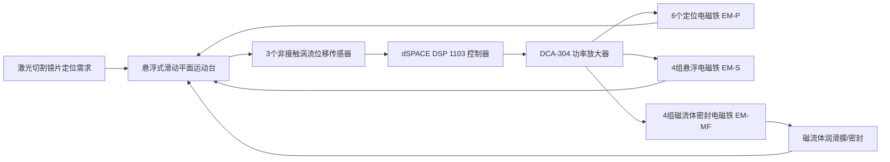

# 论文系统架构

## 总体系统

论文系统是一个用于激光切割机镜片驱动的平面运动执行机构。它的任务是在紧凑尺寸内，让镜片在平面内做 X/Y 平移和 Theta 旋转，从而实现离轴激光切割中对光束/气流相对位置的动态调整。相关位置：PDF第2页。

## 需求输入

论文从应用需求开始，而不是从器件开始。基于预实验和现有激光切割头尺寸，论文给出这些设计边界：

| 项目 | 论文需求 | 位置 |
|---|---:|---|
| 平移行程 | 不小于 ±1 mm | PDF第2页 |
| 平移分辨率 | 不大于 ±25 µm | PDF第2页 |
| 速度 | 不小于 2 mm/s | PDF第2页 |
| 带宽 | 在 50 µm 范围内不小于 100 Hz | PDF第2页 |
| 总体尺寸限制 | 200 x 200 mm | PDF第2页 |
| 重量限制 | 2 kg | PDF第2页 |

这是一种很值得迁移的方法：先写目标工况、行程、分辨率、速度、带宽和体积限制，再决定机构与控制路线。

## 机械层

平台由定子、运动台、磁流体载体、目标件和电磁铁组成。论文给出的核心尺寸：

| 项目 | 论文参数 | 位置 |
|---|---:|---|
| 定子平面尺寸 | 191 x 191 mm | PDF第3页 |
| 运动台平面尺寸 | 135 x 135 mm | PDF第3页 |
| 定子/运动台高度 | 10 mm | PDF第3页 |
| 定子与运动台竖向间隙 | 10 mm | PDF第3页 |
| 中心位置侧向间隙 | 每侧 1.1 mm | PDF第3页 |
| 运动台质量 | 1.882 kg | PDF第3页 |
| 材料 | SUS304 非磁性材料 | PDF第3页 |

## 执行器层

论文把机构分成三类执行器：

| 执行器 | 数量/结构 | 功能 | 位置 |
|---|---|---|---|
| EM-S | 4 对悬浮电磁铁和目标 | 提供悬浮吸引力，降低接触力 | PDF第3-4页 |
| EM-MF | 4 对磁流体密封电磁铁和目标 | 产生磁场约束磁流体，防止泄漏并形成润滑膜 | PDF第4页 |
| EM-P | 6 个定位电磁铁 | 控制 X/Y/Theta 平面运动 | PDF第3-4页 |

论文摘要也明确写到平台通过 six electromagnets 和 three non-contact displacement sensors 实现两平移一旋转运动。相关位置：PDF第2页。

## 传感器层

实验中控制器输入来自 3 个涡流式 gap sensors：

| 项目 | 论文信息 | 位置 |
|---|---|---|
| 型号 | PU-07, AEC Corp. | PDF第6页 |
| 类型 | eddy current-type gap sensor | PDF第6页 |
| 数量 | 3 个 | PDF第6页 |
| 量程 | 0-3 mm | PDF第6页 |
| 分辨率 | 1 µm | PDF第6页 |

这说明论文最终性能是受传感器噪声/分辨率约束的。后续实验结果也写到 X/Y/Theta 方向的实测噪声分别为 1 µm、1.6 µm、4 µrad。相关位置：PDF第8页。

## 控制与驱动层

控制器使用 dSPACE DSP 1103，采样率 20 kHz。控制器输入为 S1/S2/S3 实时位移，参考为 Xr/Yr/Thetar，输出为两个 bias voltages 和三个 control voltages。输出电压经 DCA-304 放大器驱动线圈。相关位置：PDF第6页。

驱动相关参数：

| 项目 | 论文参数 | 位置 |
|---|---:|---|
| DSP 采样率 | 20 kHz | PDF第6页 |
| 每个定位线圈偏置电流 | 0.5 A | PDF第6页 |
| EM-S 串联偏置电流 | 1.4 A | PDF第6页 |
| 放大器饱和电压 | ±28 V | PDF第6页 |
| 放大器最大输出电流 | ±4 A | PDF第6页 |
| 放大器带宽 | 100 kHz | PDF第6页 |

## 实验验证层

论文的验证不是只做一个最终指标，而是按链路逐项验证：

1. 确认磁流体被磁场约束，防止自由流动。
2. 记录 X/Y/Theta 分辨率。
3. 测 X 和 Theta 的阶跃响应。
4. 做 1 Hz 和 10 Hz 圆轨迹。
5. 用频率响应分析仪测带宽。

相关位置：PDF第7-8页。

这套验证层最值得迁移到当前单轴闭环实验：读数、阶跃、轨迹、频响/动态响应要分开测，不要把所有结果混成一个“闭环成功”。
