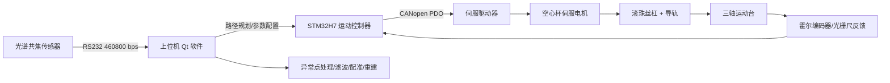

# 论文系统架构

## 总体链路

论文系统由上位机、运动控制器、光谱共焦数据采集系统和三自由度运动台组成。总体目标是用光谱共焦传感器获取高度信息，用三轴运动台完成面扫描，再通过控制和算法把线扫描数据重建为三维点云。相关位置：PDF第32页/正文第14页，PDF第49页/正文第31页。

## 当前台架实物链路修正

> 重要：上面的框图来自赖建君学位论文，对赖建君原系统具有高置信度；但它不等同于当前实验台的实物接线。2026-05-28 的现场照片显示，当前台架至少包含 Panasonic `GM1 CSEC16T`、DINGS 驱动器、DINGS `30ZWWC65TEK5-1` 电机和一块 STM32H743 板。当前硬件接线应以照片、铭牌、纸质接线页和现场测量为一手证据。

按证据分级，当前台架更可能的主运动链路是：

实物依据：

- Panasonic 控制器面板可见 `GM1 CSEC16T`、`EtherCAT`、`CN1/CN2`、`RUN/STOP`、USB。官方资料中 `AGM1CSEC16T` 为 GM1 EtherCAT 型运动控制器。
- DINGS 驱动器纸质接线页列出 `M10 -> EtherCAT Output`、`M11 -> EtherCAT Input`，PCB 上也有 `ECAT IN/OUT` 丝印。
- 电机图纸写 `30ZWWC65TEK5-1`、`DC 24V 6900 RPM`，并给出 U/V/W、霍尔和增量编码器线色。
- STM32H743 板照片只能确认其为 MCU 板，当前不能确认它承担主运动控制、光栅采集还是转接功能。

置信度拆分：

| 判断 | 置信度 | 原因 |
|---|---|---|
| 赖建君原系统采用 `STM32H7 + CANopen + PDO` | 高 | 论文摘要、第二章和答辩 PPT 均直接出现该架构 |
| 当前实物包含 GM1、DINGS、30ZWWC65TEK5-1 和 STM32H743 板 | 高 | 当前照片、纸质接线页和电机图纸直接可见 |
| 当前应优先排查 `GM1 -> EtherCAT -> DINGS -> 电机` | 中-高 | GM1 是 EtherCAT 运动控制器，DINGS 同时有 `ECAT IN/OUT`，两者接口匹配；但还缺少 GM1 工程、ESI/XML 和 EtherCAT 扫描结果 |
| 当前由 STM32H743 通过 CANopen 控制 DINGS | 低 | 只有 MCU 板照片和论文架构相似，缺少当前线缆、固件和 CAN 实测证据 |

因此，当前接线记录中不要把“STM32H7 -> CANopen -> DINGS”写成既定事实。它只能写成“赖建君论文方案/当前可能备选”，待补充接线图、工程文件或实测通信后再确认。

换句话说：`STM32H7 + CANopen + PDO` 对赖建君论文系统是高置信描述；对当前台架则是待核验假设。

## 运动子系统

运动子系统按扫描需求倒推设计：

- 扫描区域：10 mm x 10 mm。
- y 向扫描步长：10 µm。
- x 向单次扫描时间：0.1 s。
- 梯形速度曲线假设下，x 轴最大速度为 150 mm/s，加速度为 1500 mm/s²。
- 1 mm 导程会要求电机 9000 rpm，最终改用 2 mm 导程以降至 4500 rpm。

相关位置：PDF第32-33页/正文第14-15页。

论文设计不是为纳米级慢速定位，而是为毫米级区域高速扫描和微米级重建服务。这一点对本课题很关键：你的单轴实验应先证明低速、短行程、微米级闭环可实现，而不是照搬论文的高速扫描工况。

## 测量子系统

光谱共焦传感器负责 z 向高度测量。论文给出的关键参数：

- 量程：400 µm。
- 采样率：2 kHz。
- 串口：RS232。
- 上位机波特率：460800 bps。
- 数据噪声：静止状态标准差 0.042 µm，峰峰值 0.256 µm。

相关位置：PDF第33页/正文第15页，PDF第49页/正文第31页，PDF第54-55页/正文第36-37页。

论文没有给出光谱共焦传感器的厂商和型号，因此不能把这些接口参数泛化到所有光谱共焦传感器。它们只能作为论文系统的已知配置。

## 控制子系统

论文采用分层控制架构：

- 上位机：路径规划、扫描参数设置、数据可视化、CSV 路径保存加载。
- 运动控制器：读取编码器位置、执行控制算法、发送运动参数。
- 驱动器：电流环和 FOC 执行。
- 编码器：霍尔编码器或光栅尺提供位置反馈。

相关位置：PDF第38-41页/正文第20-23页，PDF第49页/正文第31页。

控制器选 STM32H7，原因是 Cortex-M7 性能、浮点计算能力、CAN 外设、STM32Cube 生态和成本。外部 ST 页面显示 STM32H7 系列包含最高 480 MHz 的 Cortex-M7/M4 双核产品线和丰富外设生态，支持论文中的“轻量级多轴控制器”定位。

对当前台架，这一段只说明论文为什么选择 STM32H7；不能据此推断照片中的 STM32H743 板正在控制电机。当前照片中更明确的运动控制器是 Panasonic GM1 CSEC16T。

## 算法子系统

论文算法子系统分两层：

1. 运动控制算法：PID、机电系统建模、前馈 + LQR。
2. 轮廓重建算法：异常点处理、卡尔曼滤波、BEADS 基线漂移、多级配准、RANSAC、聚类和圆拟合。

相关位置：PDF第45-49页/正文第27-31页，PDF第52-70页/正文第34-52页。

对本课题而言，运动控制算法是主线，轮廓重建算法只需作为背景。真正可迁移的是“实验数据要保留足够完整的时间戳、指令位置、反馈位置、误差和控制输出”，这样后续才能做滤波、补偿和控制策略比较。

## 软件结构

论文上位机基于 Qt，功能包括：

- 总线设置和运动参数设置。
- 点对点运动与路径规划。
- 光谱共焦传感器串口通信。
- 线扫描数据显示与三维重建展示。
- 软限位、急停保护、手动微调，手动微调分辨率 1 µm。

相关位置：PDF第49页/正文第31页。

这给本课题的上位机最低功能清单提供参考：先不用做三维可视化，但必须有连接状态、手动步进、目标位置输入、实时反馈、CSV 记录、急停/软限位和参数记录。

## 关键系统判断

论文的工程核心不是“光栅尺一上就解决全部定位误差”。第 4.1 节说明，即使 z 轴使用光栅尺反馈，补偿余弦误差后仍有与 2 mm 丝杠导程同周期的残余定位误差，需要查找表补偿。相关位置：PDF第71-73页/正文第53-55页。

这意味着本课题的闭环演示也要避免过度承诺：光栅尺反馈能显著提升可观测性和闭环控制能力，但机械装配、导轨、丝杠、采样噪声和控制周期仍会决定最终误差。
