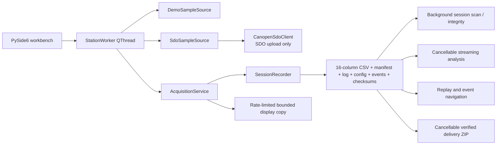

# Motion Acquisition V1.0 Architecture

## Product boundary

V1.0 is a Windows read-only acquisition and experiment-data workstation. It does not own motor motion and has no device-write path.



## Layer responsibilities

- `canopen_client.py`: the only real CANopen access point; exposes SDO upload reads and connection lifecycle.
- `sample_source.py`: Demo and real read-only source adapters.
- `acquisition.py`: deadline-aware record-by-record polling.
- `acquisition_service.py`: UI-neutral run state machine, cooperative `StopToken`, event draining, and terminal outcomes.
- `session_store.py`: authoritative per-record persistence and atomic terminal manifest/checksum finalization.
- `projects.py`, `presets.py`, `conversion.py`, `user_settings.py`: current-user configuration and immutable per-session snapshots.
- `session_integrity.py`, `session_checksums.py`: structure, outcome, read-only boundary, SHA-256 verification, diagnostics, and explicit interrupted-session recovery.
- `analysis.py`, `session_browser.py`, `replay.py`: downstream read-only data use.
- `delivery_export.py`: non-destructive, cancellable, multi-session delivery bundle.
- `desktop/`: GUI coordination and QThread workers. GUI display queues never gate CSV writes.

## Stable contracts

### Reader

The acquisition core consumes the existing `SdoReader` protocol:

```python
def read(spec: ObjectSpec) -> ReadResult:
    ...
```

A future read-only source must translate its input into the same `ReadResult` and must not bypass the recorder or alter the CSV schema.

### Record

`AcquisitionRecord` carries wall/monotonic/elapsed time, `sample_seq`, Node-ID and one object `ReadResult`. Partial object failures remain first-class records.

### Session

`samples.csv` is fixed at 16 columns and contains raw values. Other session files provide context, events, diagnostics and integrity without changing the raw table.

### Cancellation

Acquisition, scanning, analysis and delivery use thread-safe stop tokens. Cancellation finishes or removes the operation's own partial output; it does not modify historical source data.

## Data protection sequence

1. Create a unique session directory.
2. Atomically write the configuration snapshot.
3. Open CSV/log/events and atomically write `outcome=in_progress`.
4. Append records; flush CSV at a bounded interval and events immediately.
5. On completed/stopped/error, flush and close data handles.
6. Atomically write the terminal manifest.
7. Hash CSV, manifest, log, config and events into `checksums.sha256`.

If the process dies before step 5, the next scan reports `incomplete`. Explicit recovery preserves the CSV, records recovery metadata, writes a new terminal manifest and creates a ledger.

## Future extension rules

- A future external sensor can be added as another read-only source producing the stable record model.
- A future PDO or EtherCAT reader requires real hardware evidence, timing design and a separate release gate. V1.0 contains no such implementation.
- Motion control must remain a separate subsystem with explicit safety authority; it cannot be slipped into a source adapter or GUI action.
- New analysis should be downstream of saved data, cancellable and memory-bounded.
- New exports must be non-destructive and include provenance.
