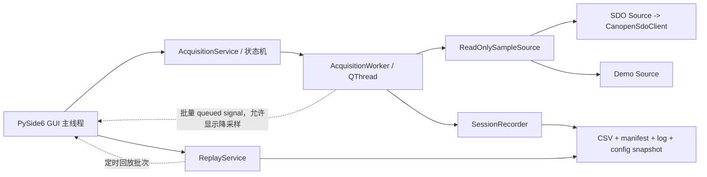
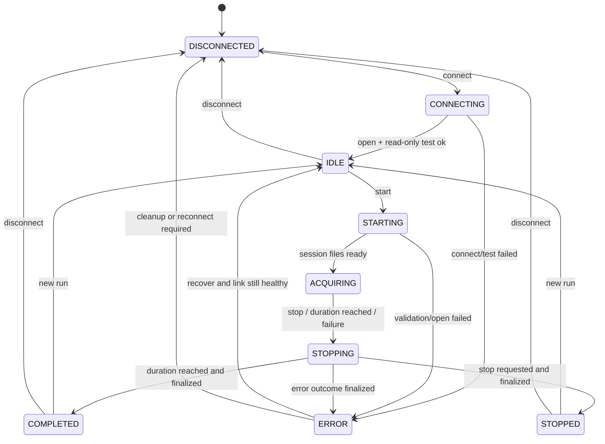

# Motion Acquisition V0.3 总体架构与 Build 计划

> 状态：架构边界已按用户决定冻结；B1+B2 已通过；B3+B4 软件实现完成、离线测试通过、现场验证延期且不影响继续推进离线工作；B5+B6 已达到当前电脑的离线验收，第二台 Windows 电脑部署实测仍延期  
> 日期：2026-07-21  
> 对象：`motion_acquisition` 精密运动数据采集与实验工作站  
> 本文只定义 V0.3，不授权运行硬件、修改 CAN 对象或开始实现。

## 1. 项目当前基础

### 1.1 当前真实调用链

- CLI 入口：`src/motion_acquisition/main.py`，控制台命令为 `motion-acq`。
- 配置：`config.py` 将 YAML、默认值和 CLI 覆盖项转为不可变 `AppConfig`，并校验 Node-ID、采样周期、持续时间和对象名。
- 真实只读通信：`CanopenSdoClient.connect()` 通过 `canopen.Network` 和 `python-can` 打开总线；`read()` 只调用 `node.sdo.upload()`。
- 采集：`acquisition.poll()` 按轮次串行读取所选对象，向一个同步 `sink` 逐条提交 `AcquisitionRecord`。
- 保存：CLI 在进入采集前打开 `CsvLogger`，采集正常结束后调用 `build_manifest()` 写 manifest。
- 诊断：`statusword.py`、`diagnostics.py`、`canopen_monitor.py` 已分别提供 CiA 402 状态、错误寄存器/SDO 错误和被动 CAN 帧分类。
- 当前网页：`ui_server.py` 只提供静态文件；浏览器端 `app.js` 在本地解析导入的 CSV/manifest、绘制一条 SVG 曲线并生成命令预览，不调用 Python 采集后端。

当前链路如下：

```text
CLI handler
  -> load_config / resolve_objects
  -> CanopenSdoClient
  -> acquisition.poll
  -> CsvLogger
  -> build_manifest（仅正常结束后）
```

### 1.2 已有运行证据与边界

- 当前现场配置为 PCAN、`PCAN_USBBUS1`、Node-ID 1、1 Mbps。
- 已有 14 对真实 CSV 和 manifest；现有长表字段及 manifest 1.0 是 V0.3 的兼容基线。
- 现有数据证明 SDO upload 只读采集可运行，不证明同步采样、控制周期、长度标定或运动安全放行。
- 多对象在同一轮共用轮次开始时间戳，但实际依次 SDO 读取，不是原子快照。
- `docs/release_v0.2.0_readonly_station_foundation.md` 的“硬件未验证”是 2026-07-10 封板时状态；2026-07-12 后的真实日志补充了 Node 1、1 Mbps 的只读采集运行证据，但没有改变无写控制边界。

## 2. V0.3 目标

V0.3 建设一个可在 Windows 独立部署的“精密运动数据采集与实验工作站”，使用户无需命令行即可完成一次只读实验：

1. 配置和连接 PCAN/CANopen 设备，执行只读通信测试；
2. 选择对象、周期、持续时间和实验信息；
3. 从 GUI 启动与停止真实 SDO 采集；
4. 实时显示数值、状态、错误和受限频率刷新的曲线；
5. 无损保存全部采集记录、manifest、配置快照和运行日志；
6. 加载旧格式或 V0.3 会话并回放；
7. 无硬件时使用演示数据验证 GUI；
8. 形成 PyInstaller Windows `onedir` 可移植包和简明用户教程；
9. 保持真实硬件路径严格只读。

## 3. 明确非目标

V0.3 不实现 Servo On、Fault Reset、Quick Stop、Jog、回零、位置/速度运动、控制字写入、参数下载、SDO download、NMT 状态写入、PDO 配置、TPDO、EtherCAT、多轴控制、自动实验序列、远程控制、云服务、权限系统、插件市场或数据库平台。

V0.3 新桌面 GUI 不显示任何“会写入什么”的 dry-run 运动按钮或预览。V0.2 的 `commands.py`、`dry_run.py`、`safety_state.py` 可作为历史隔离代码保留，但不接入 V0.3 应用服务、菜单或打包入口。未来控制功能必须另立版本、另做安全契约和放行审查。

## 4. 可直接复用的代码

| 现有模块 | V0.3 用法 | 结论 |
|---|---|---|
| `config.py` | 继续作为配置模型、加载和校验基础；增加用户目录解析与 GUI 表单转换 | 直接复用并小幅扩展 |
| `object_dictionary.py` | GUI 对象选择、解码和回放字段解释的唯一对象定义来源 | 直接复用 |
| `models.py` | `ObjectSpec`、`ReadResult`、`AcquisitionRecord` 作为数据主模型 | 直接复用；V0.3 不扩展 CSV 时间字段 |
| `canopen_client.py` | 真实 SDO upload 适配器，继续保持唯一 CANopen 硬件入口 | 直接复用，不增加写 API |
| `acquisition.read_once()` | 单轮只读和通信测试的底层函数 | 直接复用 |
| `csv_logger.py` | 保持现有长表字段和旧数据可读性 | 直接复用并增加 flush/恢复策略 |
| `manifest.py` | 保持 manifest 1.0 既有键；V0.3 只追加状态和实验元数据 | 直接复用并扩展 |
| `sampling_stats.py` | 采集统计基础 | 复用，但界面必须区分实际输出频率与处理容量 |
| `statusword.py`、`diagnostics.py` | 实时状态和错误解释 | 直接复用，禁止在 GUI 复制一套解析逻辑 |
| `SimulatedReadOnlyBackend` | 演示模式的种子实现 | 复用并扩展为连续样例源 |
| `session.py` | 会话/run ID 与实验信息概念 | 复用概念并扩展生命周期字段 |
| `tests/` | CSV、manifest、诊断和无写路径回归基线 | 继续保留 |

现有静态网页源码保留为 V0.2 历史原型，但不继续扩展，不进入 V0.3 主菜单，也不进入 V0.3 发布包。新桌面 GUI 直接使用 Python 模型，消除 `app.js` 中重复的对象表、状态字解析和命令字符串拼装。

## 5. 最小重构点

只处理真正阻碍 GUI 的五项：

1. **CLI 负责编排过多。** 连接、轮询、CSV、manifest 和输出都在 `cmd_log_sdo()` 中组装。需抽出与 CLI/Qt 无关的 `AcquisitionService`；CLI 保持为该服务的薄适配器。
2. **采集循环不可协作取消。** `poll()` 只按持续时间退出。`StopToken` 必须封装 `threading.Event`；GUI/控制线程直接设置 Event，采集循环在每个对象读取前后、逐条写入后、每轮结束和等待期间主动检查。停止不能依赖 Qt queued signal，因为阻塞采集期间 worker 的事件循环未必能处理 stop slot；不得使用强制终止线程。
3. **异常时 manifest 不一定存在。** 当前 manifest 只在正常返回后写。需由 `SessionRecorder` 在采集开始时建立会话，并在 completed/stopped/error 三种结局中统一最终化。
4. **实时记录无法订阅。** 保留持久化 sink，同时增加批量只读记录通知；GUI 通知是可丢弃的显示副本，CSV 是权威副本。
5. **状态分散。** `ConnectionState` 尚未覆盖采集生命周期。需增加一个小型、可测试的 `AcquisitionStateMachine`，禁止 GUI 自行猜状态。

本轮不重写 CANopen 客户端，不引入 asyncio，不拆微服务，不单独抽象 `python-can` 的每个厂商实现，也不修改既有 CSV 列名。

## 6. 总体架构

采用同一进程内的模块化单体：



### 6.1 关键架构决定

1. **桌面 GUI 与采集核心分离。** Qt 只负责交互和展示，应用服务不导入 PySide6，CLI 与 GUI 复用同一服务。
2. **持久化与显示分流。** 每条记录在采集线程内先写入 CSV，再进入显示批次；显示可降采样/丢旧批次，存储不得因 GUI 卡顿丢记录。
3. **硬件能力按只读接口封死。** V0.3 保持现有逐对象 `read(spec)` 语义；不提前冻结为 `read_cycle() -> list`，也不定义通用“写命令”或 `execute()` 接口。

## 7. 模块职责与建议目录

在现有扁平包上做小幅增量，不大搬家：

```text
src/motion_acquisition/
  main.py                    # 现有 CLI，改为 AcquisitionService 的薄适配器
  acquisition.py             # 单轮读取、可取消轮询底层
  acquisition_service.py     # 连接、测试、启动、停止、最终化编排
  acquisition_state.py       # 状态、事件、合法转换
  sample_source.py            # 最小 ReadOnlySampleSource 协议和 SDO/Demo 包装
  session_store.py            # 会话目录、CSV、manifest、日志、配置快照
  replay.py                   # 旧 CSV/manifest 与 V0.3 会话加载、按时间回放
  canopen_client.py           # 保持 SDO upload only
  config.py
  csv_logger.py
  manifest.py
  diagnostics.py
  statusword.py
  desktop/
    __main__.py               # 桌面入口
    main_window.py            # 页面容器和全局动作
    acquisition_worker.py     # QObject worker + QThread 生命周期胶水
    view_models.py            # Qt 侧展示状态和环形缓冲，不含硬件调用
    pages/                    # 仅按确有独立职责拆分页面
```

关键接口保持小而具体：

```python
class ReadOnlySampleSource(Protocol):
    def open(self) -> None: ...
    def close(self) -> None: ...
    def read(self, spec: ObjectSpec) -> ReadResult: ...

class StopToken:
    # 内部唯一停止事实源是 threading.Event
    def request_stop(self) -> None: ...
    def is_stop_requested(self) -> bool: ...
    def wait(self, timeout_s: float) -> bool: ...  # 可中断等待

class RecordSink(Protocol):
    def write(self, record: AcquisitionRecord) -> None: ...
    def flush(self) -> None: ...
    def close(self) -> None: ...
```

采集服务继续按对象调用 `source.read(spec)`，每得到一条结果就立刻构造、保存并发布一条 `AcquisitionRecord`，随后再次检查停止 Event；不会先收集完整一轮列表。`SdoSampleSource` 只包装现有 `CanopenSdoClient`；`DemoSampleSource` 产生同一种逐条结果。回放不是伪装成硬件连接，而由 `ReplayService` 读取已保存记录。未来 TPDO/EtherCAT 只有在进入对应版本时才重新评估流式接口，V0.3 不创建空壳类。

PCAN 与其他 `python-can` interface 目前继续由 `AppConfig` 和 `CanopenSdoClient` 参数化；在第二种真实适配器形成测试证据前，不再增加一层厂商插件框架。

## 8. 线程与数据流

### 8.1 线程模型

- GUI、QWidget、PyQtGraph 对象只存在于主线程。
- 一个长生命周期 `QThread` 承载一个 `AcquisitionWorker(QObject)`；worker 在该线程内创建、使用和关闭 CANopen 客户端，避免跨线程访问同一客户端。
- 主线程可通过 queued signal 请求 connect、disconnect、test 和 start；**stop 不依赖 queued signal**。Start 时主线程与 worker 共享一个 `StopToken(threading.Event)`，停止按钮直接调用 `request_stop()` 设置 Event；worker 通过 queued signal 返回状态、记录和错误。
- 不用 `QThread.terminate()`；窗口关闭前请求协作停止，等待 worker 最终化和 `finished`，再 `quit()/wait()`。
- Qt 官方说明跨线程 queued signal 会在接收对象所属线程执行，适合把阻塞采集放到 worker；官方也明确删除仍在运行的 QThread 可能导致崩溃，因此必须先完成停止和等待：<https://doc.qt.io/qtforpython-6/overviews/qtdoc-threads-qobject.html>。

### 8.2 单轮数据路径

```text
SDO 逐对象读取
  -> AcquisitionRecord
  -> SessionRecorder.write（权威、不得丢）
  -> SamplingStats.observe
  -> LiveBatchBuffer（仅显示副本）
  -> 每 50~100 ms 发一个批次到 GUI
  -> GUI 更新数值和环形曲线
```

- 存储继续在采集 worker 内同步进行，避免第二个写线程带来的排序、关机和队列一致性复杂度。若后续实测磁盘写入成为明确瓶颈，再以证据引入独立 writer；V0.3 不预先增加。
- GUI 只保留最近可配置时间窗（默认 60 s）的点。高密度曲线启用 PyQtGraph downsampling/clip-to-view，刷新率默认 10 Hz、上限 20 Hz；官方 `PlotDataItem` 提供 `autoDownsample`/`setDownsampling()`：<https://pyqtgraph.readthedocs.io/en/latest/api_reference/graphicsItems/plotdataitem.html>。
- GUI 忙时可以覆盖尚未显示的旧批次，但不得反向阻塞 worker，也不得改变 CSV 内容。
- 实时数值显示采用各对象最近一个成功值；失败读数保留前值但标记“过期”和最后成功时间，不能用旧值冒充新值。

### 8.3 停止与关闭

1. 用户点击停止：状态立即进入 `STOPPING`，禁用重复点击。
2. 主线程立即设置共享 `threading.Event`；采集循环在当前 SDO 尝试/重试返回后、逐条写入后、下一个对象读取前和可中断等待期间主动检查。
3. worker 停止新一轮读取，刷新并关闭 CSV，写最终统计和 `outcome=stopped` manifest，再断开 CAN。
4. 关闭窗口时若正在采集，先显示明确提示：“停止采集不会停止电机运动”；确认后执行同一停止流程。
5. 只要 worker 未最终化，普通窗口关闭事件就被忽略；不得强杀线程。若驱动调用超过配置超时仍不返回，显示“通信驱动未返回”，保留日志并等待人工决定退出，不能宣称已安全收尾。

## 9. 采集状态机

统一状态：`DISCONNECTED`、`CONNECTING`、`IDLE`、`STARTING`、`ACQUIRING`、`STOPPING`、`COMPLETED`、`STOPPED`、`ERROR`。`COMPLETED` 只表示达到计划结束条件，`STOPPED` 只表示用户/调用方主动停止，`ERROR` 只表示异常终止；三者同时也是 manifest 的最终 `outcome`，不得合并。



| 状态 | 允许操作 | 禁止操作 |
|---|---|---|
| `DISCONNECTED` | 编辑连接配置、演示、回放、Connect | 通信测试、真实 Start/Stop |
| `CONNECTING` | Cancel connect（协作式） | 再次 Connect、Start、改连接配置 |
| `IDLE` | Test、Start、Disconnect、改实验信息 | Stop |
| `STARTING` | Stop request | 重复 Start、改配置、Disconnect |
| `ACQUIRING` | Stop、只读查看页面 | Start、Disconnect、改运行配置 |
| `STOPPING` | 查看收尾进度 | 所有连接/采集命令 |
| `COMPLETED` | 打开目录、回放、New run、Disconnect | Stop |
| `STOPPED` | 打开目录、回放、New run、Disconnect | Stop |
| `ERROR` | 查看详情、导出日志、Recover/Disconnect | Start，直到恢复完成 |

所有 UI enable/disable 都由状态机派生。任何非法事件返回可见提示并记日志，不静默执行。通信中断发生在采集中时先走 `STOPPING` 完成文件最终化，再进入 `ERROR`。

## 10. GUI 页面

V0.3 使用 PySide6 Widgets + PyQtGraph。页面保持少而完整：

### 10.1 实时采集页（默认首页）

- 顶部：全局状态、只读徽标、连接/断开、只读通信测试。
- 左侧：CAN interface、通道、波特率、Node-ID、超时/重试；采集中锁定。
- 中部：对象多选、周期、持续时间、Start/Stop、保存目录摘要。
- 右侧：位置、跟随误差、速度、电流最新值及新鲜度；状态字、错误寄存器、错误码。
- 下部：四条可开关实时曲线、实际轮次率、失败读取数、deadline miss、运行时长。
- 永久提示：“停止采集只停止读取，不会停止电机运动。”

### 10.2 实验信息页

- 实验名称（必填）、操作者（可选）、工况/方向、备注、标签。
- 当前配置预览和数据目录预览。
- 不在此页编辑控制参数，也不把工程换算写成正式标定值。

### 10.3 历史回放页

- 打开旧 CSV + manifest，或打开 V0.3 会话目录。
- 完整性检查、对象/时间范围摘要、播放/暂停/速度/拖动。
- 使用与实时页相同的数值卡和曲线组件，但显著标明 `REPLAY`，不会打开 CAN。

### 10.4 设备诊断页

- 只读连接结果、适配器/通道、Node-ID、最近通信成功时间。
- 状态字位解释、错误寄存器位解释、SDO timeout/abort 分类和读取失败时间线。
- 将“通信异常”“设备报告 fault”“采集 timing miss”分栏，不互相冒充。

### 10.5 设置页

- 默认数据根目录、默认 interface/channel、默认对象组、曲线时间窗和 GUI 刷新率。
- 恢复默认值、导入/导出用户配置。
- 不提供任何写控制开关或“高级解锁”。

### 10.6 帮助页

- 五步快速开始、PCAN 驱动前置条件、只读边界、常见错误、数据文件说明。
- 提供“打开用户手册”和“打开数据目录”，不要求命令行。

不单独建设空白“主页”。演示模式从实时采集页的数据源选择进入；选中后界面明显显示 `DEMO — NO HARDWARE`。

## 11. 数据保存与回放

### 11.1 会话目录

默认数据根目录由用户目录解析，不依赖仓库路径。每次 run 创建：

```text
<data_root>/
  2026/
    07/
      20260721_143012_run-8f2a31c4/
        samples.csv
        manifest.json
        acquisition.log
        config_snapshot.yaml
```

目录名由本地时间到秒 + 随机 run ID 后缀组成；manifest 另存时区、主机名和 UUID。即使两台电脑同秒开始，也不会冲突。实验名称只作为 manifest 字段和经过清理的可选短标签，不作为唯一标识。

### 11.2 兼容策略

- `samples.csv` 严格保持现有 16 列长表及语义，旧 CSV 可直接加载；V0.3 不新增请求开始、响应结束或其他时间字段。更细时间语义留待独立版本设计，不能借 GUI 开发顺手扩表。
- manifest 保留现有 `software`、`can`、`canopen`、`acquisition`、`statistics` 和 `safety_boundary` 键；schema 升级时只追加：`run`、`outcome`、`host`、`timing_semantics`、`files`、`errors`。
- manifest 内文件路径优先写相对于会话目录的相对路径；加载旧 manifest 时继续接受旧相对/绝对字符串。
- `config_snapshot.yaml` 是启动瞬间的最终有效配置，不依赖之后用户设置变化。
- 回放默认使用 CSV 的 `elapsed_s` 和 `sample_seq`，不把 manifest 的 `estimated_rate_hz` 当作真实调度频率。

### 11.3 异常保全

- `SessionRecorder.open()` 先创建目录、日志、CSV 头和 `outcome=in_progress` 的 manifest。
- CSV 每批写入并至少每 1 s flush；正常停止、用户停止和异常均在 `finally` 中 flush/close。
- manifest 通过同目录临时文件 + 原子替换更新，最终 outcome 为 `completed`、`stopped` 或 `error`。
- 进程崩溃或断电时，已经 flush 的 CSV 保留；下次启动扫描 `in_progress` 会话并标记为 `recovered_incomplete`，不自动删除。
- 磁盘写入失败立即停止新采集并进入收尾；不能只在界面显示曲线而继续丢失权威数据。

## 12. 错误、安全与收尾

### 12.1 错误分类

| 类别 | 示例 | UI 文案边界 | 后果 |
|---|---|---|---|
| 配置 | Node-ID 越界、对象为空 | “配置无效” | 不连接 |
| 驱动/适配器 | PCAN 驱动缺失、通道不存在 | “CAN 适配器/驱动不可用” | 返回 disconnected |
| 通信 | SDO timeout/abort、总线断开 | “只读通信失败” | 收尾并 error |
| 设备报告 | Statusword fault、Error Code 非零 | “设备报告状态/故障码” | 继续或停采由只读采集策略决定，不自动声称运动异常 |
| 采集时序 | deadline miss、轮次过慢 | “采集时序告警” | 记录统计，不伪称驱动控制周期变化 |
| 存储 | 无空间、权限、写入失败 | “数据无法安全保存” | 立即停止采集 |
| 回放 | 缺列、manifest 不匹配 | “历史数据不完整/不兼容” | 不访问硬件 |

### 12.2 不可突破的安全边界

- GUI 不出现写控制按钮、写对象编辑器或隐藏解锁入口。
- `AcquisitionService` 只暴露 connect/disconnect/test/start/stop-read；stop 表示停止采集，不表示 Quick Stop 或停止电机。
- `CanopenSdoClient` 不新增 `download`、NMT 写入、PDO 配置或原始 CAN send。
- 新增测试静态扫描所有 V0.3 硬件路径，继续阻止 `.sdo.download`、NMT Operational、PDO send 和控制对象写入。
- 未来控制功能不得复用 V0.3 的“stop”名称制造歧义；必须进入独立阶段、独立服务接口、独立界面和独立安全放行。

## 13. Windows 多机部署

### 13.1 用户目录和配置

- 应用资源只读打包；运行时不向源码目录或 exe 目录写数据。
- 用户配置放在 Qt `QStandardPaths.AppConfigLocation` 对应的每用户目录；默认数据根目录放在 `Documents/MotionAcquisitionData`，可在设置页修改。
- 不假定用户名、盘符、仓库位置或 `PCAN_USBBUS1`。首次启动向导要求发现/选择通道或明确输入，默认值仅是建议。
- 每台电脑保存自己的配置；会话目录含随机 ID 和主机元数据，无共享数据库、端口或中心服务器，因此不同电脑的本地实例互不影响。
- 同一台电脑上两个实例争用同一 CAN 适配器时，后打开者应得到明确“通道占用”错误；这不属于多机协同。

### 13.2 打包路线

1. V0.3 首选 PyInstaller `onedir --windowed`，不先做 `onefile`。官方文档说明 onedir 更容易检查所收集的依赖和排障，应在 onefile 前先验证：<https://pyinstaller.org/en/latest/operating-mode.html>。
2. 在 Windows x64 干净虚拟环境构建，显式纳入 Qt platform plugins、PyQtGraph、`python-can`、`canopen`、默认配置和帮助文档。
3. PCAN 驱动/PCAN-Basic 作为外部系统依赖，不捆绑、不自动安装；应用启动时做只读 preflight 并给出厂商驱动安装说明。
4. 产物附版本、构建时间和依赖锁定清单；先在无 Python 的干净 Windows 电脑验证 demo/replay，再在获得现场授权后验证 PCAN。
5. 安装器、代码签名和 onefile 属于后续发布工程；V0.3 验收只要求可复制的 onedir 包。

多机互不干扰的原因是：进程、配置、数据目录和物理适配器都属于各自电脑；桌面版不监听网络端口、不共享锁文件、不访问中心服务。

## 14. 分阶段 Build 计划

每阶段独立验收，后续阶段不得倒逼前一阶段扩大范围。

### B1：可取消的只读采集服务与可靠会话保存

- 从 CLI 抽出 `AcquisitionService`、状态机、StopToken 和 `SessionRecorder`。
- 保持现有 CLI 行为和 CSV 兼容。
- 用 fake reader 验证正常完成、用户停止、SDO 失败、存储失败和 manifest 最终化。
- 强化无写路径测试。

**出口：**不依赖 Qt、不开硬件即可证明服务可连接假源、启动、取消、收尾，旧 CLI 回归不变。

### B2：桌面壳、演示模式和历史加载

- 引入 PySide6/PyQtGraph，建立状态驱动的页面壳。
- 接入 DemoSampleSource、旧 CSV/manifest 加载和基本回放。
- 完成无硬件的 connect/start/stop 交互和界面线程测试。

**出口：**用户在无硬件电脑上不使用命令行完成一轮演示并回放生成文件。

### B3：GUI 真实只读连接与采集

- 在 worker 线程接入 `SdoSampleSource`。
- 完成通道配置、连接/断开、只读测试、Start/Stop 和异常断线收尾。
- 真实硬件验证必须另行说明目的、输入、输出、风险和边界，并获得用户授权。

**出口：**获得授权后，用户本人可由 GUI 对 Node 1、1 Mbps 完成一次短时只读采集；无任何 CAN 写帧路径。

2026-07-21 实现记录：长生命周期 worker 已接入 PCAN/CANopen 只读源、连接/断开/逐对象通信测试、Start/Stop 与持续失败收尾；假源 GUI 回归通过。现场预检未发现 PCAN 通道，故静止和运动实采出口尚未形成当次证据，B3 不标记通过。

2026-07-21 状态冻结：**软件实现完成；离线测试通过；现场验证延期；不影响继续推进离线工作。**未访问真实 CAN/USB，未伪造静止或运动会话。

### B4：实时数值、曲线和诊断

- 批量信号、显示环形缓冲、10~20 Hz 限频和 PyQtGraph downsampling。
- 接入状态字、错误码、读取失败和采集 timing 诊断。

**出口：**GUI 卡顿/切页不改变保存行数；长时 demo 和已有高频日志回放无明显失控增长。

2026-07-21 实现记录：15 Hz 批量显示、每曲线 1200 点上限、PyQtGraph downsampling/clip-to-view、状态字/错误码与 timing 统计已接入；10 s Demo 实测 500 轮、3500 行、49.92 Hz、0 失败、0 deadline miss，四文件完整。真实运动曲线稳定性仍随 B3 现场会话待验收，因此 B4 不标记通过。

2026-07-21 状态冻结：**软件实现完成；离线测试通过；现场验证延期；不影响继续推进离线工作。**实时曲线的现场稳定性仍须由真实静止/Servo Studio 运动采集形成证据。

### B5：回放、数据完整性与恢复

- 完成会话目录、旧数据兼容、回放控制、in-progress 恢复提示和日志导出。
- 验证异常停止后 CSV 可读、manifest 标记明确、配置快照存在。

**出口：**14 组现有 CSV/manifest 可加载，V0.3 会话可完整回放，残缺数据不会被冒充成功实验。

2026-07-21 离线验收：14 组旧 CSV/manifest 全部按 16 列格式加载，共 208,824 条记录；旧 manifest 明确识别为 `legacy`，并覆盖 `completed`、`stopped`、`error`、`incomplete`、`recovered_incomplete` 和仅 CSV 情况。异常中止测试确认已 flush CSV、manifest、日志和配置快照可用；诊断 ZIP 导出完整性报告、manifest、日志和配置快照，不复制权威 CSV。B5 离线出口通过。

### B6：Windows onedir 与独立用户教程

- 固化依赖、PyInstaller spec、构建说明和 GUI 五步教程。
- 在至少两台不同 Windows 电脑或一台实体机 + 一台干净 VM 上验证独立配置和数据目录。

**出口：**无 Python 环境可运行 demo/replay；安装 PCAN 驱动后可进入只读连接流程；两机数据互不覆盖。

2026-07-21 离线验收：已生成 Windows x64 PyInstaller `onedir --windowed` 目录；从源码目录之外双击启动成品，完成 Demo 自然结束、用户停止、四文件保存、会话完整性检查和历史播放。配置使用 Qt 每用户目录，数据默认使用当前用户“文档”目录；发布文件扫描未发现固定用户名、构建盘符或源码路径。B6 当前电脑离线出口通过。尚未在第二台 Windows 电脑或干净 VM 实测，因此不宣称“两机部署出口”已经形成。

## 15. V0.3 验收标准

### 功能

- 用户不使用命令行完成配置、只读连接测试、对象选择、启动、停止、保存和回放。
- 实时显示位置、跟随误差、速度、电流、状态字和错误码；对象不可用时明确显示，不造值。
- Demo 模式不打开 CAN；Replay 模式不打开 CAN；两者均有显著模式标识。
- GUI 可加载全部 14 组现有 CSV/manifest，并正确识别旧 schema。

### 数据与收尾

- 每次真实或演示采集生成一个唯一会话目录和四个规定文件。
- CSV 保持现有列兼容；保存记录数不因绘图限频而减少。
- 正常完成、用户停止、通信失败和存储失败都有明确 outcome；异常中止保留已 flush 数据。
- 关闭窗口时不强杀采集线程，关闭前完成或明确无法完成的收尾。

### 性能与线程

- GUI 主线程不执行 SDO upload、文件逐行写入或大 CSV 全量解析。
- 实时绘图默认 10 Hz、上限 20 Hz；显示缓冲有界，GUI 变慢不会使采集 worker 等待界面。
- 在无硬件 demo 连续运行 30 min 不出现无界内存增长、重复启动或无法停止。
- 现场速率只按实际测量报告；不把请求周期、`estimated_rate_hz` 或 GUI 刷新率混写为设备控制频率。

### 安全

- 包内不存在 SDO download、控制字/目标值写入、NMT Operational 或 PDO 配置路径。
- GUI 不存在 Servo On、Jog、Home、Move、Fault Reset、Quick Stop 或通用写对象控件。
- 所有 Start/Stop 文案均明确针对“数据采集”；界面永久提示停止采集不会停止电机。

### 部署与独立使用

- PyInstaller onedir 可在未安装 Python 的 Windows x64 环境运行 demo 和 replay。
- 用户配置和数据不依赖开发机绝对路径、固定盘符或固定用户名。
- 两台 Windows 电脑可使用各自配置和数据根目录独立运行，互不访问对方实例。
- 用户按 GUI 帮助页可独立完成一次演示采集；真实硬件教程在单独放行后由用户本人完成一次只读采集验收。

## 16. 开始编码前仍需用户决定的问题

用户已冻结原先的两个问题，不再保留编码前待决项：

1. V0.3 默认只显示和保存原始 counts，不写死尚未正式标定的物理单位，也不显示约算 µm。
2. 旧静态网页源码保留，但不进入 V0.3 主菜单和发布包。

其他默认冻结项：PySide6 Widgets + PyQtGraph；PCAN 是 V0.3 唯一现场验收适配器；PyInstaller onedir 是首个发布形态；中文界面优先；默认配置与数据按每台 Windows 电脑、每个用户独立保存。
