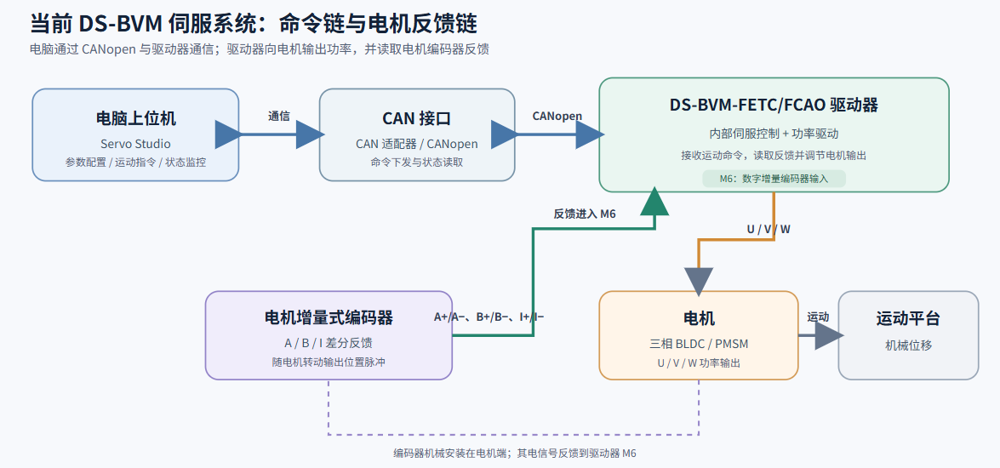
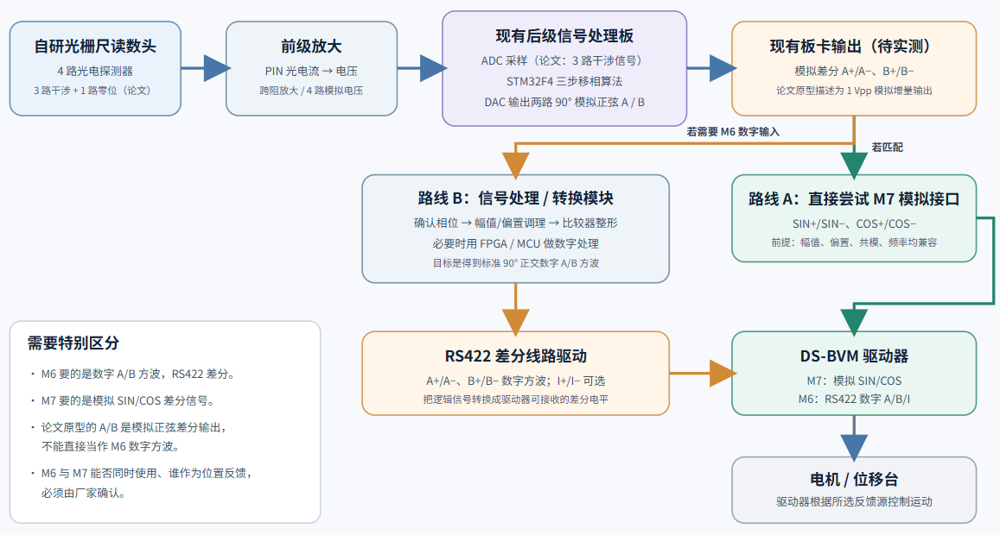

# 接口需求与运动台详情：用户原稿转存

来源：用户本机 Word 文档《接口需求与运动台详情11.03.docx》，最后修改 2026-11-03 22:17（北京时间）。以下转存正文和两张示意图，便于在 GitHub 阅读。原稿中的两张现场照片未公开：其中一张含手部细节；原 Word 及其个人元数据也未上传。原文件未修改。

**阅读边界：**这是当时的接口需求和设想。原稿概括 M6/M7 是讨论范围内的简化，手册另列 M8 串行编码器接口；“可能只支持单个反馈信号输入”是推测，不能当作厂家确认。两张图是当时的示意，尤其现有反馈源的实际接线仍应查验现场记录。具体引脚和电气参数以型号对应的厂商手册为准，不能单凭此稿放行接线。

## 一、接口需求

电机驱动器的反馈接口有两个，一类是数字接口 M6，一类是模拟接口 M7。两种接口应该都可以实现信号输入。以下是两种接口的具体需求：

### （一）增量式 A/B 正交数字信号

数字编码器接口引脚定义：

| 引脚 | 信号 | 说明 |
|---|---|---|
| 1 | 5V | 编码器供电 |
| 2 | GND | 地 |
| 3 | Encoder A+ | A 相正端 |
| 4 | Encoder A− | A 相负端 |
| 5 | Encoder B+ | B 相正端 |
| 6 | Encoder B− | B 相负端 |
| 7 | Encoder I+ | Index/零位信号正端 |
| 8 | Encoder I− | Index/零位信号负端 |
| 9–14 | HALL U/V/W ± | 霍尔信号接口 |
| 15 | FG | 屏蔽/机壳地相关引脚，接法需按厂家要求 |

手册上给出的主要指标包括：信号类型 A-quad-B，可带或不带 Index；电气形式 RS422 差分；最大输入频率 10 MHz（before quadrature，即正交解码前的输入频率）。

### （二）模拟 SIN/COS 编码器接口

如果自研光栅尺现有处理板已经能够输出质量合格的两路模拟正交信号，也希望确认能否不再额外转换成数字方波，直接接入 DS-BVM 的 M7 模拟编码器接口。

| 引脚 | 信号 | 说明 |
|---|---|---|
| 1–2 | SIN+ / SIN− | 正弦信号正负端 |
| 3–4 | COS+ / COS− | 余弦信号正负端 |
| 5–6 | REF+ / REF− | 参考信号正负端 |
| 7 | 5V | 编码器供电 |
| 8 | GND | 地 |
| 9 | FG | 屏蔽/机壳地相关引脚 |
| 10–12 | AHALL_U/V/W | 模拟霍尔相关引脚 |
| 13–14 | AIN+/AIN− | 另一路模拟输入 |

硬件手册对 Sin/Cos 编码器给出的参数为：信号范围 −0.7 V ～ +0.7 V at 2.5 V；采样频率 24 kHz。

原稿记录：目前只使用过 M6 数字编码器接口，尚不清楚 M7 功能是否完好，暂时没有测试条件。同时 M6、M7 各有一个，**可能**只支持单个反馈信号输入。后半句尚待厂家确认。

### （三）数据线主要接线形式

原稿说明：数据线接口可见杜邦线；DS-BVM 驱动器的 M6 接口线已插上，M7 接口线尚不明确具体位置。原稿所附两张现场照片因包含手部细节而未在公开副本中提供；此描述不替代逐线验收。

### （四）期望能够解决的问题

经过信号处理的数字信号或者模拟信号能够成功被识别。前期沟通过程中判断可能需要一定的电路校正或者 FPGA 做数字处理；是否需要及具体方法待确认。

## 二、目前基于 DS-BVM 驱动器的运动平台链路示意

图为需求文档中的示意，不能单独证明当前实际反馈源及接线。

## 三、初步设想接入光栅尺后的运动平台链路

图中论文原型链路和 M6/M7 两条路线均为背景或候选；实际输出、反馈配置和兼容性尚待实测及厂家确认。
